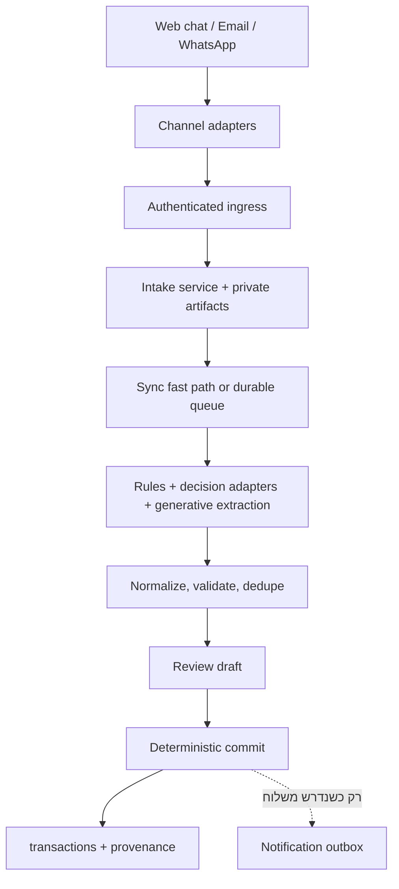
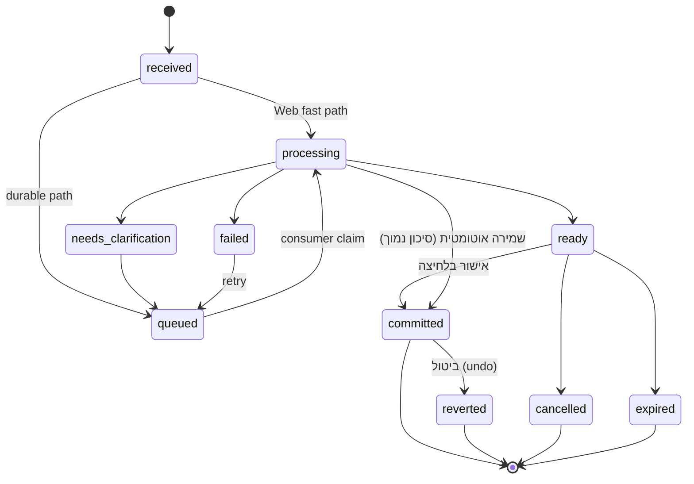

# Ten10 — תוכנית ארכיטקטורה וביצוע מתוקנת למערכת AI רב־ערוצית

**גרסה:** 2.7 (תשובות מדפי ההלכה שפורסמו, בדיקת grounding למספרים, והקשר של שאילתה מובנית אחת; ראו נספח ז׳)  
**תאריך:** 18 באוקטובר 2026  
**סטטוס:** תוכנית Production סופית לביצוע מדורג, ללא קוד חד־פעמי  
**תחולה:** Web/PWA/TWA, Supabase, Cloudflare, AWS SES, PostHog, WhatsApp Business Platform, ותאימות ל־Desktop/Tauri

---

## 1. תקציר מנהלים

המטרה היא לבנות ל־Ten10 תשתית Production רב־ערוצית וארוכת טווח. משתמש יוכל לשלוח טקסט, תמונה, PDF או הקלטה דרך הצ'אט באתר, Share Target מהטלפון, כתובת מייל ייעודית או WhatsApp. כל הערוצים ייכנסו לאותה ליבת domain, ייצרו חוזה טיוטה אחיד, יעברו normalization, validation ו־review קיימים, ורק לאחר אישור בלחיצה אחת בתוך הערוץ שבו המשתמש נמצא, או בשמירה עם כפתור ביטול לתנועות בסיכון נמוך שהמשתמש הפעיל, יישמרו באמצעות מסלול דטרמיניסטי ואידמפוטנטי. מעבר להזנת תנועות, אותו עוזר מבין פקודות חופשיות: כללים קבועים, שאלות על הנתונים של המשתמש וסריקת כפילויות.

החלטת הליבה היא ש־AI **אינו כותב תנועות ישירות**. הוא מפיק הצעה מובנית עם ראיות, שדות חסרים ואותות איכות. פעולת השמירה נעשית על ידי קוד רגיל, תחת הרשאות, ובהתאם לאותם כללי domain ולמסך הסקירה שכבר קיימים בייבוא CSV/XLSX. אין לבנות pipeline פיננסי מקביל לזה שכבר עובד.

הארכיטקטורה המומלצת:



המערכת תשתמש בסטאק הקיים:

- **Supabase** יהיה מקור האמת, שכבת Auth/RLS, Storage פרטי, Queues/`pgmq`, Edge Functions ו־Cron.
- **Cloudflare** יישאר גבול הכניסה החיצוני למייל ול־webhooks, עם אימות חתימות, הגבלת קצב והעברה ל־Supabase.
- **AWS SES** יישאר מנוע המייל היוצא; יתווספו Configuration Set ואירועי delivery/bounce/complaint.
- **PostHog** ישמש ל־product analytics, feature rollout ול־AI observability במצב privacy-safe, אך לא כבקרת הרשאה, מנוע תזמון או מקור אמת.
- **React/Vite/TanStack Router/Zustand/shadcn/Tailwind** ישמשו ל־UI, דרך `src/lib/data-layer/` בלבד.
- **Tauri/SQLite Desktop** לא יקבל תלות ענן סמויה. בשלב הראשון היכולת הרב־ערוצית תהיה Web/TWA; שימוש ב־Desktop בענן ידרוש החלטת מוצר נפרדת או פרויקט Sync.

הביצוע מדורג כדי לצמצם blast radius ולשמור תאימות לאחור, לא כדי לבנות ניסוי זמני. כל שלב הוא שכבת Production מלאה ונשמרת: תחילה חוזי domain ותשתית, אחר כך Web טקסט, מדיה ו־Share Target, לאחר מכן מייל ו־WhatsApp, ולבסוף תזכורות ותובנות AI על אותה תשתית. כל יכולת מופעלת בהדרגה עם הרשאות ו־quotas בצד השרת, feature flags בצד המוצר, telemetry ו־rollback מיידי.

---

## 2. מטרות, עקרונות וגבולות

### 2.1 מטרות מוצר

1. לאפשר יצירת תנועות מתוך טקסט חופשי, תמונה, PDF או הקלטה.
2. לספק חוויה עקבית בצ'אט האתר, במייל וב־WhatsApp.
3. להשתמש ב־AI לקטלוג, חילוץ והסבר — בלי לוותר על בקרות פיננסיות.
4. לשמור קשר אמין בין תנועה לבין המקור שממנו נוצרה.
5. להוסיף תזכורות חכמות ותובנות אנליטיות עם הסבר וראיות.
6. להקטין עלות באמצעות model routing, caching ושימוש במודלים זולים למשימות פשוטות.
7. לאפשר החלפת ספק או מודל דרך interfaces כלליים; Jev הוא adapter מועמד ל־benchmark, לא תלות ארכיטקטונית מחייבת.

### 2.2 עקרונות מחייבים

- **אישור לפי סיכון, בתוך הערוץ:** כל תנועה נשמרת רק אחרי אישור מפורש בלחיצה אחת בערוץ שבו המשתמש נמצא, או, בסוג סיכון נמוך שהמשתמש הפעיל, נשמרת מיד עם כפתור ביטול (סעיף 10.6). המשתמש לא נדרש לצאת מהערוץ כדי לאשר. AI לעולם אינו כותב ישירות.
- **Channel-agnostic core:** הערוצים הם adapters בלבד; אין לוגיקת עסק בתוך webhook של WhatsApp או Worker של מייל.
- **Deterministic money logic:** חישובים פיננסיים, סכומים, מעשר, המרות ותאריכים עסקיים נשארים בקוד/SQL/Rust.
- **AI as untrusted input:** גם פלט המודל עובר schema validation, ולידציה עסקית ודדופליקציה.
- **Least privilege:** כל רכיב מקבל את ההרשאות המזעריות הנדרשות.
- **Async where durability requires it:** טקסט קצר מה־Web משתמש ב־fast path סינכרוני; מדיה, webhooks ופעולות ארוכות משתמשים ב־Queue עמיד.
- **Additive migration:** אין שינוי או מחיקה של migrations שכבר יושמו, ואין שבירת לקוחות ישנים.
- **DRY:** schemas, state machine, error codes, normalization וחוזי API מוגדרים פעם אחת ומשותפים לכל הערוצים.
- **Privacy by design:** מצמצמים תוכן פיננסי בלוגים, ב־PostHog ובקריאות מודל.
- **One state owner:** מצב עסקי נשמר ב־DB; ה־Queue אחראי למסירה בלבד ואינו מקור אמת נוסף לאותו state.
- **Explicit ownership:** לכל טבלה, queue, job, prompt ו־dashboard יש owner ו־runbook.

### 2.3 גבולות שאינם חלק מהתוכנית הנוכחית

- סנכרון מלא בין Supabase ל־SQLite Desktop.
- בוט פיננסי שמבצע פעולות ללא אישור, מלבד שמירה עם ביטול לתנועות בסיכון נמוך שהמשתמש הפעיל (סעיף 10.6).
- ייעוץ השקעות, מס או הלכה מותאם אישית ללא גילוי נאות ובקרה.
- עיבוד קבצי ZIP או קבצים בינאריים כלליים.
- אימון מודל על מידע פרטי של משתמשים.
- החלפת מנגנוני האנליטיקה הדטרמיניסטיים הקיימים ב־LLM.

---

## 3. מצב קיים שאומת

### 3.1 אפליקציה וקוד

- Web: React 19, Vite, TanStack Router, Zustand, Supabase ו־Vercel.
- Desktop: Tauri v2 ו־SQLite, עובד מקומית ואינו מסונכרן עם Web.
- TypeScript הוא ברירת המחדל לקוד חדש.
- UI חייב להשתמש ברכיבי shadcn/Radix הקיימים, Tailwind ו־Lucide.
- גישה לנתונים מה־UI מתבצעת דרך facade ב־`src/lib/data-layer/`.
- לוגים דרך `src/lib/logger`; אין `console.*` בקוד מוצר ואין PII בלוגים.
- תאריכים עסקיים עוברים דרך `src/lib/utils/local-date.ts`; אין להשתמש ב־`toISOString().split("T")[0]`.
- לוח עברי/זמני חג דרך `src/lib/calendar`; אין להוסיף Hebcal כמסלול מקביל.
- בדיקות frontend/domain באמצעות Vitest.
- ייבוא תנועות קיים עובד במסלול upload → parse → mapping → normalize → validate → review → approval → persist.
- ייבוא CSV/XLSX מקבל במכוון רק `income`, `expense`, `donation` ו־`recognized-expense`, ו־`recognized-expense` רק כשהוא כתוב במפורש בקובץ. השער בפועל הוא `TYPE_LOCALE_ALIASES` והסקה לפי סימן הסכום ב־`resolveTypeWithIssues`; הפונקציות `isImportableType` ו־`isSpecialType` (שכוללת גם `initial_balance`) מוגדרות ב־`type-resolver.ts` אך אינן נקראות. `exempt-income` ו־`non_tithe_donation` מסומנים "מיוחדים" ונחסמים, ומטבע זר נדחה בלי המרה (`transaction-import-guide.md`). אלה החלטות מוצר נכונות לדף בנק, שאינו יודע הכרעות הלכתיות ואינו מתאים להמרה בשער של היום. לכן טיוטות AI אינן משתמשות בהן כפי שהן, אלא בפרופיל validation משלהן (סעיף 10.1).
- `persist-approved-import.ts` שומר Web באצוות של 100 ו־Desktop דרך פקודת bulk מקומית.
- `ImportNormalizedRow` מגדיר את שדות ההמרה כ־`null` בלבד, ו־`ImportRowEditModal` מאפס אותם גם בפתיחת הטופס וגם בהחזרת העריכה ("Imports never carry conversion data"). לכן העורך אינו שומר המרת מטבע כפי שהוא (סעיף 10.1).
- ה־bulk update (`bulk_update_user_transactions`) מאפשר לשנות רק `payment_method`, `category`, `description`, `recipient` ו־`is_chomesh`, ולא `type`.
- ל־`get_user_transactions` יש שלוש חתימות (9, 12 ו־13 פרמטרים, לפי `20260715090000_harden_user_transaction_rpcs.sql`). ב־DB החי, לחתימה עם 9 הפרמטרים יש 8 ברירות מחדל, ולחתימות עם 12 ו־13 אין אף אחת. הקורא היחיד הוא `tableTransactionService.ts`, והוא תמיד שולח את כל 13 הפרמטרים בשמם, כך שהיום אין עמימות.
- `update_user_transaction(uuid, uuid, jsonb)` מוגדר ב־`20260122_update_transaction_rpc_currency_fields.sql`, רץ כ־`SECURITY INVOKER` (כפוף ל־RLS) ומעדכן רק רשימה סגורה של עמודות. נבדק גם ב־DB החי.
- סכמת הבסיס של `transactions` אינה ב־migrations, וגם ה־trigger `on_transaction_update` (`handle_updated_at`) קיים רק ב־DB החי.
- רכיבי הנתונים (טבלה, כרטיסים, גרפים) מתרעננים לפי `lastDbFetchTimestamp` ב־Zustand, שפעולות שמירה בדפדפן מעדכנות.
- `local-date` משתמש באזור הזמן של סביבת הריצה. בדפדפן זה אזור הזמן של המשתמש, וב־Edge זה UTC. בשרת קיים `_shared/israel-date.ts` שמחשב תאריך לפי `Asia/Jerusalem`.
- מטבע זר: הטופס הידני (`TransactionForm` + `CurrencyConversionSection`) תומך בתנועה במטבע זר שמומרת למטבע ברירת המחדל. שער `auto` נשלף מ־`ExchangeRateService` (exchangerate-api → frankfurter → floatrates, שער `latest`, עיגול ל־4 ספרות) או מוזן ידנית (`manual`). נשמרים `amount` מומר (עיגול ל־2 ספרות), `currency` = מטבע ברירת המחדל, `original_amount`, `original_currency`, `conversion_rate`, `conversion_date` ו־`rate_source`.
- לעומת זאת, ייבוא CSV/XLSX דוחה מטבע זר כשגיאה fatal (`foreign_currency_not_supported` ב־`normalize.ts`), ולכן שימוש עיוור בכללי הייבוא היה חוסם קבלות במטבע זר.
- רשימת ספקי השערים משוכפלת כיום: `src/lib/services/exchange-rate.service.ts` בצד הלקוח ו־`fetchExchangeRate` ב־`process-recurring-transactions`, שקורא את `profiles.default_currency` בצד השרת. הספקים, ה־parsing והעיגול זהים, אבל ההתנהגות לא: בלקוח יש החזרה מיידית כשהמטבעות זהים, cache של שעה, offline ו־last-known; בשרת רק cache לכל invocation. העיגול לארבע ספרות נעשה בשירות, לא בטופס.
- כיסוי הבדיקות של הייבוא דל: ל־`normalize` כ־5 בדיקות (תאריכים בלבד), ואין בדיקות ל־`type-resolver`, לשירות השערים ולחישוב ההמרה בטופס, ואין fixtures לייבוא.
- אין logger משותף ב־`supabase/functions/_shared`; הפונקציות כותבות ל־`console`. אין מנגנון entitlement כללי בצד השרת, רק `EMAIL_ALLOWLIST` ובדיקת admin.
- CI מריץ `deno test` רק על `_shared/calendar/index_deno_test.ts` ועל `reminder-schedule_deno_test.ts`. בדיקת Deno חדשה דורשת הוספה מפורשת ל־`ci.yml`.
- כל שינוי תחת `supabase/functions/_shared/`, גם תיקייה חדשה, פורס מחדש לייצור את כל `SHARED_DEPENDENT` (היום כל 10 הפונקציות, כולל `process-recurring-transactions` ו־`process-email-request`). שינוי ב־`supabase/config.toml` פורס את כולן.

### 3.2 Supabase חי

- Production: `flpzqbvbymoluoeeeofg`, אזור `eu-central-1`, PostgreSQL 17.
- Testing: `bbcllewcotypedqsnwmi`; cron jobs קיימים שמסוכנים ל־Production נשארים כבויים. ב־Vault של testing יש שני סודות, `service_role_key` ו־`functions_base_url`, ושניהם כבר של testing (אומת בדשבורד, 18/10/2026). מאפשרים שם רק jobs מבודדים של ה־AI pipeline. ה־Database Webhook "Trigger Contact Email" שוכפל מהייצור עם URL ומפתח של הייצור, ולכן מכובה ב־testing.
- Storage: בייצור וב־testing קיים רק ה־bucket `contact-attachments`. ה־bucket `avatars` שהקוד מזכיר (`profile.service.ts`) אינו קיים.
- `track_functions` בייצור הוא `none`, ולכן `pg_stat_user_functions` אינו זמין למיפוי שימוש בפונקציות.
- קיימים Auth, RLS, Edge Functions, Storage, `pg_cron` ו־`pg_net`.
- `pgmq` זמין אך טרם מותקן; הוא הבסיס המומלץ ל־Supabase Queues.
- קיימים cron jobs לתנועות מחזוריות, תזכורות ומעקב תקלות.
- ה־bucket הקיים `contact-attachments` הוא פרטי, מוגבל ל־5MB ואינו תומך audio. אין להשתמש בו ל־AI intake.
- קיימות 11 Edge Functions פעילות ב־Production. הפונקציה הנוספת היא `unsubscribe`: היא פעילה עם `verify_jwt=false`, אך אינה קיימת ב־repo ואינה מנוהלת בסקריפטי הפריסה. אין למחוק אותה לפני בדיקת logs, קישורים ישנים ותלויות; בשלב 0 משחזרים אותה ל־repo או מעבירים את התעבורה ומסירים אותה בצורה מתועדת.
- סקריפט ה־CI `deploy-changed-functions.sh` מנהל 10 פונקציות, ואילו `deploy-functions.js` מנהל 8 בלבד וכבר אינו מסונכרן. יש לקבוע את סקריפט ה־CI כמקור האמת היחיד ולהוציא את הסקריפט הישן משימוש או להפוך אותו ל־wrapper של המקור הקנוני.

### 3.3 מייל ו־Cloudflare

- Cloudflare Email Worker קיים מעביר כיום metadata בלבד ל־`process-email-request`.
- הוא אינו מעבד raw MIME או attachments ומכיל מגבלת מוצר של 256KB.
- AWS SES משמש לשליחה יוצאת ולתזכורות.
- אין לשנות את מסלול המייל הקיים של הורדות. יש להוסיף מסלול intake נפרד.
- קיימים שני מימושי `simple-email-service`; גרסת התזכורות כוללת יכולות שאין בעותק המשותף. אין לאחד אותם “על הדרך”. תחילה מגדירים parity tests וחוזה משותף, ואז refactor נפרד.
- `process-email-request` הקיים משתמש ב־static bearer. מסלול intake החדש משתמש ב־HMAC עם timestamp/nonce/body hash; הקשחת המסלול הישן נעשית ב־PR נפרד כדי לא לשבור הורדות.

### 3.4 PostHog

- פרויקט פעיל: `posthog-ten10`, מזהה 169449, EU, אזור זמן UTC.
- Session Replay, exception autocapture, surveys ו־heatmaps מופעלים.
- אירועי מוצר קיימים, אך טרם נצפו אירועי `$ai_generation`/`$ai_trace` ב־30 הימים שנבדקו.
- משפך הייבוא שנבדק הראה 9 התחלות ו־2 השלמות ב־30 ימים; לכן flow חדש חייב למדוד גם נשירה ולא רק “הצלחה טכנית”.

### 3.5 חובות טכניות רלוונטיות

1. לבצע audit ל־15 פונקציות `SECURITY DEFINER` שניתנות להפעלה על ידי `authenticated`: ownership, `search_path`, grants וקלט.
2. `app_kv_store` עם RLS ללא policies ועם grants ל־service role בלבד הוא דפוס service-only תקין; אין להפוך אותו ל־rollout blocker ללא ממצא גישה ממשי.
3. `reminder_run_logs` מוגנת בפועל על ידי RLS, אך grants רחבים הם חוב ניקיון שכדאי לצמצם.
4. להוסיף indexes למפתחות זרים שמשמשים join/delete, לאחר בדיקת query plans.
5. `pg_net` ב־`public` וחיבורי Auth DB הקשיחים ל־10 דורשים ניטור ובדיקה, לא שינוי חפוז כחלק מהפיצ'ר.
6. bucket `contact-attachments` מוגדר חי כפרטי עם 5MB ו־MIME allowlist; מאחר שההגדרה אינה מנוהלת ב־repo, יש להביא Storage configuration ל־IaC/מיגרציה מתועדת.

**Gate:** אין rollout רחב לערוצים חיצוניים לפני סגירת ממצאי ההרשאות הקריטיים בפועל, בדיקות cross-user, quotas ו־alerts. חובות שאינם מאפשרים גישה לא מורשית מטופלים במקביל ואינם עוצרים את ליבת Web.

---

## 4. חוויית המשתמש

### 4.1 תרחיש טקסט

המשתמש כותב: “קניתי היום בסופר ב־247.80 באשראי”. המערכת:

1. מזהה תאריך לפי אזור הזמן וה־calendar adapter הקיים.
2. מציעה `expense`, סכום `247.80`, מטבע ברירת המחדל, קטגוריה `food`, תיאור ואמצעי תשלום.
3. מציגה טיוטה ניתנת לעריכה עם סימון שדות שהוסקו.
4. שומרת רק לאחר “אישור ושמירה”.

### 4.2 תרחיש תמונה/PDF

המשתמש מעלה קבלה. המערכת:

1. בודקת קובץ, שומרת אותו ב־Storage פרטי ומחשבת hash.
2. מחלצת merchant, תאריך, סה״כ, מטבע ושורות אפשריות.
3. אם מטבע הקבלה שונה ממטבע ברירת המחדל, ממירה אותו באותו מנגנון של הטופס הידני ומציגה סכום מקורי, שער, מקור השער וסכום מומר (סעיף 10.2).
4. יוצרת תנועה אחת או מספר טיוטות בהתאם למדיניות.
5. מציגה crop/page/source לצד השדות כדי לאפשר בדיקה.
6. לאחר אישור מקשרת בין התנועה למקור; הקישור הוא ל־artifact ולא URL קבוע.

### 4.3 תרחיש הקלטה

המשתמש אומר: “אתמול שילמתי 80 שקל למונית”. המערכת מתמללת, מחלצת את התנועה ומציגה טיוטה. אם התאריך או הסכום אינם חד־משמעיים, היא שואלת שאלה ממוקדת אחת במקום לנחש.

### 4.4 תרחיש מייל

המשתמש שולח חשבונית, צילום או טקסט חופשי לכתובת intake אישית. הוא מקבל acknowledgment מיידי, ולאחר העיבוד מייל עם סיכום וקישור לדף אישור קצר: הדף מציג את הטיוטה וכפתור "שמור". הקישור עצמו לעולם אינו מאשר, כי סורקי אבטחה ארגוניים פותחים קישורים אוטומטית (סעיף 10.6). תשובה במייל אינה חייבת להכיל את כל המידע הפיננסי.

### 4.5 תרחיש WhatsApp

המשתמש שולח טקסט חופשי, צילום, PDF או הודעה קולית למספר העסקי. לאחר pairing חד־פעמי לחשבון Ten10, המערכת מחזירה הודעה עם סיכום ושלושה כפתורים: "שמור", "ערוך", "בטל". "שמור" רושם את התנועה בלי לצאת מ־WhatsApp, ו"ערוך" פותח את מסך הסקירה באתר רק כשצריך. בתנועה בסיכון נמוך שהמשתמש הפעיל לה שמירה אוטומטית, התנועה נשמרת מיד וההודעה כוללת כפתור "בטל". בתוך חלון שירות ניתן להשיב בצורה חופשית, אך מאוקטובר 2026 גם תשובה כזו מחויבת מעבר למכסה החינמית (סעיף 8.3); מחוץ לחלון משתמשים רק ב־template מאושר ורלוונטי.

### 4.6 כללי UX

- לא להציג “הצלחה” לפני שה־commit הושלם.
- אישור בתוך הערוץ: כרטיס עם כפתורים בצ'אט באתר, כפתורים ב־WhatsApp, ודף אישור קצר מהמייל. מסך הסקירה המלא נפתח רק לעריכה.
- כל ערוץ מקבל את כל סוגי התוכן: טקסט חופשי, תמונה, PDF והקלטה.
- בכל טיוטה: מקור, שדות שחולצו, שדות חסרים, confidence, אזהרות ודדופליקציה.
- בטבלת התנועות: אייקון קטן בשורה של תנועה שנוצרה מ־AI, כמו התג הקיים של הוראת קבע ב־`TransactionRow.tsx`. ה־tooltip מציג את הערוץ ואם התנועה נשמרה אוטומטית. לחיצה מציגה את המקור (קישור זמני) ואת "בטל", כל עוד הביטול מותר. הפירוט נשלף מ־`ai.transaction_source_links` רק בלחיצה.
- סינון בטבלה: "נוצר מ־AI" ו"נשמר אוטומטית", כדי לבדוק בנוחות שלא נכנסו טעויות. הסינון מוסתר ב־Desktop.
- רענון: תנועה שנשמרה מ־WhatsApp או ממייל לא מעדכנת דפדפן שכבר פתוח. לכן כשהחלון חוזר לפוקוס אחרי שהיה מוסתר, ה־Web מעדכן את `lastDbFetchTimestamp`, וכל רכיבי הנתונים מתרעננים במנגנון הקיים. גם אישור מהכרטיס בצ'אט ושמירה אוטומטית מעדכנים אותו, כמו שמירה ידנית.
- בטיוטה במטבע זר: הסכום המקורי והמטבע כפי שחולצו, השער, מקור השער (`auto`/`manual`) ותאריכו, והסכום המומר שייכנס לחישוב המעשר. עריכת שער ידני משתמשת ב־`CurrencyConversionSection` הקיים דרך `TransactionForm`.
- לעריכה להשתמש ב־`TransactionForm.onOverrideSubmit` או abstraction משותף, לא בטופס חדש כפול.
- RTL/LTR דרך המנגנון הגלובלי; אין class-ים ידניים סותרים.
- Toasts דרך Sonner בלבד.
- ב־mobile להשתמש ב־Drawer וב־desktop ב־Dialog לפי pattern הקיים.
- נגישות: focus management, תוויות לקלט, תמלול להקלטה, ותיאור alt לתמונה.

---

## 5. ארכיטקטורה לוגית

### 5.1 רכיבים

| רכיב | אחריות | אסור לו לעשות |
|---|---|---|
| Channel Adapter | תרגום payload חיצוני ל־envelope אחיד | לכתוב תנועה או להחליט קטגוריה עסקית |
| Ingress | אימות, rate limit, idempotency ו־persistence ראשוני | webhook חיצוני אינו ממתין ל־AI; Web רשאי להמתין רק ל־fast path מוגבל בזמן |
| Artifact Service | אחסון פרטי, hash, metadata, retention | לחשוף public URL |
| Queue Producer | יצירת job עמיד למדיה ולערוצים חיצוניים | לשמור state עסקי כפול בתוך payload |
| AI Orchestrator | rules, decision adapters, generative extraction ו־tracing | גישה ישירה ל־transactions או תלות בשם ספק ב־interface |
| Normalizer/Validator | התאמה ל־`ImportNormalizedRow`, קטגוריות, תאריכים והמרת מטבע זר | לעקוף כללי import, או לשמור סכום במטבע זר ללא המרה |
| Draft Service | state machine, שאלות הבהרה, review | auto-commit כברירת מחדל |
| Commit Service | טרנזקציה אטומית ואידמפוטנטית | לקבל JSON לא מאומת מהמודל |
| Notification Outbox | משלוח acknowledgment/reminder/result | לייצר החלטה פיננסית |
| Analytics/Observability | מדדים, funnels, cost, latency | להיות מקור אמת תפעולי |

### 5.2 חוזה envelope אחיד

```ts
export type IntakeChannel = "web" | "email" | "whatsapp";
export type IntakeContentKind = "text" | "image" | "pdf" | "audio" | "mixed";

// What a channel adapter sends. It does not know the Ten10 user yet.
export interface ChannelEnvelopeV1 {
  schemaVersion: 1;
  idempotencyKey: string;
  channel: IntakeChannel;
  sender: { externalIdentityHash: string };
  externalMessageId?: string;
  receivedAt: string;
  locale?: "he" | "en";
  text?: string;
  artifactRefs: string[];
  replyContext?: {
    conversationId?: string;
    parentExternalMessageId?: string;
  };
}

// What ingress persists after identity resolution.
export interface IntakeEnvelopeV1
  extends Omit<ChannelEnvelopeV1, "sender" | "artifactRefs" | "locale"> {
  messageId: string;
  userId: string;
  locale: "he" | "en";
  timezone: string;
  artifactIds: string[];
}
```

החוזה נמצא בחבילה/מודול domain משותף. adapters אינם ממציאים variants משלהם. כל שינוי שובר יוצר `V2`; לא משנים משמעות של שדה קיים.

`userId` נקבע רק ב־ingress: ב־Web מתוך ה־JWT, ובערוצים חיצוניים לפי `channel_connections.external_identity_hash` פעיל. adapter חיצוני לעולם אינו שולח `userId`, ו־ingress דוחה envelope חיצוני שמכיל אותו.

### 5.3 state machine עסקי



`reverted` הוא מצב סופי שבו התנועה שנוצרה נמחקה בפעולת ביטול אחת (סעיף 10.6). המעבר הישיר `processing → committed` קיים רק בשמירה אוטומטית בסיכון נמוך, ועובר דרך אותו commit RPC.

כל מעבר state נעשה בפונקציית DB/RPC אחת עם בדיקת current state, timestamp ו־audit event. `intake_messages.status` הוא מצב עסקי; `pgmq` הוא מנגנון delivery מסוג at-least-once. אין לשכפל את מצב העסק בתוך queue payload.

יצירת message והכנסה לתור נעשות תמיד באמצעות RPC אחד, `create_intake_and_enqueue`, שמבצע insert ו־`pgmq.send` באותה טרנזקציית Postgres. אין outbox בין טבלת intake ל־pgmq. `notification_outbox` נשאר מנגנון נפרד רק לפעולות מול ספקים חיצוניים לאחר commit.

### 5.4 pipeline מלא

1. **Receive:** קבלת בקשה, signature/auth, size/type check.
2. **Resolve identity:** מיפוי לחשבון Ten10.
3. **Persist envelope:** יצירת `intake_messages` עם unique idempotency key.
4. **Persist artifacts:** שמירה פרטית וחישוב SHA-256.
5. **Dispatch:** Web text עובר fast path; מדיה/webhook נכנסים ל־`ai_intake_jobs` עם IDs בלבד.
6. **Extract:** parser דטרמיניסטי תחילה, ולאחריו OCR/vision/STT/generative extraction רק כשנדרש.
7. **Classify:** type/category/recipient/payment method באמצעות היסטוריית משתמש, rules ו־decision adapter שנבחר ב־benchmark; מודל גנרטיבי או Jev הם implementations אפשריים.
8. **Normalize:** שימוש ב־currency/category/date registries הקיימים.
9. **Convert:** מטבע זר מומר למטבע ברירת המחדל של המשתמש בזמן יצירת הטיוטה, כמו בטופס הידני (סעיף 10.2). ה־commit אינו שולף שער מחדש.
10. **Validate:** Zod + business rules + ownership.
11. **Dedupe:** מול drafts פתוחים ותנועות קיימות: התאמה ודאית לפי hash, סינון מועמדים ב־DB, ושיפוט סמנטי של המועמדים בלבד (סעיף 10.5).
12. **Draft:** יצירת שורות review עם evidence ו־confidence.
13. **Clarify:** שאלה אחת או יותר רק כאשר נדרש.
14. **Approve:** המשתמש בוחר/עורך ומאשר.
15. **Commit:** RPC/Service אטומי ואידמפוטנטי. התנועה נכתבת עם `origin`, והפירוט נשמר ב־links (סעיף 6.1).
16. **Notify when needed:** רק מייל/WhatsApp או הודעה מתוזמנת יוצרים `notification_outbox`; Web commit רגיל אינו יוצר outbox ללא צורך.

### 5.5 חוזי API פנימיים וחיצוניים

| Endpoint/Function | caller | Auth | Idempotency | תגובה |
|---|---|---|---|---|
| `extract-transactions` | Web/TWA | Supabase JWT + server entitlement/quota | header + user scope | `200` עם drafts או `202` fallback |
| `ingest-channel-message` | Cloudflare adapters | HMAC + timestamp + nonce | provider/message key | `202 { messageId }` |
| `get-intake-message` | UI | JWT + RLS | לא נדרש | message + drafts + artifact metadata |
| `update-intake-item` | UI | JWT + ownership | `itemId + expectedVersion` | item מעודכן או `VERSION_CONFLICT` |
| `submit-intake-clarification` | UI/channel adapter | JWT או channel connection | reply external ID | updated state |
| `commit-intake-items` | UI | JWT + ownership | `{ id, expectedVersion }[]` + unique constraints | `{ transactionIds, alreadyCommitted }`; all-or-nothing |
| `undo-intake-commit` | UI / channel adapter | JWT, או channel connection פעיל של בעל הפריט | item ID | `{ reverted, alreadyReverted }` או `UNDO_NOT_ALLOWED` |
| `email-approval` | דף אישור מקישור במייל | token חד־פעמי קצר־חיים שקשור ל־item + version; GET מציג, POST שומר | token | committed, `VERSION_CONFLICT` או `TOKEN_EXPIRED` |
| `manage-user-rule` | UI / channel adapter | JWT או channel connection | rule draft ID + version | כלל מאושר, מושבת או מעודכן |
| `start-duplicate-scan` | UI / channel adapter | JWT או channel connection | סריקה אחת ליום למשתמש | `202 { scanId }` |
| `create-source-signed-url` | UI | JWT + ownership | לא נדרש | URL קצר־חיים |
| `process-whatsapp-webhook` | Meta/Cloudflare | Meta signature | `wamid` | 2xx מהיר |
| `process-ses-events` | AWS event path | signature/source validation | SES message/event key | 2xx מהיר |

כל response כולל `requestId`. אין להחזיר stack trace, provider raw error או מידע על משתמש אחר. רשימת error codes משותפת מתחילה ב־`AUTH_REQUIRED`, `CHANNEL_NOT_VERIFIED`, `UNSUPPORTED_MEDIA`, `FILE_TOO_LARGE`, `RATE_LIMITED`, `DUPLICATE_MESSAGE`, `PROCESSING_FAILED`, `DRAFT_NOT_READY`, `VERSION_CONFLICT`, `OWNERSHIP_DENIED`, `ALREADY_COMMITTED`, `PROVIDER_UNAVAILABLE`, `FOREIGN_CURRENCY_NOT_CONVERTED`, `DEFAULT_CURRENCY_CHANGED`, `UNDO_NOT_ALLOWED` ו־`TOKEN_EXPIRED`. מצב שבו לא נמצא שער אינו error code אלא warning על הפריט (`exchange_rate_unavailable`), כפי שמוגדר בסעיף 10.2.

---

## 6. מודל נתונים מוצע

### 6.0 schema נפרדת: `ai`

כל הטבלאות והפונקציות של יכולת ה־AI נוצרות ב־schema בשם `ai`, מופרדות מה־schema `public` של המוצר הדטרמיניסטי הקיים. המטרה היא סדר: במבט אחד רואים מה שייך ליכולת ה־AI ומה שייך לליבה הקיימת.

- **ב־`ai`:** `channel_connections`, `intake_messages`, `source_artifacts`, `intake_items`, `transaction_source_links`, `intake_events`, `user_rules`, `duplicate_scans`, `duplicate_dismissals` ו־`insights`. גם ה־RPCs של היכולת יושבים שם, למשל `ai.create_intake_and_enqueue`, `ai.commit_intake_items`, `ai.update_intake_item`, `ai.undo_intake_commit`, `ai.find_duplicate_candidates` ו־RPCs של שאלות על הנתונים.
- **לא ב־`ai`:**
  - `public.transactions`, שמקבלת עמודה nullable אחת בלבד, `origin` (סעיף 6.1). ה־AI כותב אליה רק דרך ה־commit RPC.
  - תשתית ההודעות (`notification_jobs`, `notification_outbox`, `delivery_events`, suppression), שנשארת ב־`public` כי היא תשרת גם את המיילים הקיימים.
  - התור, ש־pgmq מנהל ב־schema משלו (`pgmq`).
  - הקבצים, ב־bucket `intake-artifacts` של Storage.
- **קשר בין schemas:** `ai.transaction_source_links.transaction_id` הוא FK ל־`public.transactions(id)` עם `ON DELETE CASCADE`: מחיקת תנועה באפליקציה מוחקת גם את הקישור למקור. ה־commit כותב לשני ה־schemas באותה טרנזקציה.
- **חשיפה ל־API:** `ai` נוסף ל־Exposed schemas בהגדרות ה־API, כדי ש־supabase-js יוכל לפנות אליו מה־Edge Functions ומה־UI (`.schema("ai")`). האבטחה זהה ל־`public`: GRANT מפורש לכל טבלה ו־RLS בכל טבלה. טבלאות פנימיות כמו `intake_events` אינן מקבלות grant ל־`anon`/`authenticated`.
  - ה־migration כולל `grant usage on schema ai` ל־`authenticated` ול־`service_role` בלבד, ו־`revoke execute ... from public` לכל פונקציה, כי Postgres מעניק EXECUTE ל־PUBLIC כברירת מחדל.
  - החשיפה עצמה היא הגדרה ולא migration: ב־dashboard של הייצור, וב־`[api] schemas` ב־`supabase/config.toml` עבור ענפים. שינוי ב־`config.toml` פורס מחדש את כל פונקציות ה־Edge בייצור, ולכן ממזגים אותו בשעה רחוקה מה־crons.
- **ביצועים:** schema אינה משפיעה על עומס. היא שכבת ארגון והרשאות בלבד.
- **types:** `supabase gen types` מורץ עם `--schema public,ai`. Desktop לא מושפע.
- **שמות:** במסמך זה שמות הטבלאות מופיעים בלי הקידומת `ai.`. `ai_insights` הופכת ל־`ai.insights`.

### 6.1 החלטה: עמודה אחת ב־`transactions`, `origin`

מוסיפים ל־`public.transactions` עמודה אחת, `origin text NULL`, עם check constraint. זה כל השינוי בטבלת הליבה. הפירוט המלא (איזה קובץ, איזה ערוץ, איזו טיוטה) נשאר ב־`ai.transaction_source_links`.

**ערכים:**
- `ai`: נוצרה מ־AI ואושרה בלחיצה.
- `ai_auto`: נשמרה אוטומטית בסוג הסיכון הנמוך (סעיף 10.6).
- `NULL`: כל השאר, כלומר תנועות קיימות, ידניות, CSV והוראות קבע. דרכי הכתיבה הקיימות לא משתנות.

אפשר להוסיף ערכים בעתיד, למשל `import` לייבואי CSV, בשינוי check constraint בלבד.

**למה עמודה ולא רק טבלת קישורים:**
- סינון ("נוצר מ־AI", "נשמר אוטומטית"), מיון וייצוא בלי join בכל שליפה.
- הטבלה נשארת פשוטה לקריאה ולתחזוקה לאורך שנים.
- החשש המקורי מנגיעה ב־Rust אינו רלוונטי. העמודה nullable, רק ה־Web כותב אליה, וב־Desktop אין AI ולכן אין צורך בעמודה ב־SQLite.
- ה־Rust אינו משתמש ב־`deny_unknown_fields` (נבדק), כך שייצוא מה־Web שכולל `origin` נקלט ב־Desktop והשדה מתעלם.

**כללי כתיבה:**
- רק `ai.commit_intake_items` כותב `origin`, באותה טרנזקציה.
- עריכה של תנועה לא משנה את הערך, וביטול מוחק את השורה.
- `origin` אינו בשדות שה־bulk update מקבל: הוא מגביל לרשימה סגורה (`payment_method`, `category`, `description`, `recipient`, `is_chomesh`), וזה נבדק. גם `update_user_transaction(uuid, uuid, jsonb)` מעדכן רק רשימה סגורה שאינה כוללת `origin` (נבדק בקוד וב־DB החי).
- `origin` הוא סימון תצוגה ולא שדה אבטחה. משתמש שמשנה אותו ידנית משפיע רק על התצוגה שלו, ולכן אין trigger מגן.

**שינוי ב־`get_user_transactions`:** לפונקציה יש היום שלוש חתימות (9, 12 ו־13 פרמטרים). הוספת פרמטר עם ברירת מחדל **לצד** חתימה קיימת (create בלי drop) הייתה יוצרת עמימות ב־PostgREST. לכן החתימה עם 13 הפרמטרים מוחלפת ב־drop+create. לפי ה־DB החי, אחרי ההחלפה קריאה עם 13 שמות מתאימה רק לחתימה החדשה: לחתימה עם 12 חסר `p_recurring_frequencies`, ולחתימה עם 9 חסרים פרמטרים אחרים. לכן הניקוי רצוי אך אינו חסם:

1. **ניקוי (PR 1c, אפשר כחלק מ־PR 4):** הקורא היחיד לפי הקוד הוא `tableTransactionService.ts`. `pg_stat_user_functions` אינו זמין (`track_functions=none`), ולכן משלימים מ־API logs של הייצור לפי שמות הפרמטרים, בטווח שה־plan שומר. חתימות שאינן בשימוש נמחקות. אם מתגלה צרכן, משאירים wrapper דק שמפנה לחתימה הקנונית.
2. **הרחבה (PR 4):** החתימה הקנונית מוחלפת ב־drop+create באותה migration. היא מחזירה גם `origin` ומקבלת `p_origin` עם ברירת מחדל `NULL`, וה־grants מחודשים. קריאה קיימת בלי הפרמטר ממשיכה לעבוד.

**מה לא משתנה:**
- ה־RPCs של האנליטיקה והמעשר.
- ה־RPCs של העדכון.
- Rust/Tauri.
- טופס ההוספה הידני.
- ייבוא CSV.
- הוראות קבע.

### 6.2 טבלאות ליבה חדשות

#### `channel_connections`

חיבור מאומת בין משתמש לערוץ. הטבלה נוצרת עם מודול Email/WhatsApp ואינה תלות של Web intake.

| שדה | הערה |
|---|---|
| `id`, `user_id` | UUID, ownership |
| `channel` | `email` / `whatsapp` |
| `external_identity_hash` | HMAC-SHA-256 עם secret שרת של כתובת/מספר; חיפוש ללא חשיפה מלאה |
| `external_identity_encrypted` | רק אם נדרש להשבה תפעולית |
| `status` | pending/active/revoked |
| `verified_at`, `revoked_at` | lifecycle |
| `preferences` | JSONB מצומצם, versioned |

Unique על `(channel, external_identity_hash)` כדי למנוע שיוך כפול.

#### `intake_messages`

אירוע מקור מכל ערוץ.

| שדה | הערה |
|---|---|
| `id`, `user_id` | ownership |
| `schema_version` | מתחיל ב־1 |
| `channel`, `content_kind` | פילוח |
| `external_message_id` | nullable, unique לפי channel |
| `idempotency_key` | unique |
| `text_redacted` | טקסט מצומצם או מוצפן לפי צורך |
| `status`, `attempt_count` | business state machine; queue delivery אינו נשמר כאן |
| `error_code` | קוד טיפוסי, לא stack trace |
| `received_at`, `processed_at`, `expires_at` | lifecycle |
| `timezone` | אזור הזמן של המשתמש בזמן הקבלה (IANA, למשל `Asia/Jerusalem`). ב־Web מהדפדפן; בערוצים חיצוניים מהגדרת המשתמש, וברירת מחדל `Asia/Jerusalem`. תאריכים יחסיים מחושבים ביחס ל־`received_at` באזור הזמן הזה, כך שעיבוד חוזר אחרי חצות מפיק אותה תוצאה |

#### `source_artifacts`

| שדה | הערה |
|---|---|
| `id`, `user_id`, `intake_message_id` | ownership וקישור |
| `storage_bucket`, `storage_path` | path בלבד; לעולם לא signed URL |
| `media_type`, `mime_type`, `file_size` | metadata |
| `sha256` | dedupe/integrity |
| `page_count`, `duration_ms` | אופציונלי |
| `retention_mode` | `temporary` / `keep_receipt` |
| `expires_at`, `deleted_at` | retention |

#### `intake_items`

שורה אחת לכל תנועה מוצעת. זהו persistence של חוזה ה־domain המשותף, לא pipeline מקביל לייבוא.

| שדה | הערה |
|---|---|
| `id`, `message_id`, `user_id`, `item_index` | unique על message + index |
| `status` | ready/needs_review/approved/rejected/committed |
| `version` | integer not null default 1; optimistic concurrency |
| `draft_schema_version` | גרסת `TransactionDraftV1` |
| `normalized_payload` | JSONB תקין ומומר ל־`ImportNormalizedRow` |
| `quality_signals` | אותות דטרמיניסטיים + confidence מכויל, לא ציון עצמי יחיד של LLM |
| `evidence` | page/span/field refs ללא URL |
| `validation_errors` | array של codes |
| `duplicate_of_transaction_id` | nullable |
| `prompt_version`, `model_route` | reproducibility |
| `committed_transaction_id` | nullable, unique |
| `created_at`, `updated_at` | lifecycle ו־cache validation |

#### `transaction_source_links`

| שדה | הערה |
|---|---|
| `transaction_id` | FK cascade לפי מדיניות |
| `source_artifact_id` | FK nullable; לרשומת metadata שנשארת גם לאחר מחיקת האובייקט |
| `intake_item_id` | FK חובה שמאפשר provenance גם למקור טקסט ללא קובץ |
| `item_index`, `page_number` | evidence |
| `confidence` | snapshot בעת commit |

כך artifact אחד יכול ליצור מספר תנועות, ותנועה יכולה להיקשר ליותר ממקור אחד.

#### `intake_events`

יומן append-only למעברי state ואירועים משמעותיים: `message_id`, `item_id` אופציונלי, `event_type`, `from_status`, `to_status`, `actor_type`, `actor_id` מצומצם, `trace_id`, `metadata` לא רגיש ו־`created_at`. הטבלה משמשת audit ותמיכה; היא אינה מחליפה את ה־status הנוכחי בטבלאות העסקיות.

#### `user_rules`

כללים קבועים שהמשתמש הגדיר, דרך העוזר או במסך ההגדרות (סעיף 9.9).

| שדה | הערה |
|---|---|
| `id`, `user_id` | ownership |
| `match` | JSONB מצומצם: שם עסק/נמען מנורמל, ואופציונלית type או קטגוריה של הקלט |
| `action` | JSONB: type, category, `is_chomesh` או payment method להחלה |
| `effective_from` | ממתי הכלל חל ("מהיום") |
| `status` | `draft` / `active` / `disabled` |
| `version`, `created_via` | `assistant` / `settings` |

כלל במצב `draft` אינו פעיל עד אישור מפורש. לכל `match` יש לכל היותר כלל פעיל אחד; כלל חדש מחליף את הקודם רק אחרי אישור.

#### `duplicate_scans` ו־`duplicate_dismissals`

- `duplicate_scans`: `user_id`, `status`, `requested_at`, `finished_at`, `result` (קבוצות חשודות: מזהי תנועות והסתברויות בלבד), `expires_at`.
- `duplicate_dismissals`: זוג תנועות שהמשתמש סימן "לא כפול", כדי שלא יסומן שוב. Unique על הזוג המנורמל.

### 6.3 טבלאות מודולריות בעת הפעלת היכולת

הטבלאות הבאות אינן תנאי לליבת Web, אך הן חלק מהארכיטקטורה ומתווספות עם המודול המשתמש בהן:

#### `notification_jobs` ו־`delivery_events`

- `notification_jobs`: user, type, channel, scheduled_at, status, dedupe_key, payload_ref, attempts.
- `delivery_events`: provider, external_message_id, event_type, occurred_at, normalized metadata.
- payload רגיש לא נשמר כפול; שומרים reference לישות המוצר.

#### `notification_outbox`

אירועי domain שנוצרו באותה transaction שבה השתנה המידע העסקי:

- `aggregate_type`, `aggregate_id`, `event_type`, `payload_ref`.
- `status`, `available_at`, `attempt_count`, `processed_at`.
- `idempotency_key` ייחודי.

consumer מעביר מהם ל־`notification_jobs`, analytics או integration אחר. כך commit אינו יכול להצליח בזמן שהודעת ההמשך “נעלמת” בין DB לספק חיצוני.

#### `insights` (ב־schema `ai`)

- `user_id`, `insight_type`, `period_start/end`, `status`.
- `metrics_snapshot` עם aggregate בלבד.
- `narrative`, `evidence_refs`, `confidence`, `model_route`, `prompt_version`.
- `expires_at` ו־`superseded_by` כדי למנוע הצגת תובנה ישנה.

### 6.4 אינדקסים

לפחות:

- `intake_messages(user_id, received_at desc)`.
- partial index ל־states פעילים: `queued`, `processing`, `needs_clarification`.
- unique `(channel, external_message_id)` כאשר external ID קיים.
- `source_artifacts(user_id, expires_at)` עבור purge.
- `intake_items(user_id, status, created_at desc)`.
- partial index `transactions(user_id, date desc) WHERE origin IS NOT NULL`, שמכיל רק את שורות ה־AI.
- `transaction_source_links(transaction_id)`, לשליפת הפירוט בלחיצה ולמחיקה ב־cascade.
- `notification_jobs(status, scheduled_at)`.
- unique `notification_jobs(dedupe_key)`.
- `delivery_events(provider, external_message_id)`.

כל FK מקבל index אם הוא משמש join/delete; להריץ performance advisor ב־testing.

### 6.5 RLS וחשיפה ל־Data API

- RLS מופעל בכל טבלה ב־`public` וב־`ai`.
- **ב־schema `ai` המשתמש מקבל SELECT בלבד**, עם policy של בעלות `(select auth.uid()) = user_id`. אין לו INSERT, UPDATE או DELETE ישירים, כך שהוא אינו יכול לשנות `status`, `version` או אותות איכות ולעקוף את מכונת המצבים. כל כתיבה עוברת דרך RPC ב־`ai` (`SECURITY DEFINER`, `search_path` קשיח, בדיקת `auth.uid()` בתוך הגוף ו־revoke מ־PUBLIC) או דרך Edge Function עם service role.

| טבלה | המשתמש קורא | המשתמש כותב | מי כותב בפועל |
|---|---|---|---|
| `intake_messages` | כן, שלו | לא | RPC של יצירה, consumer |
| `intake_items` | כן, שלו | לא ישירות | `ai.update_intake_item`, commit, undo |
| `source_artifacts` | metadata שלו | לא | Ingress, purge |
| `transaction_source_links` | כן, שלו | לא | commit RPC |
| `intake_events` | לא | לא | RPCs בלבד |
| `user_rules` | כן, שלו | לא ישירות | `ai.manage_user_rule` (יצירה, אישור, השבתה) |
| `duplicate_scans`, `duplicate_dismissals` | כן, שלו | לא ישירות | consumer, RPC של "לא כפול" |
| `channel_connections` | כן, שלו, בלי המזהה המוצפן | לא ישירות | pairing וביטול דרך RPC |
| `insights` | כן, שלו | לא | job של תובנות |
| `public.transactions` | כמו היום | כמו היום | ה־AI כותב רק דרך commit RPC; `origin` נכתב רק שם |

- טבלאות תפעוליות פנימיות ו־queue נשמרות ב־schema לא חשוף כשאפשר.
- אין `TO authenticated` ללא predicate של ownership.
- פונקציות privileged אמיתיות נשמרות ב־private schema, עם `search_path` קשיח, revoke מ־PUBLIC ובדיקת user בתוך הגוף.
- בשל שינוי Supabase שנאכף ב־30 באוקטובר 2026, כל migration מצהיר במפורש על `GRANT`/`REVOKE`; אין להסתמך על default privileges.

---

## 7. אחסון מקורות ללא עומס

### 7.1 bucket חדש

ליצור `intake-artifacts` כ־private bucket. לא למחזר `contact-attachments`.

ברירות מחדל ל־Production, ניתנות להגדרה ללא deployment:

- image עד 10MiB, PDF עד 15MiB, audio עד 20MiB; גם מספר הקבצים והסכום הכולל לבקשה מוגבלים בצד השרת.
- images: JPEG, PNG, WebP.
- documents: PDF בלבד בשלב ראשון.
- audio: MPEG/MP3, MP4/M4A, OGG, WAV, WebM לפי תמיכת ה־STT שנבחר.
- אין ZIP, Office macros, HTML, SVG או executable.
- בדיקת magic bytes בנוסף ל־`Content-Type` ולסיומת.
- path: `<user_id>/<yyyy>/<mm>/<artifact_uuid>`; אין שם קובץ מקורי ב־path.

### 7.2 URLs

- DB שומר `storage_path`, לא URL.
- צפייה יוצרת signed URL קצר חיים, למשל 5 דקות.
- endpoint יוצר URL רק לאחר ownership check.
- אין לשלוח signed URL ל־PostHog או ללוגים.

### 7.3 retention

ברירת מחדל:

- מקור זמני: 30 יום.
- “שמור כקבלה”: ללא מחיקה אוטומטית שוטפת, אך תמיד כפוף למחיקה ידנית ול־delete-account המאומת שבסעיף 13.6.
- לאחר מחיקה נשמרים metadata מצומצמים: hash, סוג, גודל, timestamps וקישור audit.
- טקסט OCR מלא נמחק יחד עם המקור, אלא אם דרוש לצורך draft פעיל.
- משתמש יכול למחוק מקור ידנית; מחיקת source אינה מוחקת תנועה מאושרת.

### 7.4 purge job

Cron יומי מסמן candidates, מוחק Storage ורק אז מעדכן `deleted_at`. הפעולה idempotent, רצה באצוות, ומפיקה מדדים על הצלחה/כשל. אין למחוק מאות/אלפי אובייקטים בתוך Edge invocation אחת ללא pagination.

---

## 8. ערוצי הקליטה

### 8.1 צ'אט באתר

#### מימוש

- route/component lazy-loaded כדי לא להגדיל initial bundle.
- auth באמצעות session הקיים; אין identity mapping נוסף.
- uploads ישירות ל־Storage באמצעות הרשאת משתמש/RLS או signed upload מוגבל.
- **הקלטה מהדפדפן:** `vercel.json` שולח היום `Permissions-Policy: camera=(), microphone=()`, וזה חוסם הקלטה (`getUserMedia`) באתר. שלב 5 משנה ל־`microphone=(self)`. צילום דרך `<input type="file" capture>` פותח את מצלמת המערכת ולא אמור להיות מושפע, אבל בודקים זאת על מכשיר אמיתי.
- טקסט קצר נשלח ל־Edge Function סינכרונית עם timeout; אם המסלול חורג מהזמן או דורש עבודה נוספת הוא מחזיר `202` וממשיך בתור.
- לאחר יצירת message, ה־UI מציג state באמצעות polling עם backoff כברירת מחדל. Realtime יופעל רק לאחר load test ומדיניות subscription מצומצמת.
- אחרי כל commit, undo או חזרה של החלון לפוקוס, ה־Web מעדכן את `lastDbFetchTimestamp`, כדי שהטבלה, הכרטיסים והגרפים יתרעננו (סעיף 4.6).
- responses נשמרות כ־structured parts: text, draft card, clarification, error.

#### גבול אחריות של העוזר

“עוזר Ten10” לנתונים של המשתמש, ולא chatbot כללי. הוא יכול:

- ליצור טיוטה, לבקש הבהרה, להסביר למה נבחרה קטגוריה ולפתוח מקור.
- לערוך, לאשר, לדחות ולבטל שמירה.
- ליצור כלל קבוע, תמיד באישור מפורש.
- לענות על שאלות על הנתונים של המשתמש עצמו, מתוך חישובים דטרמיניסטיים.
- להריץ סריקת כפילויות ולהציע מחיקה של תנועה כפולה, רק באישור מפורש לכל תנועה.

הוא אינו יכול לשנות הגדרות מלבד כללים, לבצע פעולות admin, לענות על שאלות כלליות או למחוק תנועות בלי אישור מפורש (סעיף 9.9).

#### Share Target בטלפון

ב־Web כבר קיים Service Worker מינימלי דרך `vite-plugin-pwa`/Workbox במצב `NetworkOnly`; הוא מושבת רק ב־Tauri. לכן אין להכניס Service Worker ראשון, אלא להרחיב בזהירות את הקיים.

- שיתוף text/url יכול להשתמש ב־GET ולהיפתח ב־route רגיל.
- שיתוף image/PDF דורש `POST multipart/form-data` ו־`files` ב־`public/manifest.json`.
- ברירת המחדל היא handler ממוקד ב־Service Worker שמקבל רק את נתיב ה־Share Target, שומר זמנית ב־IndexedDB, מפנה ב־303 למסך intake, והאפליקציה המחוברת מעלה ל־Supabase באמצעות session רגיל.
- ה־config הנוכחי משתמש ב־`workbox` (אסטרטגיית `generateSW`), שאינה מאפשרת fetch handler מותאם בתוך הקוד הנוצר. לכן ה־handler נכתב כקובץ נפרד ונטען דרך `workbox.importScripts: ["share-target-sw.js"]`. הוא נטען בראש ה־SW שנוצר, תופס רק `POST` לנתיב השיתוף ומעביר כל request אחר הלאה. אין מעבר ל־`injectManifest` כל עוד אין צורך נוסף.
- קבצים ששותפו ונשמרו ב־IndexedDB נמחקים מיד לאחר העלאה מוצלחת, ובכל מקרה לאחר 24 שעות.
- אין לשנות את מדיניות ה־cache הגלובלית; כל request אחר נשאר `NetworkOnly`.
- החלופה היא endpoint same-origin בצד השרת, אך היא מחייבת פתרון auth שאינו נשען על Supabase session ב־localStorage.
- `twa-manifest.json` ו־`public/manifest.json` אינם כוללים כרגע Share Target. לאחר השינוי נדרשים Bubblewrap build, בדיקת Digital Asset Links ושחרור חדש ב־Play Store.
- `<input type="file" capture>` נשאר fallback פשוט שאינו תלוי ב־Share Target.

כך משתמש Android/ChromeOS יכול לשתף קבלה מהגלריה ישירות ל־Ten10 בלי לעבור דרך WhatsApp. זו אינה חלופה אוניברסלית: התמיכה תלויה בהתקנת ה־PWA/‏TWA ובמערכת ההפעלה, ולכן Web, מייל ו־WhatsApp נשארים ערוצים מלאים.

**iOS:** Safari באייפון אינו תומך ב־Web Share Target ל־PWA, ולכן Ten10 לא יופיע בתפריט השיתוף שם. באייפון הערוצים הם העלאה מהאתר (`<input type="file" capture>`), מייל ו־WhatsApp. מסך הקליטה באתר מציג באייפון את שתי האפשרויות האחרונות כקיצור.

### 8.2 מייל נכנס

#### זהות

- כתובת ייעודית עם token אקראי, לדוגמה `inbox+<opaque_token>@...`; לא user ID גלוי.
- token באורך לפחות 128-bit entropy, ניתן לסיבוב ולביטול.
- בשימוש ראשון: sender חייב להתאים למייל מאומת או לעבור confirmation מתוך החשבון.

#### Cloudflare Worker

- worker חדש/route חדש ל־AI intake.
- קורא `message.raw` ו־`rawSize`, ומפרש MIME באמצעות ספרייה pinned כגון `postal-mime`.
- מגבלת Cloudflare הנכנסת היא 25MiB, אך מגבלת המוצר תישאר נמוכה יותר.
- מנקה HTML ומעדיף text/plain; אינו מרנדר HTML לא מהימן.
- שולח metadata ו־artifacts ל־Supabase, ומכניס job; אינו קורא למודל.
- HMAC בין Cloudflare ל־Supabase כולל timestamp, nonce ו־body hash. static bearer לבדו אינו מספיק.
- dedupe לפי `Message-ID` + hash, עם fallback כאשר `Message-ID` חסר.

#### תשובה

- acknowledgment קצר ומיידי.
- תוצאה דרך AWS SES עם סיכום וקישור לדף אישור. הקישור נושא token חד־פעמי קצר־חיים שקשור ל־item ול־version. GET מציג את הטיוטה וכפתורי "שמור"/"ערוך"/"בטל", ורק POST מבצע. כך סורק אבטחה שפותח את הקישור לא מאשר דבר.
- threading באמצעות headers תקניים ככל האפשר.
- bounce/complaint מעדכנים suppression והעדפות משלוח.

### 8.3 WhatsApp

#### עיקרון

משתמשים רק ב־WhatsApp Business Platform/Cloud API הרשמי או BSP מורשה. אין browser automation, WhatsApp Web scraping או ספריות לא רשמיות — אלו המסלולים שמובילים לחסימות ולשבירות.

#### מדיניות AI של Meta

מ־15 בינואר 2026, תנאי WhatsApp Business Solution אוסרים על ספקי AI להשתמש ב־API כאשר ה־AI הוא הפונקציונליות העיקרית שמוצעת (עוזרים כלליים בנוסח ChatGPT). שימוש של עסק ב־AI לשירות הלקוחות שלו מותר. ההכרעה מה "עיקרי" היא של Meta בלבד. לכן:

- ערוץ ה־WhatsApp של Ten10 הוא עוזר הזנת תנועות לאפליקציית המעשר בלבד. הוא אינו עונה על שאלות כלליות, אינו מנהל שיחה חופשית ואינו מוצג כ"עוזר AI".
- הודעה שאינה תנועה, תשובה לשאלת הבהרה או פקודה מוכרת מקבלת תשובה קבועה (template/rules, ללא LLM) שמסבירה מה הערוץ עושה.
- בכל תשובה זמינה אפשרות "לדבר עם אדם", שמפנה לטופס יצירת הקשר הקיים. יש לאמת מול ה־WhatsApp Business Messaging Policy אם זו חובה מפורשת; בכל מקרה היא נכללת.
- נוסח התיאור של המספר העסקי ושל התבניות מדגיש את Ten10 כשירות, לא את ה־AI.

#### הקמה ותפעול

- מספר ייעודי ל־Ten10 שאינו פעיל באפליקציית WhatsApp הרגילה (או מוגדר במצב coexistence, אם יוחלט). המספר נרשם דרך ה־API; הוספה בדשבורד בלבד אינה מספיקה.
- המספר שנבחר ב־22/10/2026: `055-289-3733` (`+972552893733`), קו שנרכש ב־019. WhatsApp Business פתוח על המספר. הוא משמש להעלאת סטטוסים, ובהמשך הוא המספר של בוט ה־AI. הרישום ב־Cloud API והבוט עדיין לא נבנו.
- טוקן קבוע של System User עם הרשאות `whatsapp_business_messaging` ו־`whatsapp_business_management`, נפרד לכל סביבה ונשמר ב־secrets. הטוקן הזמני מהדשבורד אינו משמש מעבר לבדיקה ראשונית.
- הרשמה לשדות ה־webhook `messages` (הודעות וסטטוסים). בלי זה לא מגיעות הודעות.
- גרסת Graph API נעוצה ב־configuration ומעודכנת בכוונה, לא אוטומטית.
- אימות עסק (Business Verification) מתחיל בשלב 0 יחד עם תהליך האישור מול Meta, כדי להעלות את מגבלת ההודעות היזומות לפני תזכורות ב־WhatsApp.

#### pairing

1. משתמש מחובר באתר בוחר “חבר WhatsApp”.
2. המערכת יוצרת קוד חד־פעמי קצר חיים.
3. המשתמש שולח אותו למספר העסקי או פותח deep link.
4. webhook משייך את `wa_id` לחשבון רק לאחר אימות הקוד.
5. המספר נשמר מוצפן או hashed לפי צורך; ניתן לבטל חיבור.

לעולם אין לשייך חשבון רק לפי מספר הטלפון שב־profile.

#### inbound

- verify challenge בעת הגדרת webhook.
- אימות `X-Hub-Signature-256` על body גולמי.
- dedupe לפי `wamid`. Meta שולחת webhook מחדש עד 7 ימים, ולכן ה־unique על `(channel, external_message_id)` חייב להחזיק לפחות 7 ימים; retention של 30 יום ל־`intake_messages` עומד בזה. אותו כלל חל על status callbacks.
- סוגי הודעות נתמכים: `text`, `image`, `document` (PDF), `audio`, ותשובות כפתור (`interactive`). כל סוג אחר מקבל תשובה קבועה.
- media יורד רק מ־URL/API הרשמי של Meta באמצעות token server-side.
- תשובת כפתור ("שמור"/"ערוך"/"בטל") מאומתת כמו כל הודעה: חתימה, `wa_id` ששייך ל־channel connection פעיל של בעל הפריט, ו־payload שהוא הפניה אטומה ל־item ול־version בלבד, לא נתונים. כפתור ישן (version שהשתנה, או פריט שכבר נשמר או בוטל) מקבל תשובה "הטיוטה השתנתה" עם קישור לסקירה, ואינו מבצע דבר.
- status callbacks מעדכנים `delivery_events`. תגובת 200 משליחה פירושה שהבקשה התקבלה, לא שההודעה נמסרה; מצב המסירה נקבע רק מה־status callbacks.
- ה־webhook מחזיר 2xx מהר ומעביר עיבוד ל־queue.

#### outbound ועלויות

- Meta גובה לפי הודעה שנמסרה, לפי מדינת הנמען וקטגוריה. הודעות נכנסות מהמשתמש אינן מחויבות.
- **מ־1 באוקטובר 2026 תשובות בתוך חלון השירות של 24 שעות אינן עוד בחינם.** לכל מספר עסקי יש 1,000 הודעות שירות חינמיות בחודש (לפי הודעות, לא שיחות; ללא העברה לחודש הבא). מעבר לכך כל הודעת שירות מחויבת בתעריף utility של מדינת הנמען. גם תבניות utility שנשלחות בתוך חלון פתוח מחויבות.
- מחוץ לחלון נדרש template מאושר, ורק עם opt-in מראש.
- **עד שתי הודעות יוצאות לכל intake:** הודעת סיכום עם הכפתורים "שמור"/"ערוך"/"בטל", ואחרי לחיצה הודעת אישור קצרה ("נשמר" או "בוטל"), כי אסור להציג הצלחה לפני commit. בשמירה אוטומטית בסיכון נמוך נשלחת הודעה אחת בלבד: "נשמר" עם כפתור "בטל". אין הודעת acknowledgment נפרדת לפני העיבוד. הודעה נוספת נשלחת רק לשאלת הבהרה. כך כ־500 intakes בחודש נכנסים במכסה החינמית.
- תזכורות Ten10 צפויות להיות utility רק אם הן לא שיווקיות ומתייחסות לפעולה/שירות של המשתמש; יש לאמת classification מול Meta בעת ההשקה.
- אין לקודד מחיר קבוע. טבלת configuration חיצונית/דשבורד תקציב תאפשר עדכון rates. התעריף לישראל נלקח מדף התמחור הרשמי של Meta בלבד.
- קצב: לא יותר מהודעה אחת כל 6 שניות לאותו משתמש (pair rate limit). ה־dispatcher של ה־outbox אוכף זאת לכל נמען.
- הודעות יזומות (תבניות מחוץ לחלון) מוגבלות לפי messaging tier, החל מ־250 משתמשים ייחודיים ביממה. העלאת ה־tier דורשת אימות עסק ודירוג איכות תקין, ולכן היא תנאי לתזכורות WhatsApp בהיקף.
- יש frequency cap, quiet hours, opt-out ו־fallback למייל/in-app.
- quality rating, template rejection, number restriction ושינוי messaging tier הם מצב תפעולי שחייב alerting.

### 8.4 Desktop

בשלב הראשון:

- Desktop נשאר offline/local ואינו מציג Inbox ענני כאילו הוא מסונכרן.
- עמודת `origin` אינה נוספת ל־SQLite. סינון ה־AI והאייקון מוסתרים ב־Desktop.
- types, normalizers, validation ו־review UI יישארו reusable.
- ניתן בעתיד להוסיף “Local AI import” שמעלה מקור בהסכמה, מחזיר draft ושומר ל־SQLite, אך זו יכולת נפרדת עם privacy toggle.
- חיבור Inbox ענני ל־Desktop דורש RFC לסנכרון, conflict resolution, identity ומחיקה; אינו חלק נסתר מהפיצ'ר.

---

## 9. שכבת AI, Jev ו־Model Routing

### 9.1 חלוקת משימות

| שלב | ברירת מחדל | סיבה |
|---|---|---|
| Text parsing | parser/rules ואז extraction גנרטיבי לפי צורך | מהיר, זול וניתן להסבר |
| Type/category decision | history/rules ואז decision adapter שנבחר ב־benchmark | typed decision מול סט אפשרויות סגור |
| Image/PDF extraction | multimodal/OCR model | נדרש vision |
| Audio | STT ייעודי ואז text pipeline | הפרדת עלויות ואבחון |
| Clarification | rules/templates, LLM רק אם צריך | אין צורך בדור יקר |
| Analytics narrative | מודל טקסט על aggregates | אין לשלוח raw transactions |

### 9.2 interface ספק — שרת בלבד

```ts
export interface AiModelRouter {
  extractDraft(input: ExtractionInput): Promise<TransactionDraftV1>;
  decide<TChoice extends string>(input: DecisionInput<TChoice>): Promise<DecisionResult<TChoice>>;
  transcribe(input: AudioInput): Promise<TranscriptionResult>;
  summarizeAggregates(input: InsightSummaryInput): Promise<InsightSummaryResult>;
}
```

הממשק ממומש תחת `supabase/functions/_shared/ai/` ואינו נכלל ב־browser bundle. אין שם ספק בתוך interface. implementations אפשריים: `RulesDecisionAdapter`, ‏`JevDecisionAdapter` ו־`StructuredLlmDecisionAdapter`. prompts, model names, token limits, timeouts וגרסאות provider נמצאים ב־configuration versioned, לא מפוזרים ב־Edge Functions.

### 9.3 התפקיד האפשרי של Jev

Jev הוא adapter מועמד שמתאים ל־`Choice`/`Score`/`Noul` על רשימת אפשרויות סגורה: סוג תנועה, קטגוריה, האם נדרשת הבהרה, route למודל והחלטת rejection/other. הוא מאפשר לבצע כמה החלטות במקביל ועל פי התיעוד הרשמי תומך בעד 255 אפשרויות. שילובו ב־Production מותנה ב־benchmark, privacy gate ו־operational gate.

**השימוש הראשון והטבעי ביותר של Jev ב־Ten10 הוא שיפוט כפילויות (סעיף 10.5).** בבחירת type וקטגוריה, מודל ה־extraction ממילא מחזיר תשובה באותה קריאה, כך ש־Jev מתחרה בתוצר לוואי חינמי. בשיפוט כפילויות אין קריאה קיימת, ו־Jev צפוי להיות זול ומהיר מהחלופות, לפי נתוני היצרן וניסיון שימוש שפורסם. זו השערה שתיקבע ב־benchmark, לא עובדה. בנוסף, שם אפשר לשלוח מעט מאוד מידע. לבחירת type, Jev נבדק בעיקר במסלול הטקסט המהיר: כש־parser דטרמיניסטי חילץ סכום ותאריך, Jev בוחר type וקטגוריה ואין צורך במודל שפה. כל עוד אין סף מכויל, בחירת הסוג נשמרת כמדידת צל ב־`quality_signals.shadow_type` והסוג שנרשם נשאר התשובה של המשתמש. בחירת הקטגוריה נשמרת ב־`quality_signals.shadow_category` כשאין קטגוריה שמורה, מתוך מפתחות הקטגוריה של סוג הבסיס וקטגוריות שהמשתמש כבר השתמש בהן. הקטגוריה השמורה לא משתנה. `initial_balance` אינו בחירה, ולתרומה אין קטגוריה.

**מה לקחת מניסיון שימוש בפרודקשן:** את הקונטקסט שמים ב־state ולא בטקסט השאלה. שילוב של `Noul` ו־`Score` (שונה / לא ברור / זהה) נותן הפרדה טובה יותר מאחד מהם לבד. התשובות אינן דטרמיניסטיות (בערך ±0.05), ולכן הספים מכוילים עם מרווח, והפיזור נמדד ב־eval ולא בחזרה על קריאות בפרודקשן.

Jev **אינו** OCR, מודל vision, STT, parser חופשי או מנוע חישובים. הוא אינו מחשב סכום, אינו מחלץ קבלה לבדו ואינו כותב DB. בתרחיש טיפוסי:

1. parser/OCR/vision מחלץ candidate fields.
2. rules והיסטוריית המשתמש מצמצמים candidates.
3. ה־decision adapter שנבחר בוחר type/category או מחזיר other/needs-clarification.
4. validator דטרמיניסטי מאמת מול סוגי Ten10 והקטגוריות המותרות.

הסיכון העסקי המרכזי הוא type שגוי בין שבעת סוגי Ten10, במיוחד `income`, `exempt-income`, `recognized-expense`, `donation` ו־`non_tithe_donation`, משום שהסיווג משנה את יתרת המעשר. `initial_balance` לעולם אינו מוצע אוטומטית על ידי AI. שאלות הבהרה מתמקדות תחילה בסוג התנועה ובהשפעתו, ורק אחר כך בשדות קוסמטיים.

### 9.4 Jev לעומת OpenRouter/CheaperInference

אלו שכבות שונות: Jev הוא מנוע inference למשימות החלטה typed; OpenRouter ו־CheaperInference הם שכבות גישה/ניתוב/אופטימיזציית מחיר למודלים גנרטיביים. הם יכולים להשלים זה את זה, אך gateway אינו מחליף classifier ו־Jev אינו מחליף vision/STT.

ברירת המחדל הארכיטקטונית היא adapter פנימי של Ten10 עם אפשרות ל־direct provider ול־gateway. בחירת gateway מחייבת אימות provider pinning, fallback semantics, retention, data residency, observability, rate limits ו־markup. אין לתת ל־gateway לבחור מודל באופן שאינו ניתן לשחזור עבור פעולה פיננסית.

### 9.5 אימוץ Jev או כל מודל חדש

לפני Production:

1. לאמת API, SLA, retention, region, DPA ומדיניות שימוש בנתונים. ל־TypeSafe יש DPA ומדיניות no-training על Input, אך השירות מתאר hosting בארה״ב ו־retention שאינו תחום במספר ימים; לכן אין לשלוח מידע פיננסי אמיתי לפני אישור privacy מפורש.
2. להריץ benchmark על dataset מייצג בעברית ובאנגלית.
3. להשוות exact match לשדות, type/category F1, latency ועלות לתנועה שאושרה.
4. להריץ shadow traffic מדוגם ללא השפעה על המשתמש וללא שתי קריאות קבועות לכל פריט.
5. ב־Jev להריץ label-swap, other/rejection ו־calibration tests כדי לזהות רגישות לניסוח labels.
6. לבחור adapter ראשי אחד לכל route. קריאה ל־adapter נוסף מותרת רק ב־shadow sample, low-confidence fallback או investigation מתועד.
7. rollout של 5%/25%/100% עם kill switch.

אין לחבר UI או business logic ישירות לשם מודל מסוים.

### 9.6 structured output

כל פלט נבדק מול Zod schema. שדות מרכזיים:

- `date`, `amount`, `currency`, `type`.
- `amount` ו־`currency` הם הערכים **כפי שמופיעים במקור**. המודל אינו ממיר מטבע, אינו מציע שער ואינו מחשב סכום מומר; ההמרה היא שלב דטרמיניסטי נפרד (סעיף 10.2).
- `description`, `category`, `recipient`, `payment_method`, `is_chomesh`.
- `evidence` לכל שדה.
- `qualitySignals` ו־provider confidence כחומר גלם בלבד.
- `missing_fields`, `warnings`, `possible_duplicate`.

אי־עמידה ב־schema גוררת retry אחד עם repair prompt; לאחר מכן error טיפוסי ו־human review. לא מתקנים JSON בלולאה לא מוגבלת.

### 9.7 quality policy ו־confidence מכויל

אין להסתמך על confidence שה־LLM נותן לעצמו. החלטת `ready`/`needs_review`/`needs_clarification` משלבת אותות ניתנים לבדיקה:

- האם הסכום והתאריך מופיעים מילולית ב־OCR/תמלול.
- התאמת currency וסכום לסיכום הקבלה.
- האם type/category קיימים ומותרים למשתמש.
- התאמה להיסטוריה של merchant/category אצל אותו משתמש.
- הסכמה או מחלוקת בין parser לבין ה־decision adapter. השוואת כמה מודלים היא אות offline/shadow ואינה מחייבת שתי קריאות ב־Production.
- ambiguity בין סוגי תנועה שמשנים את חישוב המעשר.
- תוצאת זיהוי הכפילויות (סעיף 10.5) ו־source hash.

thresholds נקבעים רק לאחר calibration על eval set של Ten10 ומנוטרים לפי field/type. אותם אותות קובעים אם פריט שייך לסוג הסיכון הנמוך שמותר לשמור עם ביטול (סעיף 10.6).

### 9.8 guardrails

- source content תמיד מסומן כ־data, לא כהוראות.
- שלב extraction חסר tools והרשאות כתיבה.
- model אינו מקבל service role, SQL או signed URLs.
- tool calls, אם יתווספו, יהיו allowlisted ומופרדים משלב extraction.
- אין לבצע URL שהתקבל ממסמך/מודל.
- prompts אינם מבקשים chain-of-thought; שומרים evidence ו־reason codes קצרים בלבד.

### 9.9 נתב כוונות ופקודות חופשיות

כל טקסט נכנס, כולל תמלול של הקלטה, עובר קודם סיווג כוונה. זו החלטה מרשימה סגורה, ולכן היא שאלת Choice אחת ל-Jev: `add_transaction`, `create_rule`, `help`, `domain_adjacent`, `ask_data`, `find_duplicates`, ו־`out_of_scope` בתפקיד «אחר». התשובה כוללת את התווית, הסתברות לכל תווית, וודאות של הזוכה. סף הוודאות הוא 0.7. בכיול של 2026-10-19 התווית הנכונה החלשה ביותר הייתה כלל בעברית, 0.71. מתחת לסף, או כשאין מספר ודאות, נשאל המשתמש במקום לנחש. אם Jev לא עונה, הכללים רצים פעם אחת: תנועה ממשיכה רק כשיש פועל מפורש, וסכום בלי פועל לא הופך לטיוטה. אין קריאה שנייה. כלל בלי ניסוח שאפשר לפרש, או מונח הלכה בלי דף מתאים, נשארים `out_of_scope`.

| כוונה | דוגמה | מה קורה |
|---|---|---|
| `add_transaction` | "שלשום קניתי ספרים ב־120" | ה־pipeline הרגיל. תאריכים יחסיים (היום, אתמול, שלשום, "ביום ראשון שעבר") מחושבים ב־parser דטרמיניסטי ביחס ל־`received_at` ול־`timezone` של ההודעה, עם `Intl` כמו ב־`_shared/israel-date.ts`, ולא לפי שעון השרת |
| `add_transaction` עם שער | "200 דולר לפי שער 3.5" | המחלץ מחזיר `requested_rate`; ההמרה נעשית עם `rate_source = manual`, בלי שליפת שער |
| `create_rule` | "מהיום כל ההוצאות שלי לחברה X פטורות ממעשר" | נוצר כלל במצב `draft`, ונדרש אישור מפורש |
| `ask_data` | "כמה אני מוציא בממוצע על משכנתא, וכמה בחצי השנה האחרונה?" | שאילתה מובנית מתבנית סגורה, מחושבת ב־RPC דטרמיניסטי |
| `find_duplicates` | "יש כפילויות בחשבון שלי?" | סריקת היסטוריה אסינכרונית |
| `help` | "מה אפשר לעשות כאן?" | תשובה קבועה |
| `domain_adjacent` | "מה זה הוצאה מוכרת?" | בחירה סגורה של סעיף מדפי `public/locales/*/halacha-*.json`. המשתמש רואה את הטקסט שפורסם, עם קישור ועם הסתייגות קבועה. בלי ניסוח של מודל |
| `out_of_scope` | פסיקה אישית, או שאלה שאין לה סעיף | תשובה קבועה שאין תשובה, בלי LLM (מדיניות Meta, סעיף 8.3) |

**כלל קבוע (`create_rule`):**
- המחלץ ממלא כלל: התאמה (שם עסק או נמען מנורמל), פעולה (type, קטגוריה, חומש או אמצעי תשלום) ותאריך תחולה.
- **עמימות נפתרת בשאלה אחת.** בדוגמה למעלה, הוצאות ממילא אינן נספרות במעשר, ולכן העוזר שואל למה הכוונה:
  - הכנסות מ־X הן `exempt-income`.
  - תשלומים ל־X הם `recognized-expense`.
  - תרומות ל־X הן `non_tithe_donation`.
- **אישור:** הכלל מוצג במשפט אחד ונשמר ב־`user_rules` רק אחרי אישור. הוא מופיע במסך ההגדרות וניתן לעריכה ולהשבתה.
- **החלה:** כלל פעיל הוא השלב הראשון בסולם ההחלטות. הוא דטרמיניסטי ולא הסתברותי, ומוצג כראיה בטיוטה ("לפי הכלל שהגדרת ב־…").
- **החלה רטרואקטיבית:** נדחית לשלב 9, אחרי מבחן השטח. בשלבים 4–8 כלל חל רק קדימה.
  - **למה לא ה־bulk update הקיים:** הוא אינו מאפשר לשנות `type`, ושינוי סוג משפיע על המעשר ועל שדות תלויים.
  - **מה כן:** RPC ייעודי, `ai.apply_rule(rule_id, transaction_ids[], expected_count)`. הוא מקבל רק את התנועות שהמשתמש ראה ואישר ברשימה, ומעדכן את כולן בטרנזקציה אחת.
  - **כללי שדות תלויים:** אותם כללים כמו בעריכה בודדת. למשל, ב־`exempt-income` ו־`non_tithe_donation` אין חומש, ו־`recipient` שייך רק לתרומות.
  - **התאמה לרשימה:** אם מספר התנועות שנמצאו שונה מ־`expected_count`, הפעולה נדחית והרשימה מוצגת מחדש.

**שאלה על הנתונים (`ask_data`):**
- השאלה מתורגמת לשאילתה מתבניות סגורות:
  - מדד: סכום, ממוצע חודשי, מספר תנועות או מקסימום.
  - נושא: קטגוריה מהרשימה של המשתמש, type, נמען, אמצעי תשלום, או חיפוש בתיאור.
  - תקופה: החודש, N חודשים אחרונים, השנה, שנת מעשר, או טווח מותאם.
- **החישוב:** RPC קריאה בלבד ב־`ai`, עם פרמטרים מ־allowlist, על התנועות של המשתמש בלבד. ה־RPC ממחזר את ה־RPCs הקיימים של האנליטיקה כשהם מתאימים.
- **מה המודל לא עושה:** לא מחשב, לא כותב SQL ולא מקבל תנועות גולמיות.
- **התשובה:** נבנית מתבנית עם המספרים המדויקים מה־RPC, ההסבר "איך חושב" וקישור לדף האנליטיקה.
- **נושא שלא נמצא:** אם "משכנתא" אינה קטגוריה, העוזר שואל: "לא מצאתי קטגוריה כזו. לחפש בתיאור התנועות?"
- **שאלה שאינה נתמכת:** מקבלת רשימה של מה שאפשר לשאול.
- **שאלת המשך:** נשמרת רק השאילתה המובנית האחרונה של אותו משתמש, מזהה התבנית והפרמטרים, לזמן קצר. "ומה עם חשמל?" רשאי להחליף את הנושא. המשפט עצמו לא נשמר, ואין היסטוריית שיחה.

**שאלה על התוכן של Ten10 (`domain_adjacent`):**
- המקור היחיד הוא דפי ההלכה שכבר מפורסמים במוצר, `public/locales/*/halacha-*.json`. `content/library` אינו מקור לתשובה הזו.
- הנתב בוחר מזהה דף או סעיף מרשימה סגורה. בלי התאמה הכוונה היא `out_of_scope`.
- התשובה היא הטקסט שפורסם, לא פרפרזה. בסופה משפט קבוע: "כך כתוב בדף ההלכה של Ten10. לשאלה אישית, פנה לרב".
- פסיקה אישית נשארת מחוץ לתכנית (סעיף 2.3).
- ב־WhatsApp זו תשובה קבועה בלי מודל, כמו בסעיף 8.3. לא פותחים ניסוח חופשי בערוץ הזה.
- הכוונה הזו לא מקדימה את מסלול השמירה והביטול. היא נבנית אחריהם.

**סריקת כפילויות (`find_duplicates`):**
- נכנסת לתור כעבודה אסינכרונית, לכל היותר פעם ביום למשתמש.
- **סינון:** הסריקה מקבצת תנועות לפי חלונות של סכום ותאריך (סעיף 10.5, שלב 2) ומדלגת על זוגות שב־`duplicate_dismissals`.
- **שיפוט:** לכל קבוצה נשלחת שאלת `Noul` של 1 מול עד 255. כאן ה־batch של Jev חוסך במיוחד.
- **התוצאה:** נשמרת ב־`duplicate_scans` ומוצגת כרשימת קבוצות, ובכל קבוצה שתי אפשרויות:
  - "מחק את זו": מחיקה של תנועה אחת, באישור מפורש לכל תנועה.
  - "לא כפול": נשמר ב־`duplicate_dismissals`.

**כללי בטיחות:** פקודות שמשנות יותר מרשומה אחת (כללים, החלה רטרואקטיבית, מחיקת כפילויות) דורשות תמיד אישור מפורש, גם כששמירה אוטומטית פעילה. שאלות הן קריאה בלבד ואינן דורשות אישור. סיווג הכוונה עצמו אינו מבצע דבר: כל כוונה מובילה לשלב משלה עם הבדיקות שלו.

---

## 10. Commit, דדופליקציה ותאימות לייבוא הקיים

### 10.1 שימוש חוזר ב־pipeline

ה־pipeline הקיים כבר כולל parse, mapping, normalize, validate, dedupe, review ו־persist. לכן AI הוא parser נוסף שמחזיר `TransactionDraftV1[]`, וממופה באמצעות adapter טהור ל־`ImportNormalizedRow[]`.

חוזי Zod ו־types הקנוניים יושבים פעם אחת ב־`supabase/functions/_shared/intake/contracts.ts`. בהתאם לדפוס הקיים ב־calendar, `src/lib/intake/contracts.ts` רק מייצא אותם מחדש. אין שני קבצי contract עצמאיים.

הנרמול הקיים אינו ניתן לייבוא ישיר ל־Edge: `normalize.ts` תלוי ב־`category-registry` וב־`payment-methods`, שמייבאים `i18n`, ו־`import-locale-aliases.ts` מייבא JSON מתוך `public/locales`. לכן שלב ה־domain המשותף כולל refactor אמיתי, לא העתקה של הקוד:

```text
supabase/functions/_shared/transaction-domain/
  transaction-types.ts
  category-keys.ts
  payment-method-keys.ts
  parsing-aliases.ts
  currency-rules.ts      # pure: applyConversion(), rounding, invariants
  exchange-rates.ts      # provider list + response parsing; fetch injected by caller
  normalize-core.ts
```

- המודולים המשותפים טהורים ואינם מייבאים React, browser APIs, `i18n`, קבצי `public/` או APIs ייחודיים ל־Deno.
- `exchange-rates.ts` מחליף את שתי רשימות הספקים הקיימות. `ExchangeRateService` בצד הלקוח ממשיך לנהל cache, מצב offline, last-known rate וההחזרה המיידית כשהמטבעות זהים, ו־`process-recurring-transactions` ממשיך לנהל cache לכל invocation. שניהם צורכים את אותה רשימת ספקים ואת אותו parsing. `process-recurring-transactions` הוא cron שכותב תנועות בייצור, ולכן המעבר שלו נעשה ב־PR נפרד עם בדיקות parity, ולא כחלק מ־PR 2.
- הנרמול וה־validation מקבלים **פרופיל** מפורש, `ValidationProfile`, במקום אופציות נפרדות. בו `allowedTypes` ו־`foreignCurrency: "reject" | "convert"`. יש שני פרופילים קבועים:
  - `FILE_IMPORT`: בדיוק ההתנהגות הנוכחית של CSV/XLSX. ארבעת הסוגים של `isImportableType`, `recognized-expense` רק כשהוא כתוב במפורש, ודחיית מטבע זר. fixtures מוכיחים שאין שינוי.
  - `AI_DRAFT`: שישה סוגים (הכול חוץ מ־`initial_balance`) ו־`"convert"`. שורה במטבע זר יוצאת עם `original_amount` ו־`original_currency` וממתינה לשלב ההמרה במקום להיחסם.

  `is_chomesh` כבר נתמך בנרמול הקיים ולא דורש שינוי.
- **אופציונלי, החלטת מוצר נפרדת שאינה תלויה ב־AI:** לאפשר גם ב־`FILE_IMPORT` את `exempt-income` ו־`non_tithe_donation` כשהם כתובים במפורש בקובץ, כמו `recognized-expense`. זה לא נכלל בתוכנית.
- `category-registry.ts` ו־`payment-methods.ts` בצד הלקוח צורכים keys ו־aliases משותפים, אך משאירים labels ותרגום ב־`src`.
- parsing aliases הם נתוני domain. מעבירים אותם למודול typed משותף או מייצרים אותו בתהליך build יחיד; אין לתחזק שתי רשימות ידניות.
- נתיבי הייבוא הישנים נשארים כ־re-exports כדי לא לשבור צרכנים קיימים.
- `normalize-core.ts` וה־fixtures שלו משמשים הן את מסלול הייבוא הקיים והן את Edge Functions, כך שאותה קלט מפיק אותה תוצאה בשתי הסביבות.

בצד הלקוח מוסיפים:

- `draft-to-import.ts` למיפוי מפורש ל־`ImportNormalizedRow`.
- `buildPreviewRowsFromDrafts()` שממחזר validation, statuses ומסך review.
- **טיפוס משותף שתומך בהמרה:** `NormalizedTransactionRow`, שבו שדות ההמרה (`original_amount`, `original_currency`, `conversion_rate`, `conversion_date`, `rate_source`) הם ערך או `null`. `ImportNormalizedRow` הופך לטיפוס צר יותר מעליו, ששדות ההמרה בו נשארים `null`, כך שהייבוא לא משתנה.
- **עריכה:** `TransactionForm.onOverrideSubmit` ממוחזר. המתאם של `ImportRowEditModal` תלוי בפרופיל:
  - `FILE_IMPORT`: מאפס את שדות ההמרה, כמו היום.
  - `AI_DRAFT`: מעביר אותם בשני הכיוונים. הטופס נפתח עם המטבע המקורי, השער ומקורו, ומחזיר אותם אחרי עריכה.

  בדיקת round-trip מוכיחה שטיוטה במטבע זר שנפתחה ונשמרה בעורך שומרת את כל חמשת השדות.

אין להעביר את מסלול הכפילויות של הייבוא כמו שהוא ל־Edge: `persist-approved-import.ts` טוען עד 5,000 שורות לזיכרון (`fetchExistingForDedup`), ו־`duplicate-detector.ts` משווה fingerprints בצד הלקוח. לליבת multi-channel מוסיפים RPC ממוקד שמחזיר מועמדי כפילות ב־DB לפי user, type, טווח תאריכים וסבילות סכום, ומעליו שיפוט סמנטי (סעיף 10.5). מסלול CSV הקיים נשאר ללא שינוי עד refactor בטוח ונפרד.

### 10.2 מטבע זר והמרה למטבע ברירת המחדל

**עיקרון:** תנועה במטבע זר שנתמכת בטופס הידני נתמכת גם ב־AI, באותה סמנטיקה ובאותו מבנה נתונים. אין מסלול המרה שני ואין חסימה של קבלה רק בגלל מטבע.

**מתי ממירים:** בזמן יצירת הטיוטה, בצד השרת, לפני ה־review. המשתמש מאשר את הסכום המומר שייכנס לחישוב המעשר, לא סכום שיחושב מאוחר יותר. ה־commit אינו שולף שער מחדש.

**איך ממירים (parity עם `TransactionForm`):**

1. המודל מחזיר `amount` ו־`currency` כפי שמופיעים במקור. `currency` חייב להיות מטבע נתמך ברשימת `CURRENCIES`; מטבע לא נתמך נשאר `unsupported_currency` ומוצג לבירור.
2. מטבע ברירת המחדל נקרא בצד השרת מ־`profiles.default_currency`, כמו ב־`process-recurring-transactions`.
3. אם המטבע זהה לברירת המחדל: אין המרה, וכל שדות ההמרה `null`.
4. אם המטבע שונה: שליפת שער `latest` דרך `exchange-rates.ts` המשותף, באותה שרשרת ספקים ועם cache לכל invocation.
5. `applyConversion()` הטהור מחשב: `amount = round2(original_amount × rate)`, `currency = default_currency`, `original_amount`, `original_currency`, `conversion_rate` מעוגל ל־4 ספרות, `conversion_date` = תאריך השליפה המקומי ו־`rate_source = "auto"`.
6. התוצאה נשמרת ב־`intake_items.normalized_payload`, ומשם ממופה ל־`ImportNormalizedRow` עם שדות ההמרה מלאים.

**תאריך השער:** כמו בטופס הידני, משתמשים בשער העדכני בזמן יצירת הטיוטה, גם כשתאריך הקבלה בעבר. המשתמש יכול לעבור לשער ידני בעריכה. שער היסטורי לפי תאריך הקבלה הוא שינוי מוצר שחל על כל מסלולי הזנת התנועות יחד ואינו חלק מהתוכנית.

**כשאין שער:** אם כל הספקים נכשלו, הפריט מקבל status `needs_review` ו־warning `exchange_rate_unavailable`, והסכום המקורי נשמר. הפריט אינו ניתן ל־commit עד שהמשתמש מזין שער ידני או מבקש לנסות שוב. לעולם אין commit של סכום במטבע זר ללא המרה.

**עריכה:** `TransactionForm` כבר כולל `CurrencyConversionSection` ומעביר ל־`onOverrideSubmit` ערכים מומרים. אבל המתאם הנוכחי של `ImportRowEditModal` מאפס את שדות ההמרה בשני הכיוונים, ולכן במסלול AI הוא עובד דרך המתאם התלוי בפרופיל (`AI_DRAFT`, סעיף 10.1). רק כך שינוי מטבע, מעבר לשער ידני או תיקון סכום מקורי נשמרים במלואם. השמירה עוברת דרך `update-intake-item`, שמאמת מחדש את חוקי ההמרה.

**שינוי מטבע ברירת מחדל:** אם המשתמש שינה את `default_currency` בין יצירת הטיוטה ל־commit, ה־commit נדחה עם `DEFAULT_CURRENCY_CHANGED`. הפריט מומר מחדש לפני אישור נוסף.

**Desktop:** מסלול ה־AI הוא Web/TWA בלבד, ולכן אין צורך בהמרה ב־Rust. הטופס הידני ב־Desktop נשאר ללא שינוי.

### 10.3 עדכון טיוטה ו־optimistic concurrency

`update-intake-item` מקבל `itemId`, ‏`expectedVersion` ו־patch typed ומוגבל לשדות הניתנים לעריכה. השירות:

1. מאמת JWT, ownership ו־state שניתן לעריכה.
2. מאמת את ה־patch מול Zod וכללי ה־domain, כולל שבעת סוגי התנועות ואינווריאנטים של המרת מטבע (סעיף 10.2).
3. מפעיל RPC מסוג compare-and-swap: עדכון רק כאשר `version = expectedVersion`.
4. מעלה את `version`, מתעד event ומחזיר את הפריט המעודכן.

אם הגרסה השתנתה מוחזר `VERSION_CONFLICT`; הלקוח טוען מחדש ומבקש מהמשתמש למזג או להחיל שוב את השינוי. `ImportRowEditModal` ממוחזר כרכיב UI, אך פעולת השמירה שלו במסלול AI עוברת דרך endpoint זה ולא נשארת רק בזיכרון.

### 10.4 commit service

`persistApprovedImport()` נשאר ללא שינוי עבור CSV/XLSX ועבור Desktop/Tauri. ל־AI intake מתמשך נדרש commit server-side נפרד, משום שמייל ו־WhatsApp אינם יכולים לסמוך על state בדפדפן.

פעולת commit מקבלת `{ id, expectedVersion }[]`, טוענת את הפריטים מה־DB ומוודאת:

1. המשתמש הוא owner.
2. state הוא `approved` או מעבר מאושר מ־`ready`, או שמירה אוטומטית שעומדת בכל תנאי סוג הסיכון הנמוך ובהגדרת המשתמש (סעיף 10.6). התנאים נבדקים מחדש בתוך ה־RPC, לא רק בקוד שקרא לו.
3. payload עומד ב־schema הנוכחי.
4. אין commit קודם.
5. duplicate warning אושר במפורש אם קיים.
6. הגרסה ב־DB זהה ל־`expectedVersion`; טיוטה ישנה אינה נכתבת בשקט.
7. `currency` שווה ל־`profiles.default_currency` הנוכחי; אחרת `DEFAULT_CURRENCY_CHANGED` או `FOREIGN_CURRENCY_NOT_CONVERTED`.
8. אם `original_currency` מלא: `conversion_rate > 0`, `rate_source` הוא `auto` או `manual`, `conversion_date` מלא, ו־`amount = round2(original_amount × conversion_rate)`. אם `original_currency` ריק, כל שדות ההמרה `null`.

הבקשה היא all-or-nothing: אם פריט אחד נכשל באחת הבדיקות, אף פריט אינו נכתב, והתגובה מפרטת את הפריטים שנכשלו ואת ה־error code של כל אחד. כך קבלה עם כמה שורות אינה נשמרת חלקית.

בתוך transaction DB אחת:

- insert ל־`transactions` עם `origin = 'ai'`, או `'ai_auto'` בשמירה אוטומטית.
- insert ל־`transaction_source_links`.
- update item ל־`committed` ו־`committed_transaction_id`.
- insert `notification_outbox` רק אם נדרשת הודעת המשך.

Unique constraints מבטיחים retry בטוח. אם אותה בקשה מגיעה פעמיים, מחזירים את ה־transaction IDs שכבר נוצרו.

### 10.5 זיהוי כפילויות

**הבעיה:** אותה תנועה מגיעה לעיתים משני מקורות בניסוח אחר. התאמה מדויקת של date, amount, currency, type ו־description, כמו ב־`duplicate-detector.ts` של ה־CSV, מפספסת את המקרים הנפוצים:

- הזנה ידנית "סופר 247.80" וקבלה "שופרסל דיל 247.80": תיאור שונה.
- קבלה עם תאריך קנייה ודף בנק עם תאריך חיוב: הפרש של יום עד שלושה.
- קבלה במטבע זר שהומרה בשער עדכני, מול החיוב בפועל בבנק: הפרש קטן בסכום המומר.
- תנועה שנוצרה מהוראת קבע (`source_recurring_id`) והקבלה על אותו תשלום.

כפילות שהתפספסה בתרומה או בהכנסה משנה את יתרת המעשר, ולכן זה פער correctness ולא רק UX.

**שלושה שלבים, מהזול ליקר:**

1. **התאמה ודאית:** אותו `sha256` של קובץ או אותו external message. זה המקרה היחיד שנחסם אוטומטית.
2. **סינון מועמדים ב־DB:** RPC ממוקד מחזיר תנועות ו־drafts פתוחים של אותו משתמש עם type תואם, תאריך בטווח ±3 ימים, וסכום תואם:
   - כששני הצדדים מומרים: `original_amount` + `original_currency` זהים.
   - אחרת: סכום מומר בסבילות מוגדרת (ברירת מחדל 2%, ניתנת לכיול ללא deployment).
   - אין מועמדים: אין אזהרה ואין קריאה למודל. זה רוב המקרים.
   - יותר מ־20 מועמדים (סכום נפוץ): נלקחים 20 הקרובים ביותר בתאריך.
3. **שיפוט סמנטי:** קריאה אחת ל־decision adapter עם שאלת `Noul` של 1 מול N: הטיוטה היא ה־state, וכל מועמד הוא אפשרות. מתקבלת הסתברות "אותו אירוע" לכל מועמד.

**Jev הוא המועמד הראשי לשלב 3.** בניגוד לבחירת type, כאן אין קריאה קיימת שמחזירה את התשובה "בחינם", כך שהחלופה היא קריאה נוספת למודל שפה. `Noul` של 1 מול N הוא בדיוק הצורה של Jev, והעלות הצפויה נמוכה. `StructuredLlmDecisionAdapter` נשאר חלופה במבחן, וה־benchmark מכריע ביניהם. לא בונים טבלת כינויי merchant או כללי דמיון ידניים: כל מועמד שעבר את שלב 2 עובר ישר לשיפוט.

**צמצום מידע:** ל־adapter נשלחים תיאור, merchant או recipient, type, הפרש הימים, והסכום עם המטבע של הטיוטה ושל כל מועמד. הסכום כבר סונן בשלב 2, והוא נשלח כדי ש-Jev יוכל להבדיל בין אירועים דומים. בלי פרטי משתמש ובלי מזהים.

**תוצאה:** תמיד warning עם דירוג המועמדים, לא חסימה ולא דילוג אוטומטי. שתי נסיעות מונית של 50 ₪ באותו יום יכולות להיות אמיתיות, ורק המשתמש יודע. הסף מעדיף recall, כי אזהרה מיותרת עולה לחיצה וכפילות שהתפספסה משנה את המעשר. מודדים את שיעור הדחייה של אזהרות כדי לא להגיע לעייפות אזהרות.

**כשה־adapter לא זמין:** מציגים את כל המועמדים משלב 2 כ־warning בלי דירוג. הזיהוי לא נחסם ולא עובר למודל יקר.

**כיול:** תשובת המשתמש לאזהרה ("כפול" או "לא כפול") נשמרת כאירוע, ומשמשת לכיול הסף על נתוני Ten10, בכפוף לאנונימיזציה ולהסכמה (סעיף 21.2). חוסר הדטרמיניזם של Jev נמדד ב־eval על ידי הרצת אותו קלט כמה פעמים. בפרודקשן לא חוזרים על קריאות; אם הפיזור גדול, מרחיבים את טווח הסף.

**היקף:** מסלול ה־CSV הקיים ו־`duplicate-detector.ts` לא משתנים. סריקת כפילויות בכל ההיסטוריה, לבקשת המשתמש, מוגדרת בסעיף 9.9 ומשתמשת באותו RPC לסינון מועמדים ובאותו שיפוט.

### 10.6 אישור לפי סיכון ושמירה עם ביטול

**שני מסלולים:**

1. **אישור בלחיצה אחת בתוך הערוץ:** ברירת המחדל לכל תנועה. כרטיס בצ'אט באתר, כפתורים ב־WhatsApp, דף אישור קצר מהמייל.
2. **שמירה אוטומטית עם כפתור "בטל":** רק לסוג הסיכון הנמוך, רק למשתמש שהפעיל את ההגדרה "שמירה אוטומטית להוצאות פשוטות" (כבויה כברירת מחדל), ורק אחרי שה־evals ומדידת הצל עברו את הסף.

**סוג הסיכון הנמוך (כל התנאים חייבים להתקיים):**
- type הוא `expense`. לפי `calculate_user_tithe_balance`, הוצאה רגילה אינה משפיעה על יתרת המעשר, ולכן טעות פוגעת רק בסטטיסטיקה.
- המטבע הוא מטבע ברירת המחדל, ואין המרה.
- הסכום והתאריך דטרמיניסטיים: חולצו ב־parser או מופיעים מילולית במקור.
- שם העסק מוכר מההיסטוריה של המשתמש עם אותו type וקטגוריה, או שהוא מתאים לכלל פעיל.
- אין מועמדי כפילות (סעיף 10.5, שלב 2).
- ההסתברות של `decide()` מעל הסף המכויל, ואין צורך בהבהרה.
- פריט יחיד, לא קבלה עם כמה שורות.

**כל השאר דורש אישור בלחיצה:** `income`, `exempt-income`, `donation`, `non_tithe_donation`, `recognized-expense`, מטבע זר, חשד לכפילות, עמימות וקבלה עם כמה שורות. סוגים שמשפיעים על המעשר אינם נשמרים אוטומטית בתוכנית הזו. שינוי בכך דורש החלטה חדשה על בסיס נתונים.

**הצל קודם:**
- **מה מודדים:** משלב 4, לכל פריט מחושב ונשמר "האם היה נשמר אוטומטית", ומושווה למה שהמשתמש עשה בפועל: אישר בלי שינוי, ערך או ביטל.
- **מתי מפעילים:** ההגדרה זמינה למשתמשים רק כששיעור העריכה והביטול בסוג הנמוך נמוך מהסף שייקבע בכיול.
- **אחרי ההפעלה:** ביטול ועריכה אחרי שמירה אוטומטית הם תוויות אמת ומשמשים להמשך הכיול.

**ביטול (`ai.undo_intake_commit`):**
- **מה הפעולה עושה, בטרנזקציה אחת:** מוחקת את התנועה שנוצרה מהפריט, מסמנת את הפריט `reverted` ומתעדת אירוע.
- **מתי מותר:** רק לבעל הפריט, כשהתנועה לא שונתה מאז ה־commit (`updated_at` זהה), ובתוך חלון הביטול (ברירת מחדל 7 ימים).
- **מחוץ לתנאים:** מוחזר `UNDO_NOT_ALLOWED`, והמשתמש מוחק את התנועה באפליקציה כרגיל.
- **אידמפוטנטיות:** לחיצה כפולה מחזירה `alreadyReverted`.
- **איפה הכפתור:** "בטל" זמין בצ'אט, בהודעת ה־WhatsApp ובמייל, וגם בתנועה עצמה באפליקציה, כל עוד הביטול מותר.

**אישור מהערוצים:**
- **WhatsApp:** תשובת כפתור מאומתת לפי סעיף 8.3 ומפעילה את אותו `ai.commit_intake_items` עם בדיקת version.
- **מייל:** token חד־פעמי קצר־חיים שקשור ל־item ול־version. GET מציג, ורק POST מבצע, כי סורקי קישורים (למשל Microsoft Safe Links) פותחים קישורים אוטומטית.
- **צ'אט באתר:** כרטיס עם הכפתורים בתוך השיחה.

---

## 11. תזכורות AI

### 11.1 הפרדה בין “מתי” ל־“איך לנסח”

- **Scheduler דטרמיניסטי:** מחליט אם ומתי נוצרת תזכורת.
- **Policy engine:** quiet hours, frequency cap, opt-in, channel preference, שבת/חג.
- **AI writer אופציונלי:** מקצר/מתאים ניסוח, ללא שינוי עובדות.
- **Outbox:** שולח ומנטר delivery.

AI אינו מחליט לבדו לשלוח הודעה.

### 11.2 סוגי תזכורות

1. טיוטות שלא אושרו.
2. מסמך שנכשל או חסר בו שדה.
3. תזכורת חודשית קיימת לחישוב/עדכון, תוך שמירת הלוגיקה הנוכחית.
4. פער נתונים: למשל חודש ללא תנועות, רק אם המשתמש הפעיל זאת.
5. תנועה מחזורית שצפויה אך לא הופיעה — בשלב מתקדם ובזהירות.

### 11.3 העדפות משתמש

- enabled per reminder type.
- channels ordered: in-app/email/WhatsApp.
- timezone, quiet hours, max reminders/week.
- שבת/יום טוב לפי adapter הקיים.
- snooze, dismiss, unsubscribe.
- WhatsApp opt-in נפרד ובר־ביטול.

### 11.4 migration מהתזכורת הקיימת

1. להשאיר `send-reminder-emails` פעיל.
2. להריץ scheduler חדש ב־shadow mode ולשוות recipients/timing.
3. לתקן פערים עד parity.
4. להעביר קבוצה קטנה ל־outbox החדש.
5. להרחיב בהדרגה.
6. לבטל את המסלול הישן רק לאחר 2 מחזורים חודשיים תקינים ו־rollback מוכח.

---

## 12. תובנות AI באנליטיקה

### 12.1 עיקרון דו־שכבתי

1. **Analytics facts:** RPC/Rust הקיימים מחשבים סכומים, השוואות וסטטיסטיקות.
2. **AI narrative:** מקבל JSON מצומצם של aggregates וכותב הסבר.

המודל אינו מחשב מחדש סכומים מתוך שורות גולמיות. כך שומרים parity בין Web ל־Desktop ומקטינים סיכון ועלות.

### 12.2 סוגי תובנות מומלצים

- שינוי משמעותי בהוצאה לפי קטגוריה מול תקופה קודמת.
- עלייה במספר/סכום תנועות מחזוריות.
- הסבר פשוט של יתרת מעשר על בסיס breakdown קיים.
- חריגה/אנומליה עם סף סטטיסטי והסתייגות.
- בעיות איכות נתונים: קטגוריה חסרה, מטבע חריג, duplicate אפשרי.
- “מה השתנה החודש” עם 3 נקודות לכל היותר.

### 12.3 פורמט תובנה

כל תובנה כוללת:

- טענה קצרה.
- טווח תאריכים והשוואה.
- מספרים מקוריים.
- “איך חושב”/evidence.
- confidence ו־severity.
- CTA רלוונטי, למשל “הצג תנועות”.
- feedback: מועיל/לא מועיל/לא נכון.

### 12.4 תזמון ו־cache

- לא מייצרים AI בכל פתיחת Analytics.
- generation on-demand או פעם ביום/שבוע לאחר שינוי נתונים משמעותי.
- cache לפי `(user, period, metrics_hash, prompt_version)`.
- שינוי transactions מבטל רק insights מושפעים.
- failure מציג analytics רגיל ללא degradation.

### 12.5 גבולות

- אין ייעוץ השקעות/מס.
- אין ניסוח מפחיד על “חריגה” כאשר sample קטן.
- אין השוואה בין משתמשים.
- תיאור תנועה חופשי לא נשלח למודל אלא אם נחוץ ומאושר.

### 12.6 בדיקת grounding למספרים

לפני שטקסט חופשי של מודל מוצג למשתמש, קוד בודק שכל מספר בטקסט מופיע בתוצאת ה־RPC. אם לא, מוצגת התבנית הקבועה. זה שער לתובנות בסעיף הזה, ולכל ניסוח עתידי של `ask_data`. כל עוד `ask_data` נשאר תבנית עם המספרים מה־RPC, אין מספר שהמודל כותב ואין מה לבדוק.

---

## 13. אבטחה ופרטיות

### 13.1 threat model

| איום | בקרה |
|---|---|
| Forged webhook | חתימת ספק, body raw, timestamp/nonce |
| Replay/duplicate | idempotency key ו־unique external ID |
| BOLA/IDOR | RLS ownership + service validation |
| Cross-user file access | private bucket, user-prefixed paths, signed URL קצר |
| Prompt injection במסמך | data boundary, no tools, schema validation |
| Malware/polyglot file | allowlist, magic bytes, quarantine, parser isolation |
| Oversized/decompression bomb | size/page/duration limits, timeouts |
| SSRF | אין fetch של URL שרירותי; רק provider media endpoint allowlisted |
| Secret leakage | Vault/Worker secrets, redaction, no client secrets |
| PII leakage to analytics | allowlisted properties בלבד |
| Model provider retention | DPA/region/zero-retention gate |
| Unauthorized auto-action | אישור בלחיצה בערוץ, שמירה אוטומטית רק בסוג סיכון נמוך עם ביטול, deterministic commit |
| אישור על ידי סורק קישורים במייל | token חד־פעמי קשור ל־item + version; GET מציג, רק POST מבצע |
| כפתור WhatsApp מזויף או ישן | חתימת Meta, `wa_id` ↔ channel connection ↔ בעל הפריט, payload אטום, בדיקת version |
| Abuse/cost attack | quotas, per-user rate limits, budgets, circuit breaker |

### 13.2 אימות והרשאות

- Web משתמש ב־Supabase JWT ונבדק server-side.
- webhook חיצוני אינו נחשב משתמש; הוא מזוהה כ־provider ומותר לו רק ליצור intake envelope.
- service role נשאר בשרת בלבד.
- אין authorisation על בסיס `user_metadata`; roles ב־`app_metadata` או טבלה מוגנת.
- פעולות רגישות מאמתות user/session טרי לפי הצורך.

### 13.3 קבצים

- כל קובץ חדש נכנס ל־quarantine state עד בדיקה.
- filename מקורי נשמר רק כ־metadata sanitized, אם בכלל.
- PDF: מגבלת עמודים, ללא JavaScript/embedded attachments; rasterize/extract דרך שירות בטוח.
- audio: מגבלת משך configurable; ברירת מחדל 5 דקות עד למדידת עומס ועלות.
- EXIF מוסר לפני שליחה למודל אם אינו דרוש.
- קובץ חשוד אינו נפתח ב־browser inline; מורידים רק בהוראה מפורשת.

### 13.4 לוגים

- correlation IDs: `trace_id`, `intake_message_id`, `job_id`.
- אין body, תיאור תנועה, כתובת מייל מלאה, מספר טלפון, prompt מלא או signed URL בלוג.
- error codes טיפוסיים; stack traces רק בסביבה מאובטחת.
- `logger.error` ל־production errors; warning למדדים צפויים.

### 13.5 PostHog ו־AI observability

- ברירת מחדל: PostHog AI privacy mode; אין לשמור prompt/response מלאים המכילים מידע פיננסי, אך כן שומרים tokens, cost, latency, model ו־outcome.
- לשלוח model/provider, tokens, cost, latency, outcome ו־confidence bucket.
- אם מפעילים trace content, לבצע redaction/sampling ולקבל החלטת פרטיות מפורשת.
- Session Replay ממשיך עם masking; יש לבדוק שכל שדות הצ'אט/הטיוטה מסומנים כ־sensitive.

### 13.6 מחיקה וייצוא

ב־repo הנוכחי לא נמצא flow מלא למחיקת חשבון. אי אפשר להסתמך על `ON DELETE CASCADE`: מחיקת שורות או משתמש Auth אינה מוחקת אובייקטים ב־Storage, ומחיקת משתמש לבדה אינה מבטיחה ביטול מיידי של JWT שכבר הונפק. לכן שמירת מקורות מעבר לעיבוד הזמני חסומה עד שקיים workflow מחיקה server-side, עמיד וניתן לחזרה:

1. אימות session טרי ופעולה מפורשת של המשתמש.
2. סימון `deletion_requested` וחסימת יצירת intake/notifications חדשים.
3. ביטול channel connections, scheduled jobs, tokens ו־sessions ככל שנתמך; JWT קצר־חיים מצמצם חלון שיורי.
4. מחיקת כל האובייקטים תחת prefix מדויק `intake-artifacts/<user_id>/` בעמודים ועם retries.
5. מחיקת drafts, messages, links, events והעדפות; transactions מטופלות לפי מדיניות מחיקת החשבון המאושרת למוצר.
6. בקשת מחיקה/ניתוק במערכות צד שלישי שבהן נשמר מזהה משתמש, כולל PostHog אם נדרש במדיניות.
7. מחיקת משתמש Auth ב־Admin API רק לאחר ניקוי המשאבים, או רישום reconciliation job אם שלב חיצוני נכשל.

ה־workflow idempotent ושומר checkpoint לא־רגיש כדי שיוכל להמשיך לאחר כשל חלקי. job תקופתי מאתר `deletion_requested` תקועים ו־Storage יתום. בדיקת end-to-end חייבת להוכיח שאין DB rows, אובייקטי Storage או חיבורי channel שנותרו.

**מיקום בתוכנית:** delete-account הוא יכולת של האפליקציה כולה, לא של AI. הוא נמסר כ־PR עצמאי (PR 1b) לפני טבלאות ה־AI. הוא כולל את מדיניות מחיקת התנועות, את ה־profile ואת הנתונים הקיימים (`contact-attachments`, recurring ו־PostHog person; ה־bucket `avatars` אינו קיים כיום), כרשימת שלבי ניקוי מודולרית. PR 5 מוסיף לרשימה הזו את שלבי ה־intake (`intake-artifacts/<user_id>/`, items, messages, links, events ו־channel connections). כך ה־gate של שמירת מקורות נפתח מוקדם, והמשתמשים מקבלים יכולת מחיקת חשבון גם ללא AI.

data export כולל את עמודת `origin` ורשימת מקורות, אך לא signed URLs ארוכי־חיים. שחזור מגיבוי JSON ב־Web שומר את `origin`, וב־Desktop השדה מתעלם. אם המשתמש מבקש את הקבצים עצמם, מייצרים export זמני ומוגן בנפרד.

---

## 14. ביצועים, אמינות ו־SLO

### 14.1 יעדי התחלה

| מדד | יעד |
|---|---|
| Web text draft ready p95 | פחות מ־5 שניות |
| Webhook acknowledgment p95 | פחות מ־500ms |
| Queue age p95 | פחות מ־30 שניות |
| Image/PDF draft ready p95 | פחות מ־25 שניות |
| Audio עד 60 שניות p95 | פחות מ־35 שניות |
| Commit p95 | פחות מ־750ms, ללא זמן UI |
| Job success ללא manual retry | מעל 99% |
| Duplicate commit | 0 |
| Cross-user access | 0 |
| Availability של review/commit | 99.9% יעד חודשי |

אלו SLOs ראשוניים ל־Production; מכיילים אותם לאחר baseline אמיתי בלי להחליש את דרישות 0 duplicate commit ו־0 cross-user access.

### 14.2 queues ו־retries

- Queue יחיד בשם `ai_intake_jobs` על Supabase Queues/`pgmq` לעבודה עמידה; payload כולל `message_id`, `job_type`, `trace_id` וגרסת contract בלבד.
- job מכיל IDs בלבד, לא קבצים או raw content.
- RPC יחיד `create_intake_and_enqueue` מכניס את הודעת ה־intake ושולח `pgmq.send` באותה טרנזקציית Postgres. אין outbox בין טבלאות ה־intake לבין PGMQ.
- `process-ai-intake` הוא consumer מוגדר: קורא batch מוגבל, נועל באמצעות visibility timeout ומוחק/מארכב הודעה רק לאחר persistence מוצלח של התוצאה.
- לאחר שה־RPC הושלם, ה־caller רשאי לבצע best-effort wake-up מיידי ל־consumer לשיפור latency; עמידות המערכת אינה תלויה בקריאה זו.
- `pg_cron` מריץ כל 30 שניות פונקציית SQL קטנה כ־backstop. היא בודקת ב־`pgmq.metrics('ai_intake_jobs')` אם יש הודעות גלויות, וקוראת ל־`net.http_post` ל־consumer רק כשהתור אינו ריק. כך אין 2,880 הפעלות Edge ביום כשהתור ריק, ועדיין אין תלות ב־request המקורי.
- visibility timeout גדול מזמן העיבוד הצפוי.
- retry עם exponential backoff + jitter.
- max attempts לפי error class.
- errors לא־זמניים עוברים ל־dead-letter/archive ומוצגים לתמיכה.
- idempotency נדרש גם אם ה־queue מבטיח delivery בתוך visibility window.
- לכל סביבת Supabase יש queue, URLs וסודות Vault משלה. ב־testing משאירים crons עסקיים מסוכנים כבויים, אך מפעילים את consumer המבודד של AI עם סודות testing כדי לבדוק latency, retries ו־DLQ אמיתיים.
- מודדים oldest age, visible/in-flight count, attempts, DLQ count, processing latency ו־consumer invocations; alert נפתח לפני חריגה מה־SLO.

### 14.3 Edge Function limits

מגבלות Supabase Edge הנוכחיות כוללות 256MB זיכרון, 2 שניות CPU לבקשה ו־wall-clock של 150/400 שניות לפי plan. לכן:

- אין OCR כבד, rasterization או loops גדולים בתוך Edge.
- יש לפצל לשלבים קצרים ו־I/O-bound.
- `waitUntil` אינו תחליף ל־queue durable.
- parsing מדיה כבד עובר לשירות מתאים או לספק AI.

### 14.4 UI

- route/component של הצ'אט lazy-loaded.
- תמונות preview מוקטנות; המקור נטען רק בלחיצה.
- virtualize/list pagination לשיחות ארוכות.
- optimistic UI רק ל־“נשלח לעיבוד”, לא ל־“תנועה נשמרה”.
- stale draft updates מוגנים ב־version/etag.

### 14.5 DB

- query לפי user + date/status עם indexes.
- אין N+1 ל־artifacts/evidence; RPC או select ממוקד.
- pagination cursor, לא offset גדול.
- batch insert כמו ב־import הקיים.
- advisors בכל שינוי schema.

### 14.6 circuit breakers

- per-user daily item/media quota.
- per-provider latency/error breaker.
- daily/monthly AI budget.
- fallback ממודל יקר לזול רק אם ה־schema/quality מאפשרים.
- כאשר ספק AI נופל: שמירת job ו־retry; לא אובדן מקור.

---

## 15. עלויות

### 15.1 מרכיבי עלות

1. tokens/requests של מודל טקסט.
2. vision/OCR לפי תמונה/עמוד.
3. STT לפי דקה.
4. WhatsApp לפי הודעה שנמסרה, מדינה וקטגוריה, כולל הודעות שירות בתוך החלון מעבר ל־1,000 החינמיות בחודש לכל מספר (מ־1 באוקטובר 2026).
5. Storage ו־egress.
6. Edge/Queue/DB invocations.
7. SES sends ו־event delivery.
8. PostHog AI events/retention.

### 15.2 נוסחת budget

```text
monthly_ai_cost =
  text_items * avg_text_cost
  + image_pages * avg_vision_page_cost
  + audio_minutes * avg_stt_minute_cost
  + insight_generations * avg_insight_cost

monthly_channel_cost =
  max(0, whatsapp_service_messages_per_number - 1000) * utility_rate_by_market
  + whatsapp_templates_by_market_and_category
  + email_sends
  + storage_gb_month
  + egress_gb
```

### 15.3 בקרות

- cost ceiling per user/day/month.
- model route recorded לכל generation.
- token/input size limits.
- image resize לפני model כאשר resolution מיותר.
- PDF page cap ודגימת עמודים רק לפי צורך.
- cache לפי content hash + prompt version, בכפוף ל־ownership.
- תובנות batch ולא generation בכל page view.
- WhatsApp: עד שתי הודעות יוצאות לכל intake (סיכום עם כפתורים, ואישור אחרי לחיצה), ואחת בשמירה אוטומטית, כמו בסעיף 8.3. בלי acknowledgment נפרד ובלי transcript ארוך.
- דשבורד עלות WhatsApp סופר הודעות שירות מול 1,000 החינמיות בחודש לכל מספר, ומציג מתי המכסה תיגמר בקצב הנוכחי.

### 15.4 החלטת go/no-go לספק

החלטה אינה מבוססת רק על מחיר רשמי. מחשבים:

- cost per **approved committed transaction**.
- error/edit rate.
- abandonment rate.
- latency p95.
- privacy/retention.
- זמינות בעברית.

מודל זול שמייצר יותר תיקונים עשוי להיות יקר יותר בפועל.

---

## 16. Observability ו־PostHog

### 16.1 אירועי מוצר

| Event | מתי | Properties לא רגישים |
|---|---|---|
| `ai_intake_submitted` | לאחר persistence | channel, content_kind, artifact_count |
| `ai_intake_processing_started` | consumer התחיל | queue_age_bucket, attempt |
| `ai_intake_draft_ready` | draft תקין | item_count, confidence_bucket, latency_ms |
| `ai_intake_needs_clarification` | חסר מידע | missing_field_codes |
| `ai_intake_approved` | אישור משתמש | edit_count, time_to_approve_ms |
| `ai_intake_committed` | commit הצליח | transaction_count, channel |
| `ai_intake_failed` | כשל סופי/מוצג | error_code, stage, retryable |
| `ai_source_opened` | המשתמש צפה במקור | media_type, age_bucket |
| `ai_duplicate_warning_shown` | הוצגה אזהרת כפילות | candidate_count, top_probability_bucket, adapter |
| `ai_duplicate_warning_resolved` | המשתמש הכריע | resolution (`duplicate`/`not_duplicate`), top_probability_bucket |
| `ai_intent_classified` | סיווג כוונה | intent, adapter, probability_bucket |
| `ai_intake_approved_in_channel` | אישור בלחיצה | channel, time_to_approve_ms |
| `ai_intake_auto_save_shadow` | חישוב צל | would_auto_save, actual_action (`approved`/`edited`/`cancelled`) |
| `ai_intake_auto_saved` | שמירה אוטומטית | channel |
| `ai_intake_undone` | ביטול | channel, minutes_since_commit |
| `ai_rule_confirmed` | כלל אושר | action_type, retroactive (bool), affected_count_bucket |
| `ai_data_question_answered` | שאלה נענתה | template, subject_kind, found (bool) |
| `ai_duplicate_scan_completed` | סריקה הסתיימה | group_count_bucket, duration_ms |
| `ai_reminder_sent` | outbox נשלח | reminder_type, channel |
| `ai_reminder_actioned` | CTA/snooze/dismiss | action, reminder_type |
| `ai_insight_viewed` | impression אמיתי | insight_type, period_kind |
| `ai_insight_feedback` | feedback | useful, reason_code |

אסור לשלוח amount, description, recipient, filename, email, phone, OCR או raw prompt.

### 16.2 AI observability

להוסיף `$ai_trace`, `$ai_generation` ו־spans לפי PostHog:

- trace ID משותף ל־ingress → extraction → classification → draft.
- provider/model, token counts, latency, cost, error, prompt version.
- input/output content כבוי או redacted ב־production כברירת מחדל.
- feedback מקושר ל־trace.

### 16.3 dashboards

1. **AI Intake Funnel:** submitted → draft ready → approved → committed.
2. **Quality:** field accuracy, edit rate, duplicate warnings, clarification rate.
3. **Reliability:** success, retry, DLQ, latency p50/p95, queue age.
4. **Cost:** cost per channel/model/committed transaction.
5. **Messaging:** SES bounce/complaint, WhatsApp delivery/read/failure/template status.
6. **Insights:** viewed, useful feedback, CTA conversion.

### 16.4 alerts

- failure rate מעל baseline.
- queue oldest age חוצה threshold.
- AI spend/day חוצה budget.
- SES complaint/bounce חריג.
- WhatsApp number quality יורד, template rejected, או messaging tier משתנה.
- הודעות שירות WhatsApp חוצות 80% מהמכסה החינמית החודשית.
- RLS/security advisor חדש.
- commit duplicate constraint violation כלשהו.

PostHog Signals/Self-driving יכול לסייע בזיהוי regression פנימי, אך אינו מנגנון production-critical לתזכורות משתמשים.

---

## 17. AWS SES ותשתית משלוח

### 17.1 Configuration Set

להגדיר Configuration Set ייעודי, לדוגמה `ten10-transactional`, עם tags:

- `message_type`: reminder/intake_ack/intake_ready/security.
- `template_version`.
- `environment`.
- `notification_job_id` או opaque correlation ID.

### 17.2 events

לקלוט send, delivery, bounce, complaint, reject, rendering failure, delivery delay, open/click אם נדרשים. bounce/complaint הם קריטיים; open/click אינם מקור אמת כי privacy clients משפיעים עליהם.

### 17.3 suppression

- hard bounce/complaint משביתים משלוח לאותה כתובת בהתאם למדיניות.
- המשתמש רואה מצב channel לא תקין בהגדרות.
- retry רק לשגיאות transient.
- unsubscribe קיים נשמר ועובר ל־notification preferences המשותפות בהדרגה.

---

## 18. מבנה קוד מוצע

המטרה היא לשמור boundary ברור ולא להפוך Edge Function אחת למערכת כולה.

```text
src/
  lib/
    intake/
      contracts.ts              # re-export from _shared
      draft-to-import.ts
      build-preview-rows.ts
    data-layer/
      intake.service.ts
      source-artifacts.service.ts
      notifications.service.ts
      ai-insights.service.ts
  components/
    ai-intake/
      AssistantDrawer.tsx
      DraftCard.tsx
      SourcePreview.tsx
      ClarificationForm.tsx

supabase/functions/
  _shared/
    transaction-domain/
      transaction-types.ts
      category-keys.ts
      payment-method-keys.ts
      parsing-aliases.ts
      currency-rules.ts       # pure applyConversion() + invariants
      exchange-rates.ts       # single provider list + parsing; fetch injected
      normalize-core.ts       # pure, universal, no i18n/browser/Deno coupling
    intake/
      contracts.ts              # canonical Zod + inferred types
      status-types.ts            # unions + allowed transitions; no persistence
      error-codes.ts
    ai/
      router.ts                 # server only
      decision-adapter.ts       # generic decide<TChoice>() contract
      jev-decision-adapter.ts   # benchmark candidate, not public interface
      structured-llm-decision-adapter.ts
      extraction-adapters.ts
      prompt-versions.ts
      observability.ts
    webhook-security.ts
  ingest-channel-message/
  process-ai-intake/
  update-intake-item/
  commit-intake-items/
  delete-account/
  dispatch-notifications/
  process-ses-events/
  process-whatsapp-webhook/

infrastructure/cloudflare/
  ai-intake-email-worker.ts
  whatsapp-webhook-worker.ts   # only if Cloudflare is chosen as the edge boundary
```

### 18.1 DRY וכללי איכות

- Zod schema יחיד לכל contract; types נגזרים ממנו.
- DB RPC הוא הבעלים היחיד של שינויי state; קובץ TypeScript מחזיק רק types ומפת מעברים לצורכי validation/UI.
- מודולי `transaction-domain` טהורים ונבדקים מול אותם fixtures ב־Web וב־Deno.
- labels מתורגמים נשארים בצד הלקוח; keys ו־parsing aliases משותפים ואינם מועתקים ידנית.
- רשימת ספקי שערי המטבע וחישוב ההמרה מוגדרים פעם אחת ב־`transaction-domain`. הטופס הידני, `process-recurring-transactions` ומסלול ה־AI צורכים אותם.
- error codes enum/union יחיד, מתורגם ב־UI.
- prompt templates versioned ולא inline strings במספר פונקציות.
- provider SDKs עטופים ב־adapters; interface ציבורי אינו כולל שם ספק.
- אין import של Supabase client מתוך רכיבי UI.
- אין duplication בין web/email/WhatsApp normalization.
- מנהל החבילות נשאר `npm`; אין להוסיף lockfile או package manager מקביל.
- parsing של CSV נשאר ב־parser המותאם של הפרויקט; אין להכניס PapaParse במסלול צדדי.
- פונקציות קטנות וטהורות ללוגיקה עסקית; I/O בקצוות.
- dependency versions ב־Edge Functions pinned במלואן; אין `@latest`.
- להריץ `npm run check-supabase-imports`.

### 18.2 data layer facade

להוסיף exports חדשים ל־`src/lib/data-layer/index.ts` כך שה־UI ממשיך לצרוך facade אחד. לא לשנות exports קיימים. אם מזיזים קוד import משותף, משאירים re-export בנתיב הישן.

---

## 19. תאימות לאחור ו־rollback

### 19.1 DB

- migrations additive ו־idempotent ככל האפשר.
- עמודות חדשות nullable או עם safe default.
- אין rename/drop בשלב rollout.
- enums ב־DB נשקלים בזהירות; text + check constraint קל יותר להרחבה ללא lock משמעותי.
- migrations חדשות בלבד; אין עריכת היסטוריה.

### 19.2 API/messages

- `schemaVersion` בכל envelope.
- consumer תומך ב־V1 לאורך כל rollout.
- unknown optional fields נזנחים בבטחה.
- breaking change יוצר endpoint/contract חדש.

### 19.3 UI

- feature flags מסתירים את היכולת בלי לשנות מסכים קיימים.
- כשל AI אינו חוסם הוספת תנועה ידנית, import או analytics קיים.
- chat bundle אינו נטען למשתמשים שאינם ב־rollout.

### 19.4 תזכורות ומייל

- מסלול reminder קיים נשאר עד parity מוכח.
- Worker הורדות קיים אינו משתנה.
- SES templates קיימים אינם מוחלפים wholesale; יוצרים versions חדשים.

### 19.5 rollback

Rollback ברירת מחדל הוא:

1. disable feature flag.
2. pause consumers/cron חדשים.
3. להשאיר נתוני intake לקריאה/התאוששות.
4. להפנות משתמש להוספה ידנית.
5. rollback קוד ללא drop schema.

Schema cleanup מתבצע רק במיגרציה עתידית לאחר תקופת יציבות, לא בזמן incident.

---

## 20. Feature flags

מפתחות rollout מוצעים:

- `ai_intake_web`
- `ai_intake_media`
- `ai_intake_share_target`
- `ai_intake_email`
- `ai_intake_whatsapp`
- `ai_reminders`
- `ai_analytics_insights`
- `ai_rules`
- `ai_data_questions`
- `ai_duplicate_scan`
- `ai_auto_save_low_risk` (גם כשהדגל פתוח, ההגדרה למשתמש כבויה עד שהוא מפעיל אותה)

כל flag מופרד לפי יכולת; אין master flag יחיד שמפעיל הכול. targeting לפי internal users → cohort → percentage. flag בצד הלקוח אינו authorization ואינו הגנת עלות: כל endpoint בודק server-side entitlement/allowlist, quota, ownership ו־budget. ב־Desktop PostHog עשוי להיות כבוי, ולכן התנהגות Production חייבת להיות בטוחה גם ללא flags; ברירת מחדל `false` ליכולת חדשה.

---

## 21. בדיקות ואימות

### 21.1 unit/domain

- envelope schemas.
- state transitions חוקיים/לא חוקיים, כאשר ה־DB RPC הוא מקור האמת למוטציה.
- normalization ו־aliases בעברית/אנגלית עם אותם fixtures ב־browser וב־Deno.
- `ValidationProfile`: `FILE_IMPORT` מחזיר בדיוק את תוצאות ה־CSV הקיימות, ו־`AI_DRAFT` מקבל שישה סוגים וממתין להמרה.
- תאריך מקומי, סוף חודש, DST, שבת/חג.
- תאריכים יחסיים לפי `received_at` ו־`timezone`: "היום" שנשלח ב־23:50 ועובד ב־00:10, ו"היום" שנשלח ב־00:30 שעון ישראל כששעון השרת ב־UTC, מפיקים את התאריך הנכון גם בעיבוד חוזר.
- round-trip בעורך: טיוטת `AI_DRAFT` במטבע זר שנפתחת ונשמרת שומרת את חמשת שדות ההמרה; שורת `FILE_IMPORT` נשארת עם `null` כמו היום.
- סינון מועמדים לכפילות: טווח תאריכים, סבילות סכום, השוואת `original_amount` בתנועות מומרות, ומקסימום 20 מועמדים.
- quality routing ו־generic decision adapters ללא הסתמכות על confidence עצמי של מודל.
- error mapping.
- `applyConversion()`: עיגול סכום ל־2 ספרות ושער ל־4, מטבע זהה לברירת המחדל ללא המרה, ו־fixtures זהים לחישוב של `TransactionForm` ושל `process-recurring-transactions`.
- `normalize-core` עם `foreignCurrency: "reject"` מחזיר בדיוק את התוצאה הקיימת של CSV; עם `"convert"` מחזיר שורה ממתינה להמרה.
- parsing של שלושת ספקי השערים מול תגובות שמורות, כולל ספק שנכשל ומעבר לספק הבא.

### 21.2 AI evals

לבנות dataset אנונימי ומאושר:

- טקסט עברי ואנגלי.
- קבלות מטושטשות/מסובבות.
- 50–100 קבלות ישראליות אמיתיות, באישור ובאנונימיזציה. האיסוף מתחיל בשלב 0, לפני שה־harness קיים. מקרי כשל ידועים שחייבים להיות בסט:
  - מספר עוסק מורשה או ח.פ שנקרא כסכום.
  - "סה״כ לתשלום" מול שורת המע״מ או "סה״כ לפני מע״מ".
  - מספרים וסכומים בתוך טקסט RTL מעורב.
  - קבלות אשראי עם תשלומים.
  - תאריך בפורמט DD/MM מול MM/DD.
- PDF רב־עמודי.
- הקלטות עם רעש ומבטאים.
- סכומים שליליים/החזרים/מטבעות, כולל קבלות במטבע זר (USD/EUR) עם סמלים, קודים ופורמט מספרים זר. נמדד זיהוי מטבע המקור, לא הסכום המומר.
- donations/recipients וקטגוריות custom.
- prompt injection בתוך מסמך.
- פקודות חופשיות בעברית ובאנגלית לכל כוונה (הזנה, כלל, שאלה על הנתונים, סריקת כפילויות, עזרה, שאלה על דפי ההלכה, מחוץ לתחום), כולל ניסוחים עמומים כמו "הוצאות ל־X פטורות", תאריכים יחסיים ושער ידני בטקסט.
- שאלות בלי תשובה. נתון שלא קיים אצל המשתמש, ושאלה שאין לה סעיף בדפי ההלכה. הציפייה היא "אין תשובה", לא ניחוש.
- `domain_adjacent`: הטקסט המוצג זהה לסעיף שפורסם וכולל את ההסתייגות. פסיקה אישית נשארת `out_of_scope`.
- שאלת המשך מחליפה רק פרמטר של השאילתה המובנית הקודמת, בלי היסטוריית שיחה.
- זוגות כפילות בעברית ובאנגלית: אותו אירוע בניסוח שונה ("סופר" מול "שופרסל דיל"), אירועים שונים עם סכום ותאריך זהים, הפרשי תאריך חיוב, ותנועות מהוראת קבע. כולל זוגות שעליהם המשתמש עצמו הכריע, כשיש הסכמה.

מדדים:

- exact match לתאריך/סכום/מטבע/type.
- category precision/recall/F1.
- confusion matrix לפי type, עם precision ו־recall על הבלבולים שמשנים את המעשר (`income` מול `exempt-income`, `donation` מול `non_tithe_donation`). אחוז הסכמה כללי אינו מדד מספיק כשרוב ההחלטות שליליות.
- כפילויות: recall ו־precision על המקרה החיובי ("אותו אירוע"), ושיעור הדחייה של אזהרות בפרודקשן.
- יציבות: אותו קלט מורץ 5 פעמים, ונמדד הפיזור של ההסתברות ליד הספים.
- field edit rate לאחר הצגה.
- clarification rate.
- commit success.

### 21.3 integration

- Cloudflare email MIME כולל attachment.
- WhatsApp signature, retry ו־media download.
- Queue visibility/retry/DLQ, wake-up מיידי ו־cron backstop של 30 שניות.
- Storage RLS עם שני משתמשים שונים.
- עדכון טיוטה מקביל מחזיר `VERSION_CONFLICT`; commit עם version ישן נדחה.
- `get_user_transactions`: קריאה קיימת בלי `p_origin` מחזירה בדיוק את אותן שורות, הסינון לפי `ai` ו־`ai_auto` עובד, ואחרי PR 1c נשארת רק החתימה הקנונית (או wrapper מתועד).
- הרשאות: משתמש מחובר שמנסה UPDATE או INSERT ישיר לטבלה ב־`ai` (למשל לשנות `status` או `version`) נדחה.
- רענון: תנועה שנשמרה מ־WhatsApp מופיעה בטבלה ובכרטיסים של דפדפן פתוח אחרי חזרה לפוקוס.
- `ai.apply_rule`: משנה `type` ושדות תלויים לכל התנועות שאושרו, באטומיות, ונדחה כשמספר התנועות שונה מ־`expected_count`.
- ייצוא Web שכולל `origin` נקלט ב־Desktop בלי שגיאה.
- commit idempotency במקביל.
- commit של כמה פריטים שאחד מהם נכשל אינו כותב אף פריט.
- אישור מכל ערוץ: כרטיס בצ'אט, כפתור WhatsApp, ודף מייל. GET על קישור המייל אינו מאשר, token שפג או שנוצל נדחה, וכפתור WhatsApp ישן או ממספר לא מחובר אינו מבצע דבר.
- ביטול: מוחק בדיוק את התנועה שנוצרה, לחיצה כפולה מחזירה `alreadyReverted`, ותנועה שנערכה אחרי ה־commit מחזירה `UNDO_NOT_ALLOWED`.
- שמירה אוטומטית: פריט שאינו עומד בכל תנאי הסיכון הנמוך נשאר לאישור, גם אם הקריאה ל־RPC טוענת אחרת.
- כלל קבוע: כלל `draft` אינו משפיע על סיווג; החלה רטרואקטיבית נעשית בפעולה אטומית אחת ורק אחרי אישור.
- שאלה על הנתונים: התשובה זהה למספר שמחשבת האנליטיקה הקיימת לאותה תקופה ואותו נושא.
- קבלה במטבע זר: טיוטה עם שער `auto`, מעבר לשער `manual` בעריכה, commit עם ערכים מומרים; כשל כל ספקי השער מחזיר `exchange_rate_unavailable` וחוסם commit; שינוי `default_currency` לפני commit מחזיר `DEFAULT_CURRENCY_CHANGED`.
- מחיקת חשבון מנקה DB, prefix מלא ב־Storage, connections ו־Auth; retry לאחר כשל חלקי נשאר idempotent.
- Share Target עבור text/URL ועבור file POST multipart, כולל handoff דרך service worker ו־TWA מותקן.
- SES event normalization.
- PostHog event redaction.

### 21.4 security

- RLS matrix ל־anon/user A/user B/service.
- replay attack ו־invalid signatures.
- malformed MIME/PDF/image/audio.
- oversized files ו־rate limit.
- prompt injection ואיסור tool/write.
- signed URL expiry.
- secret scanning ו־dependency audit.

### 21.5 performance/load

- burst webhooks.
- 100/1,000 queued jobs עם concurrency מוגבלת.
- large but valid PDF/audio.
- DB query plans לאינבוקס ודשבורד.
- bundle analysis וללא regression ב־LCP/CLS.

### 21.6 regression

- manual transaction add/edit/delete.
- CSV/XLSX import המלא.
- recurring transactions.
- analytics Web ו־Desktop.
- reminders/unsubscribe.
- download email flow.
- HE/EN ו־RTL/LTR.

---

## 22. תהליך migrations ו־deployment

1. ליצור migration חדש באמצעות workflow הפרויקט; לא לבצע SQL אד־הוק ב־Production.
2. migration timestamped ב־`supabase/migrations/`.
3. PR מפעיל Supabase Preview על testing ו־Vercel Preview. ה־Preview מגיע מאינטגרציית GitHub של Supabase, שמוגדרת בדשבורד ולא כקובץ workflow ב־repo (`supabase-database-migrations-workflow.md`). בשלב 0 מוודאים שהאינטגרציה עדיין חלה על PRs חדשים, כי התיעוד משייך את ענף ה־testing ל־`feat/hebrew-calendar-foundation`.
4. להשאיר crons עסקיים קיימים ומסוכנים כבויים ב־testing; להגדיר Vault secrets ייעודיים ולהפעיל רק את consumer המבודד של AI ואת jobs הבטוחים הנדרשים לבדיקתו.
5. להריץ smoke tests, RLS tests ו־advisors על testing.
6. Edge Functions חדשות מתווספות ל־deploy allowlist.
7. `npm run check-supabase-imports`, tests ו־build.
8. merge ל־main בלבד מפעיל production deployment.
9. לאחר deployment: migrations status, function health, queue wake-up ו־cron-backstop smoke, PostHog events.
10. rollout דרך flags, לא באמצעות deployment נוסף.

סודות נפרדים לכל סביבה: provider keys, WhatsApp app secret/token, HMAC Cloudflare, SES/SNS verification, model provider keys. אין להכניס secret ל־Git או ל־migration.

### 22.1 סביבות לעבודה בלי לגעת בייצור

ענף ה־testing של Supabase (`bbcllewcotypedqsnwmi`) שוכפל מהייצור **עם הנתונים**. לפי התיעוד, כל השורות בו הן נתוני ייצור רגישים. לכן:

- **עבודת AI ב־testing נעשית רק על משתמשי הניסוי של בעל המוצר.** ה־allowlist של ה־entitlement בצד השרת מכיל ב־testing רק את ה־`user_id` שלהם. כך שום RPC, consumer או Edge Function לא שולחים לספק AI נתונים של משתמש אחר.
- **עבודות רוחביות** (סריקת כפילויות, תובנות, purge, תזכורות) מסוננות לפי אותו allowlist ב־testing, ולא רצות על כל המשתמשים.
- **ענף ה־testing:** מוודאים שהוא עדיין מקושר לאינטגרציית ה־Preview, ומגדירים בו Vault secrets של testing (סעיף 3.2).
- **פיתוח מקומי:** Supabase מקומי (Docker) עם נתוני seed מדומים הוא אופציה ל־migrations ול־RPCs, אבל דורש קודם dump של סכמת הבסיס, כי `transactions` וה־trigger שלה אינם ב־migrations. הוא אינו תנאי, כי משתמשי הניסוי ב־testing מספיקים.

| רכיב | סביבת בדיקה |
|---|---|
| Vercel | Preview deployments מצביעים על ענף ה־testing (לוודא את משתני הסביבה של Preview) |
| Cloudflare Worker למייל | `[env.testing]` ב־`wrangler.toml` ותת־דומיין נפרד, למשל `in-test.ten10-app.com`, שמפנה לפונקציות של testing. ה־Worker הקיים כותב את כתובת הייצור בקובץ ונשאר כמו שהוא |
| WhatsApp | מספר הטסט של Meta: חינם, מבודד, עד 5 נמענים מאומתים (משתמשי הניסוי) |
| AWS SES | Configuration Set וכתובת שולח נפרדים לבדיקות; sandbox או שליחה רק לכתובות של משתמשי הניסוי |
| PostHog | אירועים מ־Preview מסומנים `environment=testing` ומסוננים מהדשבורדים, או ש־PostHog כבוי ב־Preview |
| ספקי AI | מפתח נפרד לסביבה, עם תקרת תקציב קשיחה |

---

## 23. תכנית פעולה בשלבים

השלבים הם סדר delivery של מערכת אחת, לא ניסויי throwaway. כל שכבה נכנסת ל־main רק כשהיא עומדת ב־Definition of Done ויכולה להישאר ב־Production. ההערכות הן ימי פיתוח נטו למהנדס מנוסה; אישורי Meta וספקים עשויים להוסיף זמן חיצוני.

| שלב | היקף | זמן | קריטריון יציאה מרכזי |
|---|---|---:|---|
| 0 — יישור קו, ADRs ומחיקת חשבון | audit deploy scripts, `SECURITY DEFINER`, Storage-as-code ו־`unsubscribe` הפרוס שאינו ב־repo; בדיקת השדות ש־`update_user_transaction` מעדכן; מיפוי שלוש החתימות של `get_user_transactions` וניקוי החתימות המתות (PR 1c); וידוא שאינטגרציית ה־Preview של Supabase חלה על PRs חדשים; testing Vault; החלטות retention, privacy, מדיניות מחיקת תנועות ו־WhatsApp; delete-account כללי לאפליקציה; תחילת איסוף קבלות ישראליות ל־evals | 8–12 | מקור אמת אחד לפריסה, החלטה מתועדת לגבי `unsubscribe`, אין ממצא הרשאה קריטי, testing בטוח, delete-account נבדק end-to-end |
| 1 — Domain טהור ומשותף | פיצול keys/aliases/normalize מ־i18n ו־`public`; `exchange-rates` ו־`applyConversion` משותפים; `ValidationProfile` (`FILE_IMPORT`/`AI_DRAFT`); `NormalizedTransactionRow` משותף עם שדות המרה; מתאם עורך שתלוי בפרופיל; `TransactionDraftV1`, adapter ל־`ImportNormalizedRow`, preview/edit reuse, type-risk rules | 8–12 | אותם fixtures עוברים ב־Web וב־Deno; CSV/Desktop, הטופס הידני ותנועות מחזוריות ללא regression |
| 2 — Evals ושכבת מודלים | eval harness, interface כללי ל־decisions, Rules/Jev/structured-LLM candidates, extraction/STT adapters, סיווג כוונות ושיפוט כפילויות עם Jev כמועמד ראשי, ו־privacy-mode observability | 5–8 | benchmark עברית/אנגלית כולל כוונות וזוגות כפילות, calibration, ספק ראשי אחד לכל משימה ו־kill switch |
| 3 — Supabase foundation | schema `ai`, טבלאות (כולל `user_rules`, טבלאות הכפילויות ו־`timezone` ב־`intake_messages`), RLS עם SELECT בלבד למשתמש וכתיבה דרך RPCs לפי מטריצת ההרשאות, grants, Storage, atomic enqueue, consumer/backstop, state RPCs כולל `reverted`, edit/version, commit/provenance כולל אינווריאנטים של מטבע, undo RPC, עמודת `origin` ו־`p_origin` ב־`get_user_transactions`, שלבי intake ב־delete-account ו־purge | 10–14 | cross-user/version/delete/undo tests, כתיבה ישירה לטבלאות `ai` נדחית, קריאות קיימות ל־`get_user_transactions` ללא שינוי, retry/redeploy, duplicate commit אפס |
| 4 — Web chat/text | fast path, async fallback, נתב כוונות (`add_transaction`, `create_rule`, `help`, `out_of_scope`), כללים עם אישור שחלים קדימה בלבד, תאריכים יחסיים לפי `timezone`, רענון אחרי commit ובחזרה לפוקוס, clarification, אישור בכרטיס בצ'אט, undo, המרת מטבע זר ושער ידני מטקסט, חישוב צל לשמירה אוטומטית, אייקון וסינון AI בטבלת התנועות, server quotas | 10–14 | funnel מלא, p95 <5s, אין כתיבת AI ישירה, כלל לא נשמר בלי אישור, טיוטה במטבע זר נשמרת כמו בטופס הידני, נתוני צל נאספים |
| 5 — Media + Share Target | image/PDF/audio, quarantine, evidence, manifest + scoped SW handoff, Bubblewrap/TWA release ו־`capture`, `Permissions-Policy: microphone=(self)` להקלטה באתר | 8–13 | קבצים נבדקים, מקור מקושר, text/file share עובד ב־PWA וב־Android מותקן |
| 6 — Email intake | opaque address/token, Cloudflare MIME, HMAC/replay, SES ack/result, דף אישור עם token חד־פעמי (GET מציג, POST שומר), bounce/complaint | 6–10 | אותו pipeline, dedupe מלא, פתיחת קישור לא מאשרת, download-email ללא שינוי |
| 7 — WhatsApp | official Cloud API/BSP, מספר ייעודי ו־System User token, pairing, טקסט/תמונה/PDF/קול, כפתורי "שמור"/"ערוך"/"בטל" עם אימות ו־version, templates, statuses, opt-out, עד שתי הודעות לכל intake, "לדבר עם אדם", cost/quality/tier alerts | 9–16 + Meta | signature/dedupe/opt-out, כפתור ישן או מזויף לא מבצע דבר, אין API לא רשמי, עמידה במדיניות ה־AI של Meta, quality יציב |
| 8 — AI reminders | preferences, deterministic scheduler, policy, outbox, shadow parity מול המסלול הקיים | 6–10 | שני מחזורים ללא missed/duplicate, rollback מוכח |
| 9 — ניתוח: תובנות, שאלות וכפילויות | aggregate contracts, anomaly rules, narrative/cache/evidence/feedback; כוונה `ask_data` עם תבניות שאילתה ו־RPC קריאה בלבד; כוונה `find_duplicates` עם סריקה אסינכרונית, batch של Jev ומסך פתרון קבוצות; החלה רטרואקטיבית של כללים דרך `ai.apply_rule` | 13–21 | כל מספר ניתן לשחזור; תשובה לשאלה תואמת את דף האנליטיקה; מחיקת כפילות רק באישור; החלת כלל אטומית ורק על התנועות שאושרו; כשל AI אינו שובר Analytics |
| 10 — הקשחה, פתיחה הדרגתית ושמירה אוטומטית | load/security/chaos, budget breakers, dashboards, runbooks, rollout מדורג; הפעלת ההגדרה "שמירה אוטומטית להוצאות פשוטות" רק אם נתוני הצל עומדים בסף | 6–10 | SLOs תחת עומס, incident drills, capacity plan, והחלטה מתועדת על שמירה אוטומטית לפי נתונים |

**סה״כ משוער:** 89–140 ימי פיתוח נטו למהנדס מנוסה, לפני זמני המתנה חיצוניים של Meta/חנויות/אישורי פרטיות. שלבים 0–5 מספקים יסוד Web מלא ל־Production; השלבים הבאים מוסיפים adapters ויכולות מוצר על אותה ליבה, בלי לזרוק או לשכתב אותה.

**Gate שטח אחרי שלב 5, לפני שלב 6:** שלבי 4–5 פתוחים לך ולקבוצת בטא לתקופת שימוש אמיתית, למשל 3–4 שבועות. נמדדים:
- שיעור העריכה לפי שדה.
- confusion matrix של סוגי התנועות.
- כשלי OCR בקבלות ישראליות.
- שאלות הבהרה שמשתמשים לא הבינו.
- נתוני הצל של השמירה האוטומטית.

ההחלטה, כולל תיקונים לפני מייל ו־WhatsApp, נכתבת במסמך קצר. זו עצירה לאיסוף נתונים, לא קיצוץ היקף: מייל ו־WhatsApp, שבהם קשה יותר לתקן טעויות, נבנים על נתונים אמיתיים.

לכל שלב ארבעה ממדי Definition of Done: schema/backend, UI/domain, security/verification ו־observability/operations. אלה אינם ארבעה צוותים או tracks מקבילים; למפתח יחיד הם checklist מחייב בתוך אותו שלב. אין לדחות בדיקות RLS, telemetry או rollback לסוף הפרויקט.

---

## 24. סדר תלות — לא חיתוך scope

כל היכולות הבאות שייכות לתוכנית: Web, מדיה, Share Target, מייל, WhatsApp, תזכורות AI ותובנות AI. הסדר נקבע לפי תלות טכנית ו־blast radius:

1. inventory, החלטות אבטחה ופיצול domain טהור.
2. eval harness ו־adapters כלליים לפני בחירת ספק ומימוש persistence תלוי־תוצאה.
3. Supabase foundation ו־Web text/media, משום שזה הערוץ הישיר ביותר ואינו תלוי בספק messaging חיצוני.
4. Gate שטח: שימוש אמיתי ומדידה לפני ערוצים חיצוניים (סעיף 23).
5. Share Target, מייל ו־WhatsApp כ־adapters על ליבה יציבה.
6. unified notifications ותזכורות על בסיס channels מאומתים.
7. תובנות AI על בסיס aggregate contracts יציבים.

WhatsApp ממוקם אחרי Web/Email בגלל אישורי Meta, pricing, template policy, quality rating וסיכון number restriction—לא משום שהוא אופציונלי או “בדיקה”. מתחילים את תהליך Meta כבר בשלב 0 כדי שלא יהיה בנתיב הקריטי בהמשך.

### 24.1 סדר PRs מומלץ

| PR | תוכן | תלות | rollback |
|---|---|---|---|
| 1 | deploy inventory, ADRs, testing Vault, audit ל־`unsubscribe` ו־security fixes ממוקדים | אין | revert קוד/מיגרציה additive; אין מחיקה לפני audit |
| 1b | delete-account כללי לאפליקציה עם רשימת שלבי ניקוי מודולרית | PR1 | flag על כפתור המחיקה; reconciliation נשאר פעיל |
| 1c | ניקוי החתימות המתות של `get_user_transactions`, אחרי מיפוי הצרכנים. רצוי אך אינו חסם; אפשר לאחד עם PR 4 | PR1 | migration הפוכה שמחזירה את החתימה; wrapper אם התגלה צרכן |
| 2.0 | בדיקות אפיון בלבד: ההתנהגות הנוכחית של `normalize`, זיהוי סוג, parsing של ספקי השערים וחישוב ההמרה בטופס; שלב Deno ב־`ci.yml` | אין | אין שינוי קוד מוצר |
| 2 | `transaction-domain` טהור כולל `exchange-rates`/`applyConversion`, contract קנוני, adapter ל־import ו־cross-runtime fixtures. מפוצל ל־2a (מפתחות, aliases, `normalize-core`) ו־2b (פרופיל, טיפוס משותף, עורך). המעבר של `process-recurring-transactions` לספקים המשותפים הוא PR נפרד, כשנדרשת המרה בשרת (PR 5) | PR 2.0 | re-exports שומרים תאימות; אין שינוי נתונים או התנהגות. שינוי ב־`_shared` פורס את כל פונקציות ה־Edge, ולכן ממזגים בשעה רחוקה מה־crons |
| 3 | eval harness, generic decision/extraction adapters, Jev כמועמד ו־privacy events. ה־harness רץ offline ויכול להתחיל במקביל ל־PR 2.0 | PR2 (contracts) | disable provider route; אין persistence חדש |
| 4 | schema `ai`, טבלאות ליבה, RLS, grants, indexes, Storage policies, עמודת `origin` ו־`p_origin` ב־`get_user_transactions` | PR2–3 | flags false; אין drop; הקריאה הקיימת ל־RPC ממשיכה לעבוד |
| 5 | atomic queue, consumer/backstop, state/edit/version, commit/provenance, purge ושלבי intake ב־delete-account | PR1b, PR4 | pause consumers; reconciliation נשאר פעיל |
| 6 | Web chat text + existing review, נתב כוונות, כללים, אישור בכרטיס, undo, חישוב צל, אייקון וסינון AI בטבלה | PR3–5 | `ai_intake_web=false`, `ai_rules=false` |
| 7 | media + scoped Share Target + TWA release assets | PR6 | `ai_intake_media/share_target=false` |
| 8 | Email adapter + SES events + דף אישור | PR5–7 | disable route; existing email untouched |
| 9 | WhatsApp adapter + כפתורי אישור וביטול | PR5–7 | disable webhook/flag; revoke templates if needed |
| 10 | notification outbox + reminders | PR8–9 | resume existing reminder path |
| 11 | insights + cache/feedback, שאלות על הנתונים, סריקת כפילויות | aggregate contracts | `ai_analytics_insights=false`, `ai_data_questions=false`, `ai_duplicate_scan=false` |
| 12 | load/security hardening, final rollout policies, הפעלת שמירה אוטומטית לפי נתוני צל | הכול | capacity rollback/flags; `ai_auto_save_low_risk=false` |

אין PR “ענק” שמערב schema, שלושה ערוצים, reminders ו־analytics יחד. כל PR משאיר מערכת deployable ומכיל migrations, tests, telemetry ותוכנית rollback רלוונטית.

---

## 25. Runbooks תפעוליים נדרשים

1. Queue backlog / consumer down.
2. AI provider latency/error spike.
3. AI budget exhausted.
4. Artifact upload/storage failure.
5. WhatsApp webhook/signature/template/quality incident.
6. SES bounce/complaint spike.
7. Incorrect transaction extraction report.
8. Cross-user access suspicion — security incident.
9. Purge/retention failure.
10. Feature rollback.

כל runbook כולל detection, impact, immediate containment, owner, recovery, data reconciliation ו־postmortem trigger.

---

## 26. סיכונים והפחתה

| סיכון | הסתברות/השפעה | הפחתה |
|---|---|---|
| חילוץ סכום שגוי | בינונית/גבוהה | review-first, evidence, field confidence |
| duplicate transaction | בינונית/גבוהה | idempotency, unique constraints, זיהוי כפילויות (סעיף 10.5) |
| WhatsApp restriction | בינונית/גבוהה | official API, opt-in, templates, quality alerts |
| עלות AI לא צפויה | בינונית/בינונית | quotas, routing, budgets, cost per commit |
| דליפת מידע ל־PostHog/model | נמוכה/גבוהה | redaction, no raw content, DPA, RLS |
| Queue backlog | בינונית/בינונית | bounded concurrency, alerts, retry/DLQ |
| אין consumer פעיל או trigger נכשל | נמוכה/גבוהה | wake-up מיידי + cron backstop + oldest-age alert |
| Desktop inconsistency | גבוהה/בינונית | cloud-only scope גלוי, shared domain, no fake sync |
| migration breaks old clients | נמוכה/גבוהה | additive tables/contracts/flags; ב־`transactions` רק עמודה nullable אחת |
| שינוי `get_user_transactions` שובר את הטבלה | נמוכה/גבוהה | ניקוי שלוש החתימות ב־PR נפרד אחרי מיפוי צרכנים, ואז drop+create של החתימה הקנונית עם פרמטר שברירת המחדל שלו `NULL`, חידוש grants ובדיקת regression |
| "היום" מתפרש לפי שעון השרת (UTC) | בינונית/בינונית | `timezone` ו־`received_at` נשמרים עם ההודעה, והחישוב עם `Intl` |
| המשתמש רואה יתרה ישנה אחרי שמירה מערוץ חיצוני | גבוהה/בינונית | רענון ב־`lastDbFetchTimestamp` אחרי commit ובחזרה לפוקוס |
| עריכה בעורך הייבוא מוחקת נתוני המרה | גבוהה/גבוהה | `NormalizedTransactionRow` ומתאם תלוי פרופיל, עם בדיקת round-trip |
| המשתמש עוקף את מכונת המצבים בכתיבה ישירה | נמוכה/גבוהה | SELECT בלבד ב־`ai`; כתיבה רק דרך RPCs; בדיקת הרשאות שלילית |
| prompt injection | בינונית/גבוהה | no-tools extraction, schema validation |
| model vendor regression | בינונית/בינונית | evals, shadow, routed rollout, rollback |
| ספק החלטות חדש ולא בשל | בינונית/בינונית | interface כללי, benchmark, privacy gate, ספק ראשי יחיד ו־kill switch |
| עריכה/commit על טיוטה ישנה | בינונית/גבוהה | version compare-and-swap ו־stale commit rejection |
| כפילות מצד שני (ידני, CSV, הוראת קבע) לא מזוהה ונספרת פעמיים במעשר | בינונית/גבוהה | סינון מועמדים בטווח תאריך וסכום, שיפוט סמנטי, warning מדורג, וכיול לפי תשובות המשתמשים |
| קבלה במטבע זר נשמרת ללא המרה או בשער שגוי | בינונית/גבוהה | המרה בזמן טיוטה, הצגת שער ומקור לאישור, אינווריאנטים ב־commit, ומקור אחד לספקים ולחישוב |
| כל ספקי השער לא זמינים | נמוכה/בינונית | `exchange_rate_unavailable`, שער ידני ב־UI הקיים, retry; אין commit לא מומר |
| קבצים יתומים לאחר מחיקת חשבון | נמוכה/גבוהה | delete workflow עמיד, prefix cleanup ו־reconciliation job |
| שמירה אוטומטית שגויה | בינונית/נמוכה | רק `expense` בלי השפעה על מעשר, תנאים מצטברים, מדידת צל לפני הפעלה, כפתור ביטול, opt-in למשתמש |
| כלל קבוע שפורש לא נכון | בינונית/גבוהה | שאלת הבהרה לעמימות, הצגת הכלל במשפט ואישור מפורש, רשימה ואישור לפני החלה רטרואקטיבית, השבתה במסך ההגדרות |
| תשובה שגויה לשאלה על הנתונים | נמוכה/בינונית | המודל רק בוחר תבנית ופרמטרים; המספרים מ־RPC דטרמיניסטי; "איך חושב" וקישור לאנליטיקה |

---

## 27. Definition of Done

יכולת נחשבת מוכנה רק כאשר:

- הקוד TypeScript נקי, ממודר ודרך data-layer.
- אין duplication משמעותי בין channels.
- contracts versioned ו־Zod validated.
- RLS נבדק עם לפחות שני משתמשים ו־anon.
- idempotency נבדקה תחת retries/concurrency.
- `update-intake-item` ו־commit דוחים version ישן באופן דטרמיניסטי.
- תנועה במטבע זר נשמרת עם אותם שדות המרה ואותו חישוב כמו בטופס הידני, ואין commit של סכום לא מומר.
- אין AI direct write ל־transactions.
- אישור בתוך הערוץ עובד בכל ערוץ שהיכולת כוללת; פתיחת קישור מייל לא מאשרת; כפתור ישן או מזויף לא מבצע דבר.
- ביטול מוחק בדיוק את התנועה שנוצרה, אידמפוטנטי, ונדחה אם התנועה שונתה מאז.
- כלל קבוע או פעולה על כמה רשומות לא מבוצעים בלי אישור מפורש.
- כל הטבלאות והפונקציות של היכולת נמצאות ב־schema `ai`, עם grants מפורשים ו־RLS.
- origin/source נשמרים וקישור המקור נפתח רק בהרשאה.
- retention/purge עובדים; מחיקת חשבון מנקה גם Storage ונבדקה לאחר כשל חלקי.
- queue consumer, wake-up ו־cron backstop נבדקו בשתי הסביבות עם secrets מבודדים.
- adapter ראשי נבחר ב־benchmark; אין שתי קריאות מודל כברירת מחדל לכל פריט.
- אם Share Target נכלל ביכולת: text/file share, service-worker handoff ו־TWA/Play Store build נבדקו בפועל.
- כל feature מאחורי flag עם default בטוח.
- unit/integration/regression tests ירוקים.
- build ו־`check-supabase-imports` עוברים.
- למשתמש יש רק SELECT בטבלאות `ai`, וכל כתיבה עוברת דרך RPC או Edge Function לפי מטריצת ההרשאות (סעיף 6.5).
- טבלה, כרטיסים וגרפים מתרעננים אחרי שמירה מכל ערוץ, לכל המאוחר בחזרה לפוקוס.
- `scripts/tauri-web-boundary.test.ts`, `lint:ratchet` ו־typecheck ratchet עוברים. קוד ב־`supabase/functions/_shared/` אינו מייבא Tauri, browser APIs או aliases מסוג `@/`.
- Supabase advisors נבדקו ב־testing.
- PostHog events ללא PII והדשבורד מציג funnel/cost/errors.
- runbook ו־rollback נוסו.
- HE/EN, RTL/LTR, mobile/desktop-web ונגישות נבדקו.
- אין regression ב־manual entry, import, recurring, analytics, reminders ו־download email.

---

## 28. החלטות ארכיטקטוניות סופיות ו־gates

| החלטה | הכרעה |
|---|---|
| interface להחלטות | `decide<TChoice>()` כללי; אין שם ספק ב־contract או ב־domain |
| Jev | מועמד ל־adapter של typed decisions בלבד; עולה ל־Production רק אם מנצח benchmark ועובר privacy/DPA/retention gate. המועמד הראשי לשיפוט כפילויות |
| זיהוי כפילויות | hash ודאי, סינון מועמדים ב־DB (±3 ימים, סכום מקורי או סבילות 2%), שיפוט סמנטי של 1 מול N; תמיד warning, אף פעם לא דילוג אוטומטי; CSV ללא שינוי |
| ספק extraction/vision/STT | benchmark של 2–3 ספקים מאחורי router; אין lock-in |
| מספר קריאות החלטה | adapter ראשי אחד לכל משימה; adapter שני רק ב־shadow מדוגם, low-confidence מאושר או חקירת incident |
| WhatsApp ישיר או BSP | להתחיל ישיר מול Cloud API אם הצוות יכול לתפעל Meta; BSP רק אם onboarding/support מצדיק עמלה |
| היקף ערוץ WhatsApp | עוזר הזנת תנועות בלבד, לא עוזר AI כללי, בהתאם למדיניות Meta מ־15 בינואר 2026; תמיד עם אפשרות "לדבר עם אדם" |
| הודעות WhatsApp יוצאות | עד שתיים לכל intake (סיכום עם כפתורים, ואישור אחרי לחיצה), ואחת בשמירה אוטומטית, כי מאוקטובר 2026 גם תשובות בתוך החלון מחויבות מעבר ל־1,000 בחודש לכל מספר |
| איפה מאשרים | בתוך הערוץ: כרטיס בצ'אט, כפתורים ב־WhatsApp, דף אישור מהמייל. מסך הסקירה המלא רק לעריכה |
| פקודות חופשיות | נתב כוונות לפני ה־pipeline: הזנה, כלל, שאלה על הנתונים, סריקת כפילויות, עזרה, מחוץ לתחום. Jev המועמד הראשי לסיווג |
| schema | כל טבלאות ופונקציות היכולת ב־`ai`, חשופה ל־API עם grants מפורשים ו־RLS; `public.transactions` ותשתית ההודעות נשארות ב־`public` |
| סימון AI בטבלת התנועות | עמודה nullable אחת, `transactions.origin` (`ai`/`ai_auto`), עם אייקון וסינון. הפירוט ב־`ai.transaction_source_links`. ב־SQLite אין שינוי |
| validation לטיוטות AI | `ValidationProfile`: `FILE_IMPORT` שומר בדיוק את כללי ה־CSV (החלטות מוצר מתועדות), ו־`AI_DRAFT` מאפשר שישה סוגים ומטבע זר |
| Gate שטח | אחרי שלב 5 ולפני מייל ו־WhatsApp: שימוש אמיתי, מדידה והחלטה כתובה |
| הרשאות ב־`ai` | SELECT בלבד למשתמש; כל כתיבה דרך RPC או Edge Function |
| כללים | קדימה בלבד עד אחרי מבחן השטח; החלה לאחור בשלב 9 דרך `ai.apply_rule` ייעודי, לא דרך ה־bulk update |
| רענון ה־UI | `lastDbFetchTimestamp` מתעדכן אחרי commit, undo וחזרה לפוקוס, בלי מנגנון גרסאות בשרת |
| תאריכים יחסיים | לפי `received_at` ו־`timezone` של ההודעה, לא לפי שעון השרת |
| retention מקור | 30 יום temporary + “שמור כקבלה”, רק לאחר ש־delete-account המלא עבר בדיקות |
| שמירה אוטומטית | רק סוג הסיכון הנמוך (`expense` במטבע ברירת המחדל, עסק מוכר, בלי כפילות או עמימות), עם כפתור ביטול, opt-in למשתמש, ורק אחרי שנתוני הצל עברו את הסף. סוגים שמשפיעים על המעשר תמיד דורשים אישור בלחיצה |
| PostHog prompt capture | כבוי/מושחר ב־production |
| Desktop cloud features | ללא sync סמוי; RFC נפרד ל־cloud inbox/sync |
| תובנות AI | aggregates בלבד, generation יומי/on-demand |
| reminder channel | in-app/email תחילה, WhatsApp לאחר שה־channel עומד ב־quality gates |
| תור | insert + `pgmq.send` אטומיים באותו RPC; consumer מיידי best-effort ו־cron של 30 שניות כגיבוי |
| Share Target | ה־PWA הקיים מקבל handler מצומצם; קבצים דרך POST multipart והעברה מאובטחת, ללא שינויי cache גלובליים |
| שמירת מקורות | מותרת רק לאחר השלמת delete-account שמנקה Storage; provenance נשאר בטבלת links |
| מטבע זר | נתמך כמו בטופס הידני: המרה למטבע ברירת המחדל בזמן הטיוטה, שער `latest` (`auto`) או `manual`, אותם שדות המרה; CSV נשאר ללא שינוי |
| delete-account | יכולת כללית לאפליקציה ב־PR עצמאי (1b) לפני טבלאות ה־AI; מודול ה־AI מוסיף שלבי ניקוי משלו |
| commit של כמה פריטים | all-or-nothing |

---

## 29. Checklist לתשתית ול־PRs 1–5

- [ ] ADR: boundaries, provider router, אישור לפי סיכון בתוך הערוץ.
- [ ] ADR: schema `ai` לכל טבלאות ופונקציות היכולת, והוספתה ל־Exposed schemas.
- [ ] ADR שמקבע provenance בטבלת links, ועמודה nullable אחת `transactions.origin` לסימון ולסינון.
- [ ] audit והכרעה ל־Edge Function `unsubscribe` הפרוסה ואינה ב־repo.
- [ ] מקור אמת יחיד לרשימת פונקציות הפריסה.
- [ ] Vault secrets ייעודיים ל־testing.
- [ ] `transaction-domain` טהור ללא `i18n`, browser APIs, `public/` או Deno-specific APIs.
- [ ] cross-runtime fixtures זהים ל־Web ול־Edge.
- [ ] `exchange-rates.ts` ו־`applyConversion()` משותפים; `ExchangeRateService` ו־`process-recurring-transactions` צורכים אותם ללא שינוי התנהגות.
- [ ] `normalize-core` עם `foreignCurrency: "reject" | "convert"`; CSV נשאר `"reject"`.
- [ ] commit מאמת אינווריאנטים של מטבע ו־`DEFAULT_CURRENCY_CHANGED`.
- [ ] delete-account כללי (PR 1b) לפני טבלאות ה־AI.
- [ ] `decide<TChoice>()` כללי; Jev הוא adapter מועמד בלבד.
- [ ] RPC לסינון מועמדי כפילות, ושיפוט 1 מול N עם fallback להצגת המועמדים ללא דירוג.
- [ ] בדיקה בעברית של Jev על זוגות כפילות, והחלטת פרטיות על שליחת תיאורים בלבד.
- [ ] migrations לטבלאות foundation ב־schema `ai` + explicit grants/revokes; `supabase gen types --schema public,ai`.
- [ ] מיפוי שלוש החתימות של `get_user_transactions` וניקוי החתימות המתות (PR 1c).
- [ ] עמודת `transactions.origin` עם check constraint ו־partial index; החתימה הקנונית של `get_user_transactions` עם `p_origin` (drop+create, grants, regression test).
- [ ] grants של SELECT בלבד ל־`authenticated` בטבלאות `ai`, ובדיקת הרשאות שלילית ל־INSERT/UPDATE ישיר.
- [ ] `NormalizedTransactionRow` ומתאם עורך תלוי פרופיל, עם בדיקת round-trip להמרה.
- [ ] `timezone` ב־`intake_messages` ופירוש תאריכים יחסיים לפיו.
- [ ] וידוא שאינטגרציית ה־Preview של Supabase חלה על PRs חדשים.
- [x] בדיקה ש־`update_user_transaction` אינו מעדכן עמודות מחוץ לרשימה שלו (נבדק בקוד וב־DB החי, 18/10/2026).
- [x] Vault של testing: `service_role_key` ו־`functions_base_url` של testing (אומת).
- [ ] Vercel Preview: משתני Supabase של testing לכל ענפי ה־Preview, ומשתני הייצור ל־Production בלבד.
- [ ] logger משותף ל־Edge ב־`_shared`, ו־allowlist/entitlement בצד השרת, לפני קוד AI ראשון.
- [ ] כל בדיקת Deno חדשה נוספת ל־`ci.yml`.
- [ ] `ValidationProfile` עם fixtures שמוכיחים ש־`FILE_IMPORT` לא שינה את תוצאות ה־CSV.
- [ ] `ai.undo_intake_commit` עם בדיקת בעלות, שינוי מאז commit וחלון ביטול, ומעבר `reverted`.
- [ ] טבלת `user_rules` עם מצב `draft` שאינו פעיל עד אישור.
- [ ] RLS policies ובדיקות user A/user B.
- [ ] bucket `intake-artifacts` ו־mime/size limits.
- [ ] atomic enqueue, consumer wake-up ו־30-second cron backstop smoke test.
- [ ] contract קנוני ב־`_shared/intake/contracts.ts` ו־re-export ב־`src/lib/intake/`.
- [ ] DB-owned state transitions ו־typed status/error definitions ב־TS.
- [ ] `update-intake-item` עם `expectedVersion` ו־conflict test.
- [ ] commit idempotency test.
- [ ] commit עם stale version נדחה.
- [ ] delete-account מנקה DB, Storage prefix, connections ו־Auth באופן idempotent.
- [ ] data-layer facade exports.
- [ ] PostHog event allowlist/redaction.
- [ ] feature flags default false.
- [ ] deploy allowlist לפונקציות חדשות.
- [ ] `npm run check-supabase-imports`.
- [ ] build/tests/advisors/testing preview.
- [ ] rollback steps מתועדים.

---

## 30. מקורות תיעוד שאומתו

- [Supabase Queues](https://supabase.com/docs/guides/queues) — Queue עמיד מבוסס Postgres/pgmq.
- [Consuming Queues with Supabase Edge Functions](https://supabase.com/docs/guides/queues/consuming-messages-with-edge-functions) — consumer, visibility ו־batch processing.
- [Supabase Cron quickstart](https://supabase.com/docs/guides/cron/quickstart) — תזמון jobs ו־Edge invocations.
- [Supabase Edge Function limits](https://supabase.com/docs/guides/functions/limits) — מגבלות memory/CPU/wall-clock.
- [Supabase Storage access control](https://supabase.com/docs/guides/storage/security/access-control) — RLS ו־private access.
- [Supabase Storage remove](https://supabase.com/docs/reference/javascript/storage-from-remove) — מחיקת אובייקטים מפורשת; FK cascade אינו תחליף לניקוי Storage.
- [Supabase Auth admin delete user](https://supabase.com/docs/reference/javascript/auth-admin-deleteuser) — מחיקת משתמש server-side והערות lifecycle של session/token.
- [Supabase Data API breaking change](https://supabase.com/changelog/45329-breaking-change-tables-not-exposed-to-data-and-graphql-api-automatically) — explicit grants לטבלאות חדשות.
- [Cloudflare Email Workers API](https://developers.cloudflare.com/email-service/api/route-emails/email-handler/) — raw MIME stream ו־`postal-mime`.
- [Cloudflare Email limits](https://developers.cloudflare.com/email-service/platform/limits/) — 25MiB inbound routing limit.
- [WhatsApp Business Platform pricing](https://whatsappbusiness.com/products/platform-pricing/) — per-message, categories, service window ו־market-based rates. יש לאמת שם את שינויי 1 באוקטובר 2026 ואת התעריף לישראל.
- [YCloud — WhatsApp API pricing update, October 1, 2026](https://www.ycloud.com/blog/whatsapp-api-message-pricing-update-effective-october-1-2026) — חיוב הודעות שירות בתוך החלון ומכסה של 1,000 בחודש לכל מספר (מקור משני).
- [Green API — AI changes to WhatsApp terms](https://green-api.com/en/blog/2025/AI-Changes-to-WhatsApp-terms/) — סעיף AI Providers ותאריכי התחולה (מקור משני; יש לאמת מול נוסח ה־Business Solution Terms הרשמי).
- [AWS SES Configuration Sets](https://docs.aws.amazon.com/ses/latest/dg/using-configuration-sets.html) — delivery/bounce/complaint/open/click events.
- [AWS SES event publishing](https://docs.aws.amazon.com/ses/latest/dg/monitor-using-event-publishing.html).
- [PostHog AI Observability](https://posthog.com/docs/ai-observability) — traces, tokens, cost, latency ו־feedback.
- [PostHog LLM cost calculation](https://posthog.com/docs/ai-observability/calculating-costs).
- [TypeSafe AI — API documentation](https://api.typesafe.ai/docs) — התיעוד הרשמי העדכני ל־Jev ול־API.
- [TypeSafe AI — Introducing System One Models and Jev](https://typesafe.ai/blog/introducing-system-one-models-and-jev) — הצגת המוצר ומקרי השימוש.
- [TypeSafe AI — Data Processing Addendum](https://typesafe.ai/legal/data-processing) — תנאי עיבוד נתונים.
- [TypeSafe AI — Privacy Policy](https://typesafe.ai/legal/privacy-policy) — שימוש בקלט, hosting ו־retention ברמת המדיניות.
- [Web Share Target API](https://developer.mozilla.org/en-US/docs/Web/Progressive_web_apps/Manifest/Reference/share_target) — קבלת שיתוף מערכת ב־PWA מותקן.

מקורות פנימיים שנבדקו: README, project overview/requirements, tech stack guidelines, transaction import guide, analytics guide, email reminders guide, Supabase migration workflow, Edge Function maintenance, security hardening, performance guide, UI guidelines, logger guide ו־migration guide של Ten10.

---

## 31. המלצה סופית

המערכת נבנית כתשתית Production אחת: ליבת domain טהורה שמתחברת למסלול הייבוא הקיים, חוזה טיוטה משותף, persistence עמיד לערוצים חיצוניים, optimistic concurrency, provenance נפרד מ־`transactions`, queue בעל consumer מוגדר, ו־adapters ל־Web, Share Target, Email ו־WhatsApp.

שכבת ההחלטות היא ספק־אגנוסטית. Jev מקבל מקום מפורש כמועמד ל־typed decisions זולות ומהירות לצד Rules ו־structured LLM—לא כמרכיב קשיח, לא כתחליף ל־OCR/extraction, ולא כקריאה שנייה קבועה. הבחירה נעשית על evals של Ten10, עלות לכל תנועה מאושרת, latency, דיוק ודרישות פרטיות.

שלבי העבודה אינם בדיקת ביקוש ואינם קוד זמני. הם דרך בטוחה לפרוס מערכת גדולה בלי לשבור manual entry, import, Desktop, recurring, reminders או analytics. ההשקעה החשובה ביותר היא boundary טוב: AI מציע; Ten10 מאמת; המשתמש מאשר; שירות דטרמיניסטי שומר; וכל פעולה ניתנת להסבר, למדידה, לשחזור ולביטול.

---

## נספח א׳ — החלטות לגבי פידבק על v2

| המלצה/טענה | החלטה | מה השתנה ולמה |
|---|---|---|
| Jev צריך להיות מועמד ב־benchmark ולא רכיב קשיח | אומצה במלואה | ה־interface שונה ל־`decide<TChoice>()`; שמות ספק הוצאו מה־contract. Jev הוא adapter מועמד וחייב לעבור benchmark ו־privacy gate. |
| אין לבצע Jev + מודל גנרטיבי לכל פריט | אומצה במלואה | Production משתמש ב־adapter ראשי אחד. קריאה נוספת מותרת רק ב־shadow מדוגם, במקרה חריג מאושר או בחקירת incident; כך שומרים latency ועלות. |
| כתובת התיעוד והבשלות של Jev לא אומתו | אומצה במלואה | הקישור תוקן ל־`api.typesafe.ai/docs`; נוספו DPA ו־Privacy Policy. היותו מוצר חדש מטופלת כסיכון ספק, לא כסיבה לפסול אותו מראש. |
| הנרמול בשרת ייצור עותק שני | אומצה במלואה | במקום `normalization.ts` מקביל, מפצלים ליבת domain טהורה מ־i18n ומ־`public/locales`, עם אותם fixtures ב־Web וב־Deno ו־re-exports לתאימות לאחור. |
| חסר endpoint לעריכת טיוטה | אומצה במלואה | נוסף `update-intake-item` עם Zod, ownership, `expectedVersion`, compare-and-swap ו־`VERSION_CONFLICT`; commit דורש גם הוא version עדכני. |
| Share Target מורכב יותר ודורש טיפול בקבצים ו־TWA | אומצה במלואה | התוכנית כוללת POST multipart, handler מצומצם, handoff מאובטח, manifest, Bubblewrap וגרסת Play Store חדשה. ההערכה הוגדלה בהתאם. |
| אין service worker באפליקציה | לא אומצה | בדיקת הקוד הראתה `vite-plugin-pwa`, Workbox ורישום SW ב־`src/main.tsx`; הוא כבוי רק ב־Tauri. לכן לא בונים SW ראשון, אלא מרחיבים בזהירות את הקיים ללא שינויי cache גלובליים. |
| לא מוגדר מי מרוקן את התור | אומצה במלואה | `process-ai-intake` הוגדר כ־consumer; יש wake-up מיידי best-effort ו־`pg_cron`/`pg_net` כל 30 שניות כגיבוי, עם מדדים ו־alerts. |
| אי אפשר לבדוק async ב־testing כי cron כבוי | אומצה חלקית | נכון שנדרשים testing Vault secrets ו־job מבודד. הטענה שאי אפשר לבדוק נדחתה: משאירים crons עסקיים מסוכנים כבויים, אך מפעילים consumer AI מבודד ובודקים גם invocations ידניים וגם cron אמיתי. |
| insert ל־intake ושליחה ל־PGMQ יכולים להיות אטומיים | אומצה במלואה | נוסף RPC `create_intake_and_enqueue` שעושה insert ו־`pgmq.send` באותה טרנזקציה. outbox לא משמש בין ה־DB ל־PGMQ; הוא נשאר רק למסירה חיצונית של notifications. |
| חסר מסלול מחיקת חשבון ו־Storage לא נמחק ב־cascade | אומצה במלואה והועלתה ל־gate | נוסף workflow עמיד שמנקה prefix מדויק ב־Storage, שורות DB, חיבורים, jobs ו־Auth, עם checkpoints ו־reconciliation. “שמור כקבלה” לא מופעל לפני אימותו. |
| יש סתירה בין ingress שאינו מחכה ל־AI לבין fast path | אומצה במלואה | ההבחנה כעת מפורשת: webhook חיצוני מחזיר 2xx מהר ואינו ממתין; בקשת Web ישירה רשאית להמתין זמן תחום ואז לעבור ל־async. |
| state machine ב־TS סותר בעלות DB על המעברים | אומצה במלואה | DB RPC הוא הבעלים של mutations. ב־TS נשארים רק status types ומפת מעברים לצורכי validation/UI. |
| התרשים הציג outbox בכל commit | אומצה במלואה | outbox מסומן כאופציונלי ורק כשנדרשת הודעת המשך חיצונית. |
| יש 11 פונקציות ב־Production אך רק 10 ב־repo | אומצה ומדויקת | זוהתה `unsubscribe` פעילה עם `verify_jwt=false` שאינה ב־repo. שלב 0 מחייב audit של שימוש ותלויות, ואז שחזור ל־repo או migration/הסרה בטוחה—לא מחיקה עיוורת. |
| להקדים eval harness לפני DB foundation | אומצה חלקית | ה־evals וה־adapters הוקדמו לפני הטבלאות, כי תוצאותיהם משפיעות על UX ו־routing. עם זאת, פיצול domain וה־contracts נשארים לפניהם כי הם הקלט הקנוני של ה־evals ומונעים fixtures כפולים. |
| “ארבעה tracks מקבילים” אינו תיאור נכון למפתח יחיד | אומצה במלואה | הניסוח שונה לארבעה ממדי Definition of Done. אין הנחה של ארבעה צוותים במקביל. |
| התוכנית הקודמת העריכה בחסר את העבודה | אומצה | ההערכה עודכנה ל־65–108 ימי פיתוח נטו ונוספו במפורש refactor ליבת domain, versioning, queue operations, delete-account ו־Share Target/TWA. |
| תיקון `occurrence_number` ב־Desktop | לא נוסף ל־scope | לפי הפידבק התיקון כבר מוזג ב־#434. הוא נשאר בבדיקות regression, אך אין הצדקה לתכנן מימוש שכבר הושלם. |

### עקרון ההכרעה

הפידבק אומץ כאשר הוא חשף פער correctness, אבטחה, פרטיות, תפעול או אי־התאמה לקוד בפועל. הוא אומץ חלקית כאשר הכיוון נכון אך הטענה הגורפת אינה נכונה במצב הקיים. הוא נדחה רק כאשר בדיקת ה־repo סיפקה ראיה נגדית, או כאשר העבודה כבר הושלמה ואינה שייכת עוד לתוכנית המימוש.

---

## נספח ב׳ — שינויים ב־v2.2 לפי פידבק על v2.1

| המלצה/טענה | החלטה | מה השתנה ולמה |
|---|---|---|
| ייבוא CSV דוחה מטבע זר כ־fatal, ולכן "אותו validation" חוסם קבלות במטבע זר | אומצה במלואה; הכרעת מוצר: parity עם הטופס הידני | נוסף סעיף 10.2. ההמרה מתבצעת בזמן הטיוטה בצד השרת, עם שער `latest` מאותה שרשרת ספקים ואפשרות לשער ידני ב־UI הקיים. נשמרים אותם שדות המרה כמו בטופס הידני. ה־commit מאמת אינווריאנטים ואינו שולף שער מחדש. CSV נשאר ללא שינוי דרך `foreignCurrency: "reject"`. |
| רשימת ספקי השערים משוכפלת בין הלקוח ל־`process-recurring-transactions` | אומצה | `exchange-rates.ts` ו־`applyConversion()` ב־`transaction-domain` הם מקור יחיד. ה־cache וה־offline נשארים בכל runtime. |
| שער היסטורי לפי תאריך הקבלה | נדחה לתוכנית זו | parity עם הטופס הידני, שמשתמש בשער העדכני. שער היסטורי הוא שינוי מוצר לכל מסלולי ההזנה יחד. |
| `generateSW` אינו מאפשר fetch handler מותאם | אומצה | Share Target נטען דרך `workbox.importScripts`, ללא מעבר ל־`injectManifest`. נוסף ניקוי של IndexedDB. |
| cron backstop כל 30 שניות מפעיל Edge גם כשהתור ריק | אומצה | פונקציית SQL בודקת את `pgmq.metrics` וקוראת ל־`net.http_post` רק כשיש הודעות. |
| adapter חיצוני אינו יודע את `userId` | אומצה | החוזה פוצל ל־`ChannelEnvelopeV1` (זהות חיצונית) ול־`IntakeEnvelopeV1` (אחרי ingress). `userId` נקבע רק ב־ingress. |
| לא הוגדר מה קורה ב־commit של כמה פריטים עם כשל חלקי | אומצה | all-or-nothing, עם פירוט שגיאה לכל פריט. |
| delete-account הוא יכולת כללית לאפליקציה | אומצה | הועבר ל־PR 1b עצמאי בשלב 0. מודול ה־AI מוסיף שלבי ניקוי ב־PR 5. ההערכה עודכנה ל־68–112 ימים. |
| fingerprint מדויק מפספס כפילויות בין מקורות (תיאור, תאריך חיוב, שער, הוראת קבע) | אומצה | §10.5 הוחלף בזיהוי כפילויות בשלושה שלבים: hash ודאי, סינון מועמדים ב־DB, ושיפוט סמנטי של 1 מול N. התוצאה תמיד warning. |
| Jev מתאים לשיפוט כפילויות יותר מאשר לבחירת type | אומצה | בשיפוט כפילויות אין קריאה קיימת שמחזירה תשובה בחינם, וה־`Noul` של 1 מול N מתאים בדיוק. Jev הוגדר כמועמד הראשי, בכפוף לבדיקה בעברית ולהחלטת פרטיות. טבלת כינויי merchant ידנית הושמטה כמיותרת. |
| לקחים מניסיון פרודקשן עם Jev | אומצה | state נפרד מהשאלה, שילוב `Noul` ו־`Score`, ומדידת חוסר דטרמיניזם ב־eval בלי חזרה על קריאות בפרודקשן. |
| מדדי eval מבוססי אחוז הסכמה | אומצה | נוספו confusion matrix לפי type, recall/precision על כפילויות, ומדד יציבות (אותו קלט 5 פעמים). |
| מ־1 באוקטובר 2026 תשובות בתוך חלון 24 השעות מחויבות (מעבר ל־1,000 בחודש לכל מספר) | אומצה; מתקנת טעות במסמך | §8.3 טען שהודעות שירות בחלון הן ללא חיוב. עודכנו §4.5, §8.3, §15 ו־§16.4. ברירת המחדל: הודעה יוצאת אחת לכל intake, ומעקב אחר המכסה בדשבורד העלות. |
| מדיניות Meta נגד ספקי AI כלליים (מ־15 בינואר 2026) | אומצה | נוסף תת־סעיף ב־§8.3: הערוץ הוא עוזר הזנת תנועות בלבד, הודעות לא רלוונטיות מקבלות תשובה קבועה בלי LLM, ותמיד יש אפשרות "לדבר עם אדם". |
| פרטי הקמה ותפעול של Cloud API | אומצה | מספר ייעודי ורישום דרך ה־API, טוקן System User לכל סביבה, הרשמה לשדה `messages`, retries עד 7 ימים, 200 אינו מסירה, pair rate של 6 שניות, messaging tier ואימות עסק מוקדם. |
| להעניק למודל כלים, זיכרון שיחה ו־RAG ב־WhatsApp | נדחתה | סותר את גבולות ה־extraction (§9.8): שלב החילוץ נשאר ללא כלים וללא הרשאות כתיבה, והערוץ אינו בוט שיחה. |

---

## נספח ג׳ — שינויים ב־v2.3 (החלטות מוצר)

| נושא | החלטה | מה השתנה ולמה |
|---|---|---|
| אישור שמחייב לצאת מהערוץ מבטל את הערך | אומצה | האישור עבר לתוך הערוץ: כרטיס בצ'אט, כפתורים ב־WhatsApp, ודף אישור מהמייל עם token חד־פעמי (GET מציג, POST שומר, בגלל סורקי קישורים). מסך הסקירה המלא רק לעריכה. עודכנו §2.2, §4.4–4.6, §5.5, §8.2, §8.3 ו־§13.1. |
| שמירה בלי אישור | אומצה לפי סיכון | נוסף §10.6: שמירה אוטומטית עם כפתור ביטול רק ל־`expense` במטבע ברירת המחדל, עסק מוכר, בלי כפילות ובלי עמימות. ההגדרה היא opt-in למשתמש, ונפתחת רק אחרי מדידת צל משלב 4. סוגים שמשפיעים על המעשר תמיד דורשים לחיצה. נוסף מצב `reverted` ו־`ai.undo_intake_commit`. |
| Jev בכל הערוצים | הובהר | שכבת ההחלטות זהה לכל הערוצים. Jev מחליט על שדות מרשימות סגורות, והמחלץ (parser, vision או LLM) קורא את הערכים הפתוחים. |
| כל סוגי התוכן בכל ערוץ | הובהר | טקסט, תמונה, PDF והקלטה בכל ערוץ, כולל WhatsApp. |
| הבנת פקודות חופשיות | אומצה | נוסף §9.9: נתב כוונות (הזנה, כלל, שאלה על הנתונים, סריקת כפילויות, עזרה, מחוץ לתחום), כללים קבועים עם אישור, שאלות מתבניות סגורות שמחושבות ב־RPC דטרמיניסטי, וסריקת כפילויות בהיסטוריה עם batch של Jev. נוספו `user_rules`, `duplicate_scans` ו־`duplicate_dismissals`. |
| הפרדת הטבלאות החדשות | אומצה | נוסף §6.0: schema `ai` לכל טבלאות ופונקציות היכולת, לצורך סדר. היא חשופה ל־API עם grants מפורשים ו־RLS. `public.transactions` ותשתית ההודעות נשארות ב־`public`. |
| הודעות WhatsApp | עודכן | עד שתי הודעות לכל intake (סיכום עם כפתורים, ואישור), ואחת בשמירה אוטומטית. |
| הערכת זמן | עודכנה | שלבים 2, 3, 4, 6, 7, 9 ו־10 הורחבו. הסה״כ עודכן ל־83–133 ימי פיתוח נטו. |

---

## נספח ד׳ — שינויים ב־v2.4

| נושא | החלטה | מה השתנה ולמה |
|---|---|---|
| חיווי וסינון של תנועות AI בטבלת התנועות | אומצה; הופכת את ההחלטה הקודמת ב־§6.1 | נוספה עמודה nullable אחת, `transactions.origin` (`ai`/`ai_auto`). זה פשוט יותר לסינון, מיון וייצוא מ־join בכל שליפה, ועדיף לתחזוקה לטווח ארוך. Rust/SQLite לא משתנים (אין AI ב־Desktop, ו־serde מתעלם משדות לא מוכרים). `get_user_transactions` מקבל `p_origin` ב־drop+create זהיר. נוספו אייקון, סינון, partial index ובדיקות regression. |
| כללי ה־CSV חוסמים `exempt-income`, `non_tithe_donation` ומטבע זר (review חיצוני) | אומצה כפרופיל, לא כתיקון | התיעוד וההיסטוריה מראים שאלה החלטות מוצר מכוונות לדף בנק. נוסף `ValidationProfile` עם `FILE_IMPORT` (ללא שינוי) ו־`AI_DRAFT`. הרחבת ה־CSV לסוגים מפורשים נשארה החלטה אופציונלית נפרדת. |
| iOS אינו תומך ב־Web Share Target (review חיצוני) | אומצה | נוספה הבהרה ב־§8.1: באייפון הערוצים הם העלאה מהאתר, מייל ו־WhatsApp. |
| חוקי ה־CI בהגדרת "גמור" (review חיצוני) | אומצה | נוספו `tauri-web-boundary.test.ts`, `lint:ratchet` ו־typecheck ratchet, ואיסור ייבוא Tauri, browser APIs ו־`@/` בקוד `_shared`. |
| מקרי כשל של קבלות ישראליות ואיסוף מוקדם (review חיצוני) | אומצה | נוספו ל־§21.2 מקרי עוסק מורשה, מע״מ, RTL, תשלומים ופורמט תאריך. איסוף 50–100 קבלות מתחיל בשלב 0. |
| עצירה למבחן שטח (review חיצוני) | אומצה כ־gate | Gate מפורש אחרי שלב 5 ולפני שלב 6, עם מדדים והחלטה כתובה. ההיקף לא קוצץ. |
| `is_chomesh` חסר בייבוא (review חיצוני) | נדחתה | `normalize.ts` כבר מטפל ב־`is_chomesh`. |
| הערכת זמן | עודכנה | שלבים 3 ו־4 הורחבו ביום אחד כל אחד. הסה״כ עודכן ל־85–135 ימי פיתוח נטו. |

---

## נספח ה׳ — שינויים ב־v2.5 (review חיצוני שני, מאומת מול הקוד)

| הערה | החלטה | מה השתנה ולמה |
|---|---|---|
| עורך הייבוא מאפס את נתוני ההמרה | אומצה; תיקון טעות במסמך | אומת: `ImportNormalizedRow` מגדיר את שדות ההמרה כ־`null` בלבד, והעורך מאפס אותם בשני הכיוונים. נוספו `NormalizedTransactionRow` משותף ומתאם עורך תלוי פרופיל, עם בדיקת round-trip (§10.1, §10.2). |
| ה־bulk update אינו משנה `type`, ולכן אינו מתאים להחלת כללים לאחור | אומצה; תיקון טעות במסמך | אומת ברשימה הסגורה של ה־RPC. החלה לאחור עברה ל־RPC ייעודי, `ai.apply_rule`, ונדחתה לשלב 9 אחרי מבחן השטח. בינתיים כללים חלים קדימה בלבד (§9.9). |
| ל־`get_user_transactions` שלוש חתימות | אומצה | אומת ב־migration `20260715090000`. נוסף PR 1c למיפוי וניקוי החתימות לפני הוספת `p_origin` לחתימה הקנונית (§6.1). |
| שמירה מערוץ חיצוני לא מרעננת דפדפן פתוח | אומצה | עדכון `lastDbFetchTimestamp` אחרי commit, undo וחזרה לפוקוס, במנגנון הרענון הקיים, בלי מנגנון גרסאות בשרת (§4.6, §8.1). |
| `local-date` תלוי בשעון סביבת הריצה, ו־`timezone` לא נשמר | אומצה | אומת. נוסף `timezone` ל־`intake_messages`, ותאריכים יחסיים מחושבים לפי `received_at` עם `Intl`, כמו `_shared/israel-date.ts` (§6.2, §9.9). |
| policies של כתיבה למשתמש עוקפות את מכונת המצבים | אומצה | ב־`ai` המשתמש מקבל SELECT בלבד, וכל כתיבה עוברת דרך RPC או Edge Function. נוספה מטריצת הרשאות (§6.5). |
| "אין Supabase Preview ב־repo" | נדחתה, עם בדיקה | ה־Preview מגיע מאינטגרציית GitHub של Supabase ומתועד ב־`supabase-database-migrations-workflow.md`. נוספה בדיקה בשלב 0 שהאינטגרציה עדיין חלה על PRs חדשים, כי התיעוד משייך את הענף ל־feature branch ישן (§22). |
| סביבת בדיקה עם נתוני ייצור | אומצה | נוסף §22.1: ב־testing עבודת AI רק על משתמשי הניסוי, דרך ה־allowlist בצד השרת, ועבודות רוחביות מסוננות לפיו. הוגדרו סביבות בדיקה ל־Cloudflare, WhatsApp, SES, PostHog וספקי AI. |
| `Permissions-Policy` חוסם מיקרופון | אומצה | `vercel.json` חוסם `microphone` ו־`camera`. שלב 5 משנה ל־`microphone=(self)` ובודק את `capture` על מכשיר אמיתי (§8.1). |
| ניסוח נחרץ מדי על Jev | אומצה | "זול ומהיר מכל חלופה" רוכך ל"צפוי", וה־benchmark מכריע (§9.3, §10.5). |
| מסלול מלא אחד לפני יכולות נוספות | אומצה חלקית | המסלול המלא (כולל רענון וצפייה במקור) כבר בשלבים 4–5, וה־gate אחריהם. החלה לאחור של כללים נדחתה אחריו; הנתב וכללים קדימה נשארים בשלב 4. |
| הערכת זמן | עודכנה | שלבים 0, 1, 3 ו־9 הורחבו. שלב 4 נשאר: הרענון ואזור הזמן נוספו, וההחלה לאחור יצאה. הסה״כ עודכן ל־89–140 ימי פיתוח נטו. |

---

## נספח ו׳ — שינויים ב־v2.6 (אימות מול ה־DB החי, ה־CI והקוד, 18/10/2026)

כל הבדיקות מול ה־DB היו קריאות קטלוג בלבד, בלי נתוני משתמשים.

| ממצא | השפעה על התוכנית |
|---|---|
| `track_functions=none` בייצור | `pg_stat_user_functions` אינו זמין. מיפוי החתימות לפי הקוד (קורא יחיד) ו־API logs (§6.1). |
| ברירות המחדל של `get_user_transactions`: לחתימה עם 9 יש 8, ולחתימות עם 12 ו־13 אין | drop+create של החתימה עם 13 לא יוצר עמימות. PR 1c הוא ניקיון רצוי ולא חסם, ואפשר לאחד אותו עם PR 4 (§6.1, §24.1). |
| `update_user_transaction` מוגדר ב־repo, `SECURITY INVOKER`, רשימה סגורה בלי `origin` | בדיקת שלב 0 הושלמה (§6.1, §29). |
| Vault של testing: נבדק שגם `functions_base_url` קיים | נמצא בהמשך שני הסודות כבר של testing; אין צורך בהחלפה (§3.2, §29). |
| Vercel Preview: משתני testing מוגדרים רק לענף `feat/hebrew-calendar-foundation` | כל Preview אחר עובד מול הייצור. מתקנים בהגדרות Vercel (§29). |
| Database Webhook של `contact_messages` מכיל URL ו־JWT של הייצור, ושוכפל ל־testing | ב־testing מכבים; בייצור מעבירים ל־Vault ושוקלים סיבוב מפתח. |
| ה־bucket `avatars` אינו קיים | הוסר משלבי המחיקה ומ־Storage-as-code (§3.2, §13.6). |
| `isImportableType` ו־`isSpecialType` אינם נקראים; השער בפועל הוא aliases והסקה לפי סימן | PR 2 מכוון לשער האמיתי (§3.1). |
| כל שינוי ב־`_shared` או ב־`config.toml` פורס מחדש את כל פונקציות ה־Edge לייצור | מיזוג בשעה רחוקה מה־crons, ובדיקת בריאות אחרי הפריסה (§3.1, §6.0, §24.1). |
| כיסוי בדיקות דל לייבוא ולשערים, ו־CI מריץ Deno רק לשני קבצים | נוסף PR 2.0 של בדיקות אפיון ושלב Deno ב־CI לפני ה־refactor (§24.1). |
| שירותי השערים שונים בהתנהגות (cache, offline, החזרה כשהמטבעות זהים) | המעבר של `process-recurring-transactions`, cron שכותב תנועות, הוא PR נפרד (§10.1, §24.1). |
| אין logger משותף ב־Edge ואין entitlement בצד השרת | נוספו ל־checklist לפני קוד AI ראשון (§3.1, §29). |
| חשיפת `ai` דורשת `grant usage` והגדרה ב־dashboard וב־`config.toml` | נוסף ל־§6.0. |
| סכמת הבסיס של `transactions` וה־trigger שלה אינם ב־migrations | Supabase מקומי דורש dump של הסכמה (§22.1). ה־trigger של `updated_at` מאפשר את תנאי ה־undo. |
| סתירה: §15.3 דיבר על הודעת WhatsApp אחת | יושר עם §8.3: עד שתיים. |

---

## נספח ז׳ — שינויים ב־v2.7 (תשובות מתוכן קיים, 19/10/2026)

שלוש נקודות מתוך השוואה לפוסט על עוזרי AI. לא אומצו: vector DB, לולאה שבה המודל בוחר כלים, והיסטוריית שיחה מלאה. סדר הבנייה לא השתנה: הביטול נשאר לפני מענה הלכתי.

| נקודה | החלטה | מה השתנה |
|---|---|---|
| שאלות על ההלכה של Ten10 נדחות היום כמחוץ לתחום | אומצה בגרסה מצומצמת | נוסף `domain_adjacent` ב־§9.9. התשובה היא סעיף שפורסם בדפי `halacha-*.json`, לא ניסוח של מודל, ולא מ־`content/library`. פסיקה אישית נשארת מחוץ לתכנית. ב־WhatsApp זו תשובה קבועה בלי מודל. |
| אין בדיקה אוטומטית שכל מספר בטקסט חופשי הגיע מה־RPC | אומצה כשער | נוסף §12.6. חל על תובנות ועל כל ניסוח עתידי. תבנית `ask_data` לא זקוקה לבדיקה כל עוד המודל לא כותב את המספר. |
| שאלת המשך מאבדת את הנושא | אומצה בצר | נשמרת שאילתה מובנית אחת, מזהה תבנית ופרמטרים, לא המשפט (§9.9). |
| שאלות בלי תשובה חסרות ב־evals | אומצה | נוספו ל־§21.2, כולל סעיף הלכה חסר ונתון חסר אצל המשתמש. |
